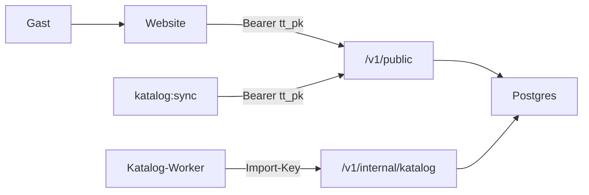

# Trizoun Travel an die Website anbinden

Operator-Anleitung für Alpine Siesta. Die Website ist schon verdrahtet – du brauchst **keinen neuen Backend-Code**. Du setzt URL und Publishable Key, richtest die Wohnung im Dashboard ein und schaltest die Module frei.

Geheimnisse (Beds24, SMTP, Import-Keys) liegen nur in Trizoun Travel, nie in dieser Website. `PUBLIC_…` landet im Browser (Buchung). Für Entdecken-SSR gibt es zusätzlich Server-Variablen `TRIZOUN_…` (bevorzugt; Fallback auf `PUBLIC_…`).

Beds24, Booking.com und Airbnb: [trizoun-travel/docs/WOHNUNG-EINRICHTEN.md](../trizoun-travel/docs/WOHNUNG-EINRICHTEN.md).

## Was die Website braucht

In `.env.local` (lokal) bzw. in den GitHub-Variablen (Deploy):

| Variable | Beispiel lokal | Beispiel live |
|---|---|---|
| `PUBLIC_TRIZOUN_API_URL` | `http://127.0.0.1:8787` | `https://digital.trizoun.ch` |
| `PUBLIC_TRIZOUN_KEY` | `tt_pk_…` | derselbe oder ein eigener Key für die Live-Domain |
| `TRIZOUN_API_URL` | wie PUBLIC (optional) | wie PUBLIC (optional) |
| `TRIZOUN_KEY` | wie PUBLIC (optional) | wie PUBLIC (optional) |

Vorlage: [`.env.example`](../.env.example). Buchung liest [`src/lib/trizoun.ts`](../src/lib/trizoun.ts); Entdecken-SSR liest [`src/modules/entdecken/api.ts`](../src/modules/entdecken/api.ts) (serverseitig, Node-Adapter).

Zusätzlich in [`site/site.config.ts`](../site/site.config.ts):

- `module.entdecken: true` – Menü und `/entdecken/` bauen; Sync läuft
- `katalog.region` – z. B. `leukerbad` (muss zur Region im Katalog passen)
- `kontakt.endpunkt` – **leer lassen**, wenn Trizoun die Kontaktmails übernimmt
- Wohnungsordner = Kurzname in Trizoun (`alpine-siesta`); sonst im Frontmatter `trizounSlug`

## Welche API wofür

Nur die **öffentliche** API (`/v1/public/…`) mit Header `Authorization: Bearer tt_pk_…`.

| Zweck | Endpoint | In der Website | Voraussetzung |
|---|---|---|---|
| Wohnung + Features lesen | `GET /v1/public/listings/:slug` | [`Anfrage.astro`](../src/components/Anfrage.astro) (prüft `emailBuchung`) | Publishable Key, Origin freigegeben |
| Kalender | `GET /v1/public/listings/:slug/availability` | [`Buchung.astro`](../src/components/Buchung.astro) via [`trizoun-client.ts`](../src/lib/trizoun-client.ts) | Listing + Beds24 |
| Preis | `GET /v1/public/listings/:slug/offer` | Buchung.astro | Listing + Beds24 |
| Link zur Beds24-Buchungsseite | `GET /v1/public/listings/:slug/booking-link` | Buchung.astro | Listing + Beds24 |
| Kontaktanfrage per Mail | `POST /v1/public/listings/:slug/kontakt` | Anfrage.astro | Feature `emailBuchung`, Modul `email-formular`, `zielEmails` |
| Wunschtermin / Kampagne | `POST /v1/public/listings/:slug/anfragen` | Buchung.astro | Beds24 + Einwilligungstext in `site.config` |
| Entdecken-Liste (SSR) | `GET /v1/public/katalog/:region` | [`src/modules/entdecken`](../src/modules/entdecken/) → `/entdecken/` | Modul `discovery` |
| Entdecken-Detail (SSR) | `GET /v1/public/katalog/:region/:slug` | Detailseite `/entdecken/:slug/` | Modul `discovery` |
| Entdecken-Bilder | `GET …/bild` bzw. `…/bilder/:dateiname` | Proxy `/entdecken/bild/:slug/` | Modul `discovery` |
| Katalog-Spiegel (optional) | dieselben Endpunkte | [`katalog-api-sync.mjs`](../scripts/katalog-api-sync.mjs) → `site/katalog/` (Sitemap, Offline) | Modul `discovery` |

**Nicht** von der Website:

- `/v1/internal/katalog/…` – nur Katalog-Worker (Import-Key)
- `/v1/orgs/…`, `/v1/auth/…` – nur Dashboard (Büro)



## Checkliste Dashboard

Im Büro auf digital.trizoun.ch (lokal http://127.0.0.1:5173/):

1. **Organisation** anlegen (Region / Gemeinden, z. B. Leukerbad).
2. **Wohnung** mit Kurzname `alpine-siesta` (= Ordner unter `site/wohnungen/`).
3. Optional **Beds24** verbinden und Property/Zimmer zuordnen (Kalender und Online-Buchung).
4. **Publishable Key** erstellen; erlaubte Origins mindestens:
   - lokal: `http://127.0.0.1:4321`
   - live: `https://alpine-siesta.ch` (und `https://www.alpine-siesta.ch`, falls genutzt)
5. Unter **Funktionen**:
   - `email-formular` an – Kontakt geht über Trizoun
   - `discovery` an – Katalog-API und Sync liefern Inhalte; im Büro erscheint der Nav-Punkt **Regionen** (Index der Katalog-Regionen mit Quelle pro Eintrag)
6. An der Wohnung:
   - `emailBuchung` an
   - mindestens eine Adresse unter `zielEmails`
7. Key und API-URL in `.env.local` bzw. GitHub-Vars eintragen, Website neu bauen.

Ohne Beds24 funktioniert trotzdem die Kontaktmail über Trizoun; Kalender und «Jetzt buchen» bleiben dann bei der Mail-Anfrage.

## Lokal testen

1. Trizoun: `cd trizoun-travel && docker compose up -d --build` → API `:8787`, Dashboard `:5173`, Postgres.
2. Dashboard: Checkliste oben (Key mit Origin `http://127.0.0.1:4321`).
3. Website `.env.local`:

   ```
   PUBLIC_TRIZOUN_API_URL=http://127.0.0.1:8787
   PUBLIC_TRIZOUN_KEY=tt_pk_…
   ```

4. Entdecken: `module.entdecken: true`. Die Übersicht und Detailseiten holen die Region **live** von der API (SSR). Optionaler Spiegel für Sitemap/Offline:

   ```sh
   npm run katalog:sync
   ```

   Mit Key und `discovery` kommt der Sync von der API. Ohne Key: Fallback Git bzw. `KATALOG_DIR=trizoun-katalog`.

5. Website neu bauen bzw. Docker (Node-Server, nicht nur statisches Preview):

   ```sh
   docker compose up -d --build
   ```

   oder `npm run dev` auf `:4321` / nach Build `npm start`.

6. Prüfen: `/wohnungen/alpine-siesta/#buchen`, `/kontakt/`, `/entdecken/`, eine Detail-URL `/entdecken/<slug>/`.

Kompletter Datenweg ohne Produktionsschlüssel: `npm run katalog:e2e` (siehe [README](../README.md)).

## Live

1. GitHub-Repo-Variablen: `PUBLIC_TRIZOUN_API_URL`, `PUBLIC_TRIZOUN_KEY`; optional `TRIZOUN_API_URL`, `TRIZOUN_KEY` für SSR ohne Key im Client-Fallback.
2. Am Publishable Key die Live-Domain freigeben.
3. Deploy liefert den Node-Standalone-Server (`dist/server/entry.mjs`); Entdecken-Routen rendern zur Laufzeit.
4. Optionaler Katalog-Sync: [`.github/workflows/katalog-sync.yml`](../.github/workflows/katalog-sync.yml) → PR mit `site/katalog/` (Sitemap-Hilfsquelle).

Anpassungen pro Website bleiben lokal: `site/entdecken.yaml`, eigene Tipps in `site/aktivitaeten/` (Content-Collection für Pillars). `site/katalog/` nie von Hand ändern.

## Wenn etwas nicht geht

| Symptom | Typische Ursache |
|---|---|
| `401` auf public-Routen | Key falsch, fehlt, oder Origin nicht freigegeben |
| `403` auf `/katalog/…` | Modul `discovery` aus |
| `403` auf `/kontakt` | `emailBuchung` aus, oder Modul `email-formular` aus |
| `422` auf `/kontakt` | keine `zielEmails` an der Wohnung |
| Formular öffnet nur Mail | Key/URL fehlen, oder `features.emailBuchung` ist false |
| Kalender leer / kein Preis | Beds24 nicht verbunden oder Listing-Slug stimmt nicht |
| Sync schreibt nichts | `module.entdecken: false`, oder weder API-Key noch Git-Fallback |
| `503` auf `/v1/internal/katalog` | Import-Key in Travel nicht gesetzt – betrifft nur den Worker, nicht die Website |
