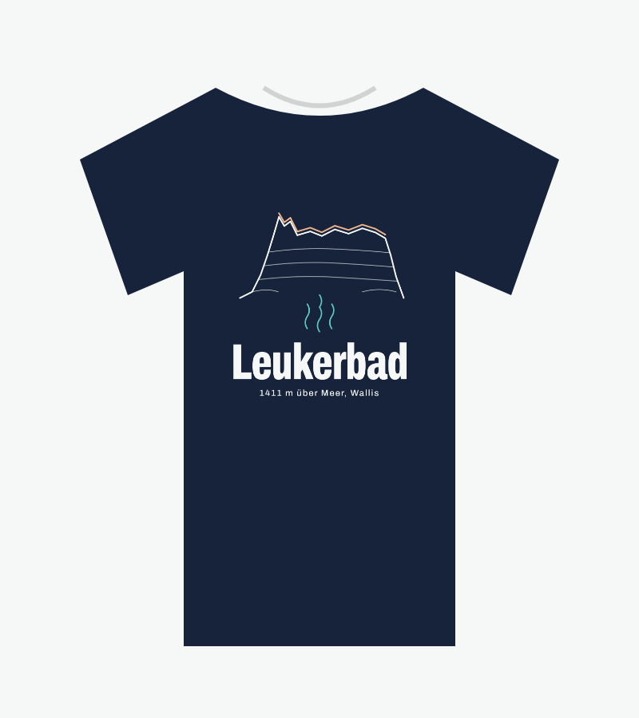
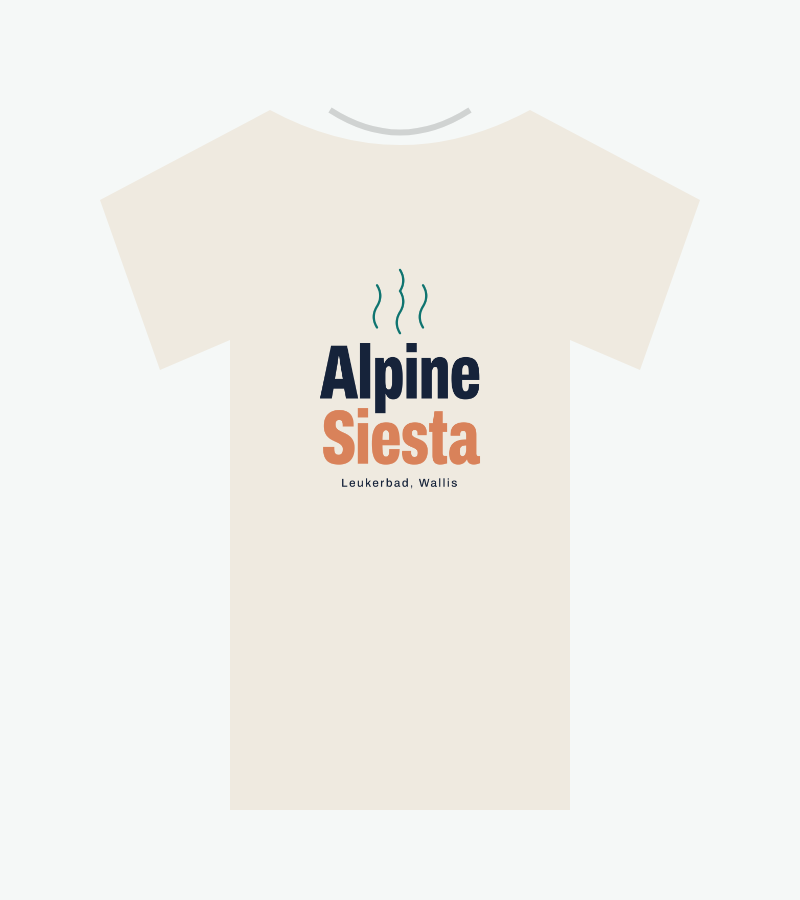
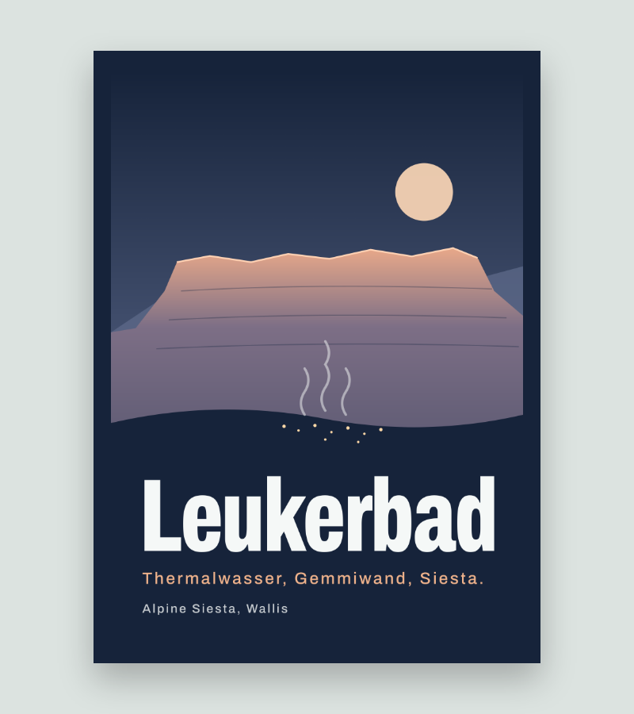

# Alpine Siesta – Merch & Modemarke

Eigene kleine Modemarke für Leukerbad: **Alpine Siesta** als Absender, **Leukerbad** und die **Gemmiwand** als Motive. Gestaltung wie die Website: schmale, schwere Plakatschrift (Archivo), Farben aus Thermalwasser, Kalk und Alpenglühen.

  

## Motive

| Datei | Motiv | Produkte |
|---|---|---|
| `motive/gemmiwand.svg` | Gemmiwand als Linienzeichnung, Thermaldampf, «Leukerbad» | T-Shirt Front, Hoodie, Tote Bag |
| `motive/alpine-siesta.svg` | Wortmarke «Alpine Siesta» mit Dampf | T-Shirt Front, Hoodie |
| `motive/thermal-badge.svg` | Rundes Abzeichen: Berg, Wasser, 1411 | T-Shirt Rücken, Tasse, Magnet, Sticker |
| `motive/siesta-1411.svg` | «Siesta auf 1411 m» klein | Brustdruck links, Cap, Tasse, Kugelschreiber-Gravur (einfarbig) |
| `motive/plakat-leukerbad.svg` | Reiseplakat Gemmiwand im Abendlicht | Poster, Alu-Druck, Bilderrahmen, Postkarte |

Jedes Shirt-Motiv gibt es in zwei Farbvarianten:
- **hell** – helle Farben für dunkle Shirts (Nachtblau)
- **dunkel** – dunkle Farben für helle Shirts (Naturweiss)

## Export

```sh
npm run merch:export
```

Erzeugt `export/<motiv>-<variante>.png` (Druckdatei, transparent, 3600 × 4800 px für Shirts) und `vorschau/` (Mockups). Braucht Chrome/Chromium; anderer Pfad per `CHROMIUM_PATH=…`.

Vor dem Hochladen zu Gelato pro Produkt prüfen: Druckbereich, Pixelmasse, Farbprofil, minimale Linienstärke. Für Gravur (Kugelschreiber) und Magnete beim Lieferanten Vektordaten (SVG/PDF) und einfarbige Version anfragen.

Die Motive sind **Entwürfe** – Linien, Proportionen und Texte direkt in den SVG-Dateien anpassen und neu exportieren. Die Gemmiwand ist stilisiert; für mehr Wiedererkennung nach einem eigenen Foto nachzeichnen.

## Marke & Recht

- **«Alpine Siesta» als Marke schützen**: beim Eidgenössischen Institut für Geistiges Eigentum (IGE) eintragen, mindestens Klassen 25 (Bekleidung), 21 (Tassen), 16 (Poster/Papier); vorher auf swissreg.ch prüfen, ob der Name frei ist.
- **«Leukerbad»** ist ein Ortsname und darf beschreibend verwendet werden. **Keine** Logos oder Schriftzüge von Leukerbad Tourismus, der Gemeinde, der Leukerbad Therme oder der Bergbahnen verwenden – nur eigene Zeichnungen.
- Schrift Archivo: SIL Open Font License (`fonts/OFL.txt`) – Nutzung auf Produkten erlaubt.

## Verkauf

Siehe `KONZEPT.md` (Shop): Gäste aus CH/LI bestellen nach Hause (Print-on-Demand), alle anderen kaufen aus dem Lager in der Wohnung und nehmen direkt mit. Für das Wohnungslager eignen sich: Magnete, Kugelschreiber, Postkarten, Tassen und ein paar Shirts in gängigen Grössen.
