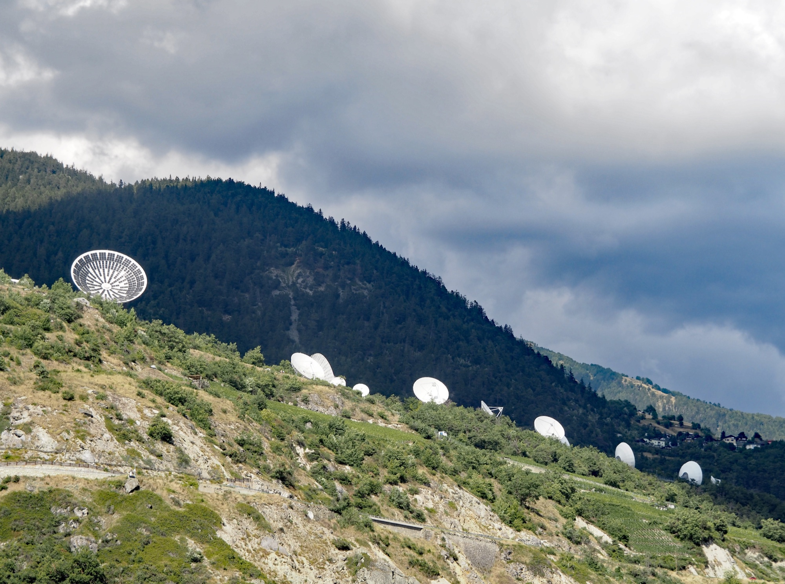
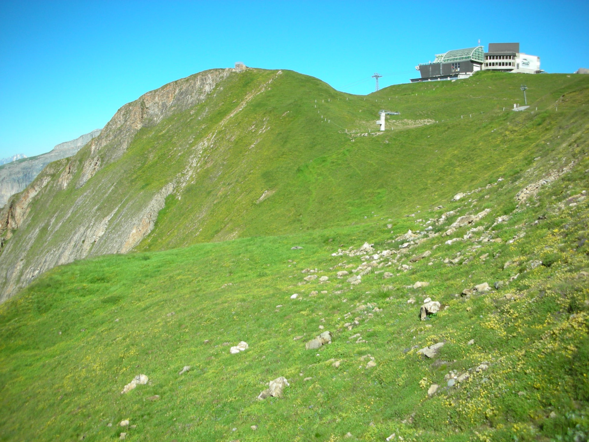
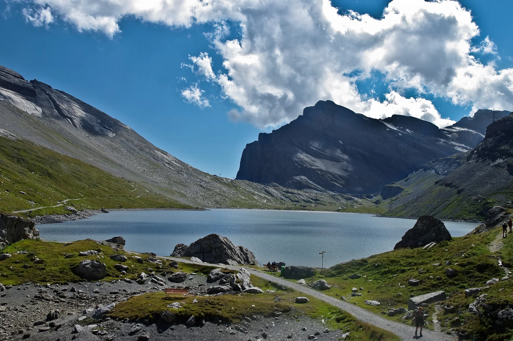
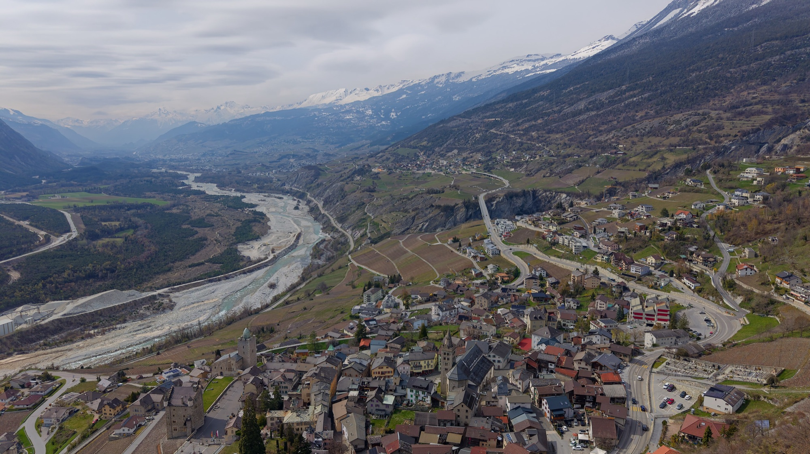

Es gibt diese Stelle auf jeder guten Tour: Du bremst, stellst einen Fuss ab und schaust nur noch. Rund um Leukerbad kommt sie öfter, als dir lieb ist, wenn du eigentlich vorwärtskommen willst. Biketouren mit Aussicht sind hier die Regel, nicht die Ausnahme. Das Dorf liegt in einer Felsarena, oben auf Torrent stehen dir die Walliser Viertausender gegenüber, und an fast jedem Hang öffnet sich irgendwann das Rhonetal. Hier sind die Touren, auf denen wir am häufigsten anhalten, und was du dort siehst.

## Warum die Aussicht hier so weit reicht

Leukerbad liegt am Ende eines Tals, das nach Süden zur Rhone hin offen ist. Auf drei Seiten stehen Felswände, gegenüber auf der anderen Seite des Rhonetals die Gipfel der Walliser Alpen. Wer mit der Bahn auf über 2300 Meter fährt, schaut über das ganze Tal hinweg auf diese Kette.

Weiter unten ändert sich der Blick. Am Hang zwischen Albinen, Guttet und Leuk siehst du hinunter auf den Talboden, auf den Lauf der Rhone und den Pfynwald. Und von oben auf der Gemmi schaust du zurück auf Leukerbad, tief unten im Kessel.

## Torrenttrail: die Viertausender als Begleiter

Wenn du nur eine Aussichtstour fährst, dann den Torrenttrail. Die Torrentbahn bringt dich zur Rinderhütte, und der Trail beginnt als Höhenweg. Er folgt den Geländekuppen unter dem Schafberg, mit dem Rhonetal unter dir und den Viertausendern gegenüber.

Ab der Bachalp wird es waldiger. Zwischen den lichten Nadelbäumen ändert sich der Blickwinkel, und an klaren Tagen siehst du nach Westen bis zum Mont-Blanc. Weiter unten führt der Trail durch Bergdörfer und an der Satellitenbodenstation Brentjong vorbei. Gegen Abend, wenn das Licht tief steht, sind die weissen Schüsseln vor dem Tal das Bild, das alle mitnehmen.

Die Stufe ist mittel, die Strecke 29 Kilometer bis Susten. Wer nicht ins Tal will, fährt den Torrenttrail Short: gleicher Start, gleicher Höhenweg bis zur Alp Oberu, dann über Guttet und Albinen zurück ins Dorf. Die beste Aussicht hast du auf beiden Varianten im ersten Teil.

## Torrent Loop: die Aussicht selbst verdienen

Der Torrent Loop führt dich an denselben Ort, aber ohne Bahn. Vom Rathaus geht es durch den Tunnel bei den Albinenleitern und auf einer schmalen Bergstrasse hinauf zur Torrentalp und über den Panoramaweg zur Rinderhütte. Rund 950 Höhenmeter, technisch einfach, aber konditionell fordernd. Mit dem E-Bike wird daraus eine entspannte Panoramarunde.

Oben auf 2350 Metern liegt dir das Tal zu Füssen. Zurück geht es über eine Bergstrasse und einen Waldweg via Folljeret und das Restaurant Weidstübli ins Dorf. Achte auf der Abfahrt auf Wandernde, Trottinetts und Scooter.

## Gemmi Gspass: Bergsee und Blick hinunter auf Leukerbad

Die Gemmi ist das Gegenstück zu Torrent. Die Gemmibahn, fünf Minuten zu Fuss von [Alpine Siesta](/wohnungen/alpine-siesta/), bringt dich auf den historischen Pass. Bevor du losfährst, geh auf die Plattform bei der Gemmi Lodge. Von dort schaust du hinunter auf Leukerbad und hinüber zu den Viertausendern.

Die Tour selbst ist einfach: ein breiter Kies- und Schotterweg auf dem Hochplateau, am Daubensee entlang und zum alten Berghotel Schwarenbach. Weiter geht es über die Spittelmatte bis zur Bergstation Sunnbüel bei Kandersteg. Hin und zurück auf demselben Weg ist auch möglich. Der Weg ist bei Wandernden beliebt, nimm deshalb eine frühe Bahn und fahre rücksichtsvoll.

## Chällerflüe: das Rhonetal nach der Felsquerung

Die Chällerflüe hat den eindrücklichsten Moment aller Touren hier. Du fährst vom Dorf über das Restaurant Birchen hinauf zur Alp Larschi. Dann folgt eine Querung der Felswand Chällerflüe. Etwa 350 Meter schiebst du das Bike auf einem breiten, talseitig mit Drahtseilen gesicherten Weg. Schwindelfrei sein ist von Vorteil.

Oben bei Pfarschong öffnet sich auf einmal das ganze Rhonetal.

 Genau für diesen Blick lohnt sich die Schiebestrecke. Danach folgt eine Abfahrt von 1100 Tiefenmetern bis nach Varen. Am Ende empfiehlt sich ein Apéro in Varen oder Leuk, mit Blick auf den Pfynwald.

## Guggerhubel: Felsarena und Südalpen in einem Blick

Der Guggerhubel ist die Tour für alle, die die Felsarena von aussen sehen wollen. Vom Dorf geht es zuerst auf Neben- und Alpstrassen hinauf zur Torrentalp. Dort reicht der Blick von der Felsarena rund um Leukerbad bis zu vielen Viertausendern der Südalpen. Das Restaurant an der Mittelstation ist ein guter Ort für eine Pause.

Danach führt ein Höhenweg zum Undru Guggerhubel, einem zweiten Aussichtspunkt, nach dem die Tour benannt ist. Der folgende Singletrail durch den Wald, der 2003 abgebrannt ist, ist der Höhepunkt der Abfahrt nach Guttet-Feschel und Leuk.

## Flüealp: Kapelle, Alp und Käse

Nicht jede Aussicht braucht ein Panorama über das ganze Wallis. Die Flüealp Tour führt in das östliche Seitental von Leukerbad, dorthin, wo die Dala entspringt. Zuerst durch kühlen Wald, dann über Bergweiden zur Majingalp und zur Flüealp auf gut 2000 Metern. Hier betreiben die Sennen eine kleine Wirtschaft. Käse und Brot gehören dazu.

Von der Flüealp sind es nur ein paar Minuten bis zur Flüekapelle. Zurück fährst du auf demselben Weg. Rund 750 Höhenmeter hinauf, Stufe mittel.

## Tipps für Touren mit Aussicht

- **Früh los.** Am Vormittag ist die Sicht auf die Viertausender oft am klarsten, und auf den Bahnen ist es ruhiger.
- **Mittagspause der Bahnen einplanen.** Die Torrentbahnen fahren über Mittag nicht. Nutze die Zeit für eine Pause mit Aussicht, statt an der Talstation zu warten.
- **Jacke mitnehmen.** Auf über 2300 Metern weht es oft, auch wenn es im Dorf warm ist.
- **Anhalten.** Die Fotos von unterwegs sind besser als die von der Bergstation. Und die Kinder freuen sich über jede Pause.

Am Abend siehst du die Berge dann noch einmal, vom Balkon der Wohnung aus, mit Blick auf die Gemmi.

## Bikes mieten und in der Wohnung abstellen

Ein eigenes Bike musst du nicht mitbringen. In Leukerbad und rundherum gibt es mehrere Bikevermietungen. **Alpine Cycling** im Dorf vermietet E-Mountainbikes, Mountainbikes und Kinderbikes und kümmert sich auch um Service und Reparaturen. **Rolis mobile Bikestation** in Albinen vermietet E-Bikes, Mountainbikes und Rennvelos, auch wochenweise, und bringt das Bike auf Wunsch direkt an den Start deiner Tour.

Hast du dein eigenes Bike dabei, stellst du es in [Alpine Siesta](/wohnungen/alpine-siesta/) im Keller ab. So steht es sicher, wenn du am Abend auf dem Balkon sitzt und die Berge noch einmal anschaust.

*Bildnachweis, Wikimedia Commons. Bergstation Rinderhütte: [Davide Rüetschi](https://commons.wikimedia.org/wiki/File:Veduta_del_Torrent_col_Rinderh%C3%BCtte.JPG), gemeinfrei; Satellitenstation: [Arkelin](https://commons.wikimedia.org/wiki/File:Satellitenbodenstation_Brentjong.jpg), [CC BY 4.0](https://creativecommons.org/licenses/by/4.0); Rhonetal: [Daniel Reust](https://commons.wikimedia.org/wiki/File:Blick_von_Leuk_ins_Unterwallis.jpg), [CC BY-SA 4.0](https://creativecommons.org/licenses/by-sa/4.0).*
