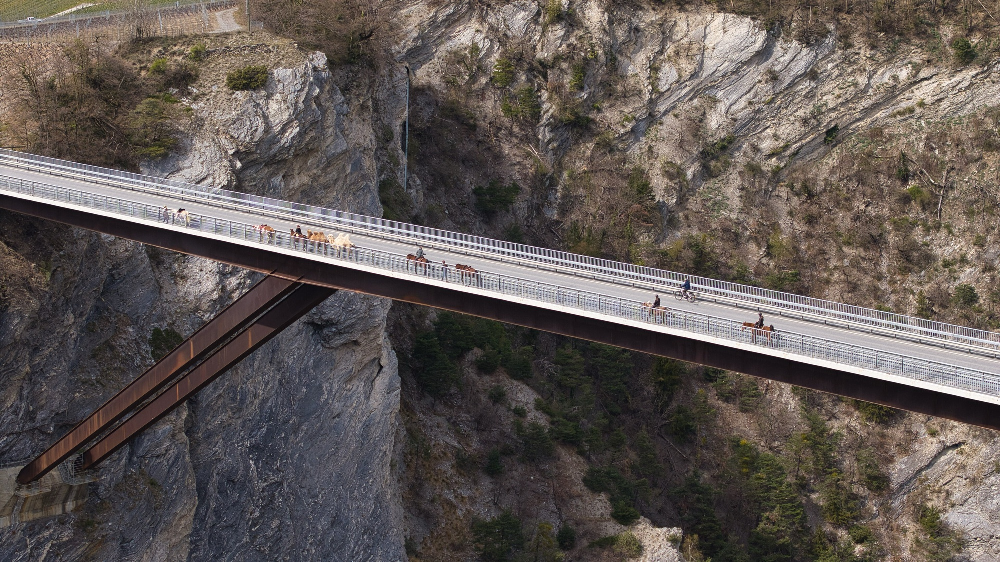

1000 Höhenmeter vor dem Mittagessen, und oben noch genug Kraft für den Trail zurück ins Dorf. Mit dem E-Bike in Leukerbad wird der Berg zur Nebensache. Die Felsarena, die Alpen über dem Dorf und die Sonnenhänge über dem Rhonetal sind steil, und genau dort spielt der Motor seine Stärke aus. Du fährst hinauf, wo andere die Bahn nehmen müssen, und hast oben noch Kraft für die Abfahrt. Ein E-Mountainbike mietest du direkt im Dorf. Alle Touren nach Niveau, die Bahnen und die Flow-Trails findest du auf [Biken in Leukerbad](/leukerbad/biken/).

## Warum Leukerbad für E-Bikes gemacht ist

Leukerbad liegt auf rund 1400 Metern, die Rinderhütte auf Torrent auf über 2300, das Rhonetal auf gut 600. Zwischen diesen Punkten liegen Höhenunterschiede, die ohne Motor einen ganzen Tag füllen. Mit dem E-Bike werden sie zu einer Runde für den Vormittag.

Dazu kommt das Wegnetz. Rund 225 Kilometer Bikewege führen um Leukerbad, viele davon auf Alpstrassen, Forstwegen und breiten Flurwegen. Genau diese Wege sind mit dem E-Bike angenehm: gleichmässig steil, gut fahrbar, und mit Aussicht, sobald der Wald aufhört.

Und am Ende des Tages ist es egal, ob du 900 Höhenmeter mit Motor gefahren bist oder ohne. Die Therme ist zehn Minuten zu Fuss von der Wohnung, und das warme Wasser fühlt sich nach jedem Bike-Tag gleich gut an.

## E-Bike mieten in Leukerbad

Du musst kein eigenes E-Bike mitbringen. Im Dorf gibt es eine Bikevermietung mit E-Mountainbikes, normalen Mountainbikes und Kinderbikes. Reparaturen, Service und Ersatzteile gibt es am selben Ort. Reservieren kannst du online, in der Hochsaison lohnt sich das.

In Albinen, dem Nachbardorf, gibt es eine mobile Bikestation. Sie vermietet E-Bikes, Mountainbikes und Rennvelos, auch für eine Woche oder länger. Ein besonderes Angebot: Sie bringt Bikes und auf Wunsch auch Personen mit dem Anhänger an den Start einer Tour oder holt sie am Ziel ab.

Was wir Gästen raten:

- **Am ersten Tag einstellen lassen.** Sattel, Federung und Unterstützungsstufe machen auf einem E-Bike viel aus. Nimm dir beim Abholen fünf Minuten dafür.
- **Mit einer Runde ab dem Dorf anfangen.** So lernst du, wie viel Akku ein Aufstieg kostet, bevor du eine lange Tour planst.
- **Zubehör fragen.** Helm, Schloss und Ersatzakku sind bei Vermietungen oft zu haben. Frag beim Reservieren nach.

## Touren, die mit dem E-Bike erst richtig Spass machen

Fast jede Tour rund um Leukerbad geht mit dem E-Bike. Bei einigen wird sie aber zu etwas anderem. Diese hier sind ohne Motor konditionell fordernd und mit Motor ein Genuss.

### Torrent Loop: zur Rinderhütte, ohne Bahn

Der Torrent Loop beginnt beim Rathaus im Dorf. Über einen Naturpfad und die Strasse Richtung Albinen geht es durch den Tunnel bei den Albinenleitern und dann auf einer schmalen Bergstrasse hinauf zur Torrentalp. Über den Panoramaweg erreichst du die Rinderhütte auf über 2300 Metern. Rund 950 Höhenmeter, technisch einfach.

Oben liegt dir das Tal zu Füssen. Hinunter geht es über eine Bergstrasse und einen Waldweg via Folljeret und das Restaurant Weidstübli zurück ins Dorf. Wer mag, steigt oben auf eine andere Abfahrt um. Achte unterwegs auf Wandernde, Trottinetts und Scooter.

### Flüealp Tour: hinauf zu Käse und Brot

Die Flüealp Tour führt ins östliche Seitental von Leukerbad, dorthin, wo die Dala entspringt. Durch kühlen Wald und über Bergweiden geht es zur Majingalp und weiter zur Flüealp auf gut 2000 Metern, rund 750 Höhenmeter mit stetiger Steigung. Oben betreiben die Sennen eine kleine Wirtschaft. Käse und Brot solltest du hier nicht auslassen. Ein paar Minuten weiter steht die Flüekapelle. Zurück geht es auf demselben Weg.

### Larschi Rundi: unter der Felswand des Tschajetuhoru

Die Larschi Rundi beginnt beim alten Bahnhof in Inden und windet sich in vielen Kehren hinauf zur Alp Larschi, unter der steilen Felswand des Tschajetuhoru. Rund 450 Höhenmeter, technisch leicht, aber nicht ohne. Über Kluscheten geht es zum Weiler Bodmen, wo eine Pause mit Kaffee und Kuchen gut passt, und über einen lustigen Trail und den Römerweg zurück nach Inden.

### Sunnubärga Loop: Sonnenhang über dem Rhonetal

Der Sunnubärga Loop startet am Bahnhof Susten und führt durch Leuk hinauf zu kleinen Weilern und nach Guttet, dann auf dem Walliser Höhenweg nach Albinen. Rund 840 Höhenmeter hinauf, eine verspielte Abfahrt durch Wald und Reben zurück nach Leuk. Die Lage ist sonnig, die Runde ist bis spät in den Herbst fahrbar.

## Ins Rhonetal und aus eigener Kraft zurück

Viele Touren rund um Leukerbad enden unten im Tal, in Leuk oder Susten. Ohne Motor nimmst du dann den Bus zurück. Mit dem E-Bike hast du eine zweite Möglichkeit: den Dala Bärgüf.

Diese Aufstiegsroute führt von Susten durch das Städtchen Leuk, über St. Barbara und den Weiler Tschingeren nach Albinen und weiter nach Leukerbad. Rund 900 Höhenmeter auf 14,5 Kilometern, mit wenig Verkehr. Wer es abwechslungsreicher will, fährt über Varen und die Dalaschlucht nach Inden, auf einer Strasse, die in die Felsflanke gehauen ist.

So wird aus einer Abfahrt ins Tal eine ganze Runde, ohne Bahn und ohne Bus. Ein Tipp für das letzte Stück: Nach dem Tunnel bei den Albinenleitern bremsen und auf den Naturpfad wechseln. Er führt ohne Höhenverlust direkt ins Dorfzentrum.

## Mehrere Tage im Sattel

Für E-Mountainbiker mit guter Kondition gibt es eine Tour über zwei Tage. Am ersten Tag fährst du von der Lauchernalp im Lötschental über das Gebiet Torrent nach Leukerbad. Am zweiten Tag geht es über den historischen Gemmipass nach Kandersteg. Zusammen über 50 Kilometer und mehr als 2400 Höhenmeter hinauf.

Dazwischen übernachtest du in Leukerbad. In [Alpine Siesta](/wohnungen/alpine-siesta/) kommen die Kleider in die Waschmaschine und du in die Badewanne. Die Gemmibahn für den zweiten Tag ist fünf Minuten zu Fuss.

## Akku, Bahn und Bus richtig kombinieren

Ein E-Bike macht dich unabhängig, aber der Akku ist die Grenze. Was sich in den Bergen bewährt:

- **Höhenmeter rechnen, nicht Kilometer.** Ein langer Aufstieg leert den Akku schneller als jede flache Strecke. Plane die Tour nach den Höhenmetern hinauf.
- **Sparsam starten.** Im unteren Teil eines Aufstiegs eine kleine Unterstützungsstufe wählen. Oben bist du froh um die Reserve.
- **Bahn nutzen, wenn es passt.** Die Torrentbahn bringt dich mit dem Bike zur Rinderhütte. Für einen Tag mit mehreren Abfahrten schont das den Akku für die Gegenanstiege. Über Mittag machen die Bahnen eine Pause, und im späten Herbst fährt die Gondelbahn Flaschen nicht mehr.
- **Bus für den Notfall.** Ist der Akku unten im Tal leer, bringt dich der Bus ab Leuk zurück. Jeder zweite Bus fährt mit Anhänger, die anderen haben einen Bikehalter. Eine Velo-Reservation über die SBB wird empfohlen.
- **Rücksicht bergab.** Ein E-Bike ist schwer und schnell. Auf Wegen mit Wandernden, auf dem Gemmipass und auf der Torrent-Bergstrasse fährst du langsam und klingelst früh.

## Nach der Tour

Am Abend steht das E-Bike, und du nicht mehr lange. Die Leukerbad Therme ist zehn Minuten zu Fuss von der Wohnung. Danach gibt es auf dem Balkon den Elektrogrill oder in der Küche ein Raclette, und vom anderen Balkon siehst du noch einmal hinauf zur Gemmi, über die du morgen vielleicht fährst.

## Bikes mieten und in der Wohnung abstellen

Ein eigenes Bike musst du nicht mitbringen. In Leukerbad und rundherum gibt es mehrere Bikevermietungen. **Alpine Cycling** im Dorf vermietet E-Mountainbikes, Mountainbikes und Kinderbikes und kümmert sich auch um Service und Reparaturen. **Rolis mobile Bikestation** in Albinen vermietet E-Bikes, Mountainbikes und Rennvelos, auch wochenweise, und bringt das Bike auf Wunsch direkt an den Start deiner Tour.

Mit dem eigenen E-Bike stellst du es in [Alpine Siesta](/wohnungen/alpine-siesta/) im Keller ab. Dort steht es geschützt über Nacht, bis die nächste Runde beginnt.

*Bildnachweis, Wikimedia Commons. Titelbild: [/kallu](https://commons.wikimedia.org/wiki/File:Biking_in_Alps_-_Verbier,_Switzerland_1.jpg), [CC BY-SA 2.0](https://creativecommons.org/licenses/by-sa/2.0); Brücke über die Dalaschlucht: [Reustli](https://commons.wikimedia.org/wiki/File:Br%C3%BCcke_zwischen_Leuk_und_Varen.jpg), [CC BY-SA 4.0](https://creativecommons.org/licenses/by-sa/4.0).*
