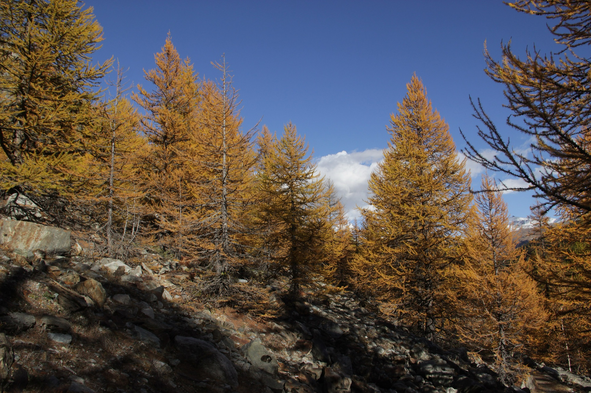
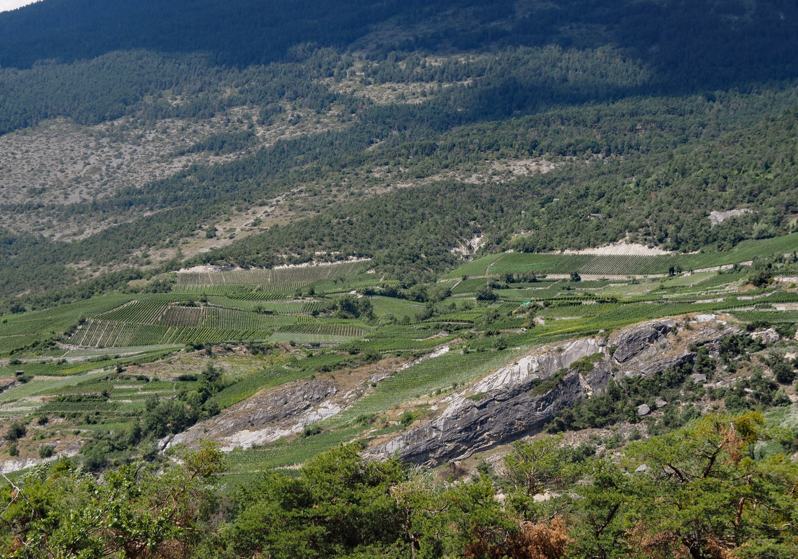

Gelbe Lärchen, klare Sicht bis zu den Viertausendern und Trails, die leerer sind als im Sommer. Biken im Herbst ist in Leukerbad vielleicht die schönste Zeit des Jahres. Oben auf über 2000 Metern ist die Luft klar und kühl, unten im Rhonetal ist es noch warm, und dazwischen liegen Hänge, die bis in den späten Herbst Sonne bekommen. Die Wege sind leerer als im Juli, und nach der Tour ist das warme Thermalwasser noch willkommener als im Sommer.

## Warum der Herbst hier so gut passt

Die Bikeregion rund um Leukerbad reicht vom Hochgebirge bis an den Talboden. Das ist im Herbst der grosse Vorteil. Ist es oben schon frisch, fährst du am Sonnenhang über dem Rhonetal. Ist es unten noch heiss, fährst du oben auf Torrent.

Der Hang zwischen Leuk, Guttet und Albinen schaut nach Süden, und die Sonne steht dort auch im Oktober lange. Die offiziellen Beschreibungen nennen einige Routen ausdrücklich als befahrbar vom Frühling bis spät in den Herbst.

Dazu kommt die Farbe. Im Herbst werden die Lärchen am Hang gelb, die Reben unten im Tal verfärben sich, und in den Weindörfern Varen und Salgesch ist Erntezeit. Wer im Herbst einen Trail ins Rhonetal fährt, endet nicht selten mit einem Glas Walliser Wein in der Hand.

## Sunnubärga Loop: die Runde für sonnige Herbsttage

Der Sunnubärga Loop ist die Tour, die wir für den Herbst zuerst empfehlen. Der Name sagt es schon: Sonnenberge. Die Runde startet am Bahnhof Susten im Rhonetal und führt durch das historische Städtchen Leuk hinauf in kleine Weiler und nach Guttet. Von dort geht es auf dem Walliser Höhenweg nach Albinen.

Die Aussicht über das Rhonetal und den renaturierten Flusslauf ist ein Grund, oft anzuhalten. Nach der Pause in Albinen folgt die Belohnung: eine Abfahrt über Naturwege und verspielte Trails durch Wald und Reben, über St. Barbara zurück in die Altstadt von Leuk.

Die Zahlen: 21 Kilometer, gut 840 Höhenmeter hinauf und wieder hinunter, Stufe mittel. Mit dem E-Bike wird daraus eine entspannte Herbstrunde. Nach Susten kommst du von Leukerbad mit dem Bus, jeder zweite fährt mit Anhänger.

## Jeizi Enduro: für Geübte, auch im späten Herbst

Für erfahrene Biker gibt es eine zweite Herbsttour mit Sonnenlage: den Jeizi Enduro. Die Seilbahn bringt dich in zehn Minuten von Gampel hinauf nach Jeizinen. Von dort sind es rund 900 Tiefenmeter zurück ins Tal: ein historischer Flurweg, der Furuwald, eine alte Ruine, durch die du hindurchfährst, und der Pitschwald mit verblockten Steinen und Wurzeln.

Die Stufe ist schwer. Es gibt Spitzkehren und einige Schiebestrecken. Wer sie mag, findet hier im Oktober einen Trail, der trocken ist, wenn andere schon nass sind. Ein kurzer Abstecher zur Aussichtsplattform beim Dorf Bratsch lohnt sich.

## Oben auf Torrent: früh im Herbst, mit Blick auf die Bahnen

Der Torrenttrail und die Flow-Trails sind im frühen Herbst grossartig. Die Luft ist klar, die Viertausender stehen scharf am Horizont, und auf den Alpen ist es still, wenn die Kühe schon im Tal sind.

Später in der Saison wird es oben schwieriger. Drei Dinge solltest du im Herbst wissen:

- **Bahnen:** Im späten Herbst fährt die Gondelbahn Flaschen nicht mehr. Hinauf geht es dann nur noch mit der Luftseilbahn ab Leukerbad. Über Mittag machen die Torrentbahnen ohnehin eine Pause.
- **Nasse Trails:** Nach Regen und im Herbst können der Jales-Flow und der Deleeschi-Flow rutschig sein. Ein gutes Reifenprofil ist dann Pflicht. Für Anfänger sind die Flow-Trails nur bei trockenem Boden zu empfehlen.
- **Anlagenstatus:** Welche Bahnen und Trails offen sind, zeigt Leukerbad Tourismus tagesaktuell. Ein Blick am Morgen spart dir einen Weg zur geschlossenen Talstation.

## Licht und Zeit: kürzere Tage richtig planen

Im Herbst ist der Tag kürzer, und in den Bergen merkst du das früher als im Tal. Die Felswände rund um Leukerbad werfen am Nachmittag lange Schatten ins Dorf. Unten am Sonnenhang ist es dann noch hell und warm.

Was sich bewährt:

- **Spät starten, früh fertig sein.** Am Morgen sind Wurzeln und Wiesen oft noch feucht. Starte, wenn die Sonne den Hang erreicht hat, und plane das Ende vor dem Abend.
- **Lange Abfahrten bergab legen.** Touren von oben nach unten, wie der Torrenttrail bis Susten, passen gut in einen Herbsttag: Die kalten Höhen hast du am Mittag hinter dir, den warmen Talboden am Nachmittag vor dir.
- **Abendlicht nutzen.** Auf dem Torrenttrail liegt kurz vor Leuk die Satellitenbodenstation Brentjong. Gegen Abend, wenn die Sonne tief steht, ist sie das beste Fotomotiv der Tour.
- **Eine Schicht mehr.** Oben auf 2300 Metern ist es im Herbst kalt, auch wenn das Tal warm ist. Eine Jacke im Rucksack gehört dazu.

## Einkehren im Herbst

Viele Bergrestaurants schliessen im Herbst früher als im Sommer, manche machen zwischen Sommer und Winter ganz zu. Unten im Tal hast du mehr Auswahl: In der Altstadt von Leuk und im Weindorf Varen findest du auch an einem Oktobertag eine offene Tür. Wer auf einer Tour durch Varen fährt, sollte einen Halt in einem Weinkeller einplanen. Mehr zum Dorf und seinem Wein steht auf [Varen, Wein in einem ruhigen Dorf](/leukerbad/wein/varen/).

## Nach der Tour: die Therme im Herbst

Der grösste Vorteil des Herbsts in Leukerbad ist das Ende des Tages. Wenn die Luft kühl wird, steigst du in warmes Thermalwasser. Aus den Quellen von Leukerbad kommen jeden Tag über 3,9 Millionen Liter. Die Leukerbad Therme ist von [Alpine Siesta](/wohnungen/alpine-siesta/) zehn Minuten zu Fuss.

Und wenn es einmal einen ganzen Tag regnet, ist das kein verlorener Tag. Dann bleibt das Bike stehen, ihr geht am Vormittag baden und macht am Abend ein Fondue. Der elektrische Kamin im Wohnzimmer erledigt den Rest.

## Bikes mieten und in der Wohnung abstellen

Ein eigenes Bike musst du nicht mitbringen. In Leukerbad und rundherum gibt es mehrere Bikevermietungen. **Alpine Cycling** im Dorf vermietet E-Mountainbikes, Mountainbikes und Kinderbikes und kümmert sich auch um Service und Reparaturen. **Rolis mobile Bikestation** in Albinen vermietet E-Bikes, Mountainbikes und Rennvelos, auch wochenweise, und bringt das Bike auf Wunsch direkt an den Start deiner Tour.

Mit dem eigenen Bike ist der Herbst noch einfacher: In [Alpine Siesta](/wohnungen/alpine-siesta/) stellst du die Bikes im Keller ab. Nach einer nassen Herbstrunde trocknen sie dort über Nacht, und du sitzt längst in der Therme.

*Bildnachweis, Wikimedia Commons. Titelbild: [Hadi](https://commons.wikimedia.org/wiki/File:Guttet.jpg), CC0; Lärchenwald: [Björn S…](https://commons.wikimedia.org/wiki/File:Larix_decidua_in_autumn_(22175289871).jpg), [CC BY-SA 2.0](https://creativecommons.org/licenses/by-sa/2.0); Rebberg bei Varen: [Arkelin](https://commons.wikimedia.org/wiki/File:Rebberg_und_Felsmassiv_bei_Varen.jpg), [CC BY 4.0](https://creativecommons.org/licenses/by/4.0).*
