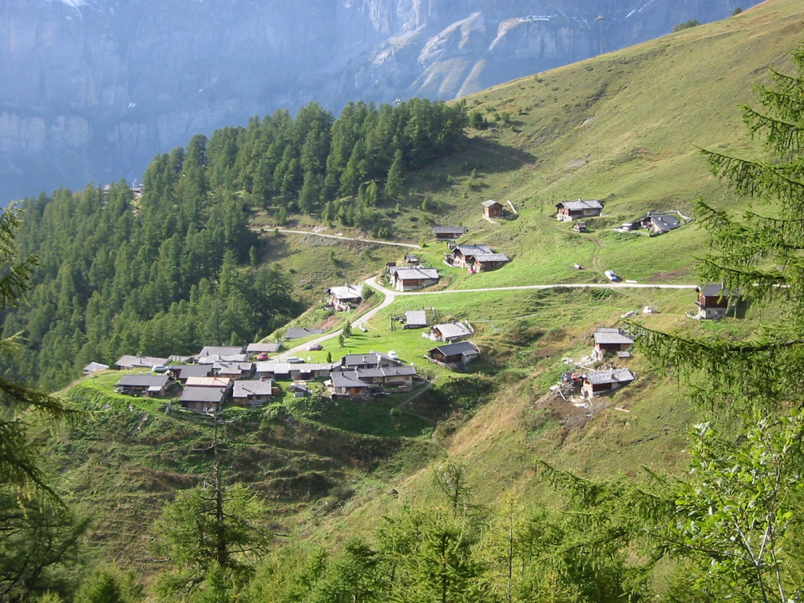
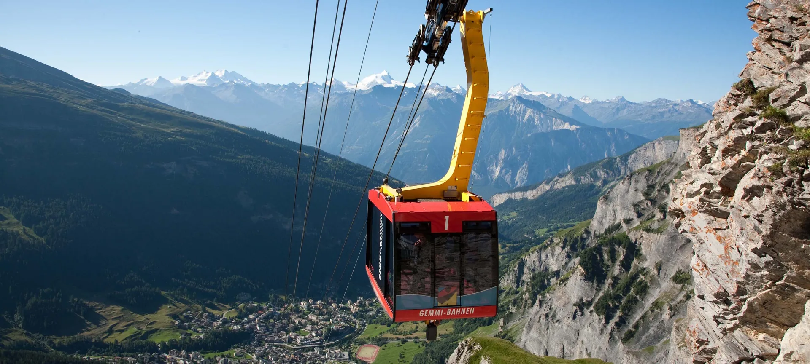

---
# Pillar Page /leukerbad/biken/ – erstellt mit dem Skill pillar-artikel.
# Quelle: inbox/biken/recherche-leukerbad-ch.md (leukerbad.ch/biken, 28.10.2026). Preise und Fahrpläne bewusst weggelassen.
title: "Biken in Leukerbad: Touren, Trails und E-Bike"
description: "Biken in Leukerbad: rund 225 Kilometer Wege, Flow-Trails ab der Bahn, leichte Runden für Familien und Abfahrten bis ins Rhonetal."
h1: "Biken in Leukerbad: Bahn hinauf, Trail hinunter, Therme danach"
lead: "Rund um Leukerbad liegen 225 Kilometer Bikewege. Die Bahn trägt das Bike auf über 2300 Meter, der Trail bringt dich zurück ins Dorf oder bis ins Rhonetal. Und am Abend wartet das warme Wasser."
aktualisiert: 2026-10-28
bild: ./mountainbiker-singletrail-rhonetal.jpg
bild_alt: "Mountainbiker auf einem schmalen Weg über einer Alpweide, tief unten das Rhonetal"
faq:
  - frage: Kann ich in Leukerbad mit dem Bike die Bahn nehmen?
    antwort: Ja. Die Torrentbahnen bringen dich mit Bike bis zur Rinderhütte auf über 2300 Meter. Der Bike-Transport wird separat verrechnet, auch für Kinder. Über Mittag machen die Bahnen eine Pause.
  - frage: Gibt es leichte Biketouren für Familien?
    antwort: Ja. Die Beizu Tour zum Majingsee, der Dala Kultur Bike und der Hännutrail sind leicht und als familienfreundlich bezeichnet. Der Jales-Flow auf Torrent ist eine gebaute Abfahrt für Gross und Klein.
  - frage: Kann ich in Leukerbad ein E-Bike mieten?
    antwort: Ja. Im Dorf gibt es eine Vermietung mit E-Mountainbikes, Mountainbikes und Kinderbikes, dazu Service und Reparaturen. In Albinen gibt es eine mobile Bikestation, die Bikes auch zum Start einer Tour bringt.
  - frage: Wie komme ich nach einer Tour ins Rhonetal wieder nach Leukerbad?
    antwort: Mit dem Bus ab Leuk. Jeder zweite Bus fährt mit Anhänger, die anderen haben einen Bikehalter. Eine Velo-Reservation über die SBB wird empfohlen. Wer will, fährt die rund 900 Höhenmeter selbst hinauf.
  - frage: Wie weit ist die Bahn von der Wohnung?
    antwort: Zur Torrentbahn fährst du von Alpine Siesta etwa sieben Minuten mit dem Bus. Die Gemmibahn ist fünf Minuten zu Fuss.
  - frage: Wo stelle ich die Bikes in der Wohnung ab?
    antwort: In Alpine Siesta stellst du die Bikes im Keller ab. Mieten kannst du Bikes direkt im Dorf und in Albinen.
entwurf: true
---

Am Morgen stehst du auf 2300 Metern, vor dir eine Kette von Viertausendern, unter dir ein Trail, der fast 1700 Höhenmeter bis ins Rhonetal hinunterführt. Am Abend liegst du im warmen Thermalwasser. Biken in Leukerbad heisst: Du musst nicht wählen zwischen Bergtour und Feierabend. Die Bahn bringt dich und das Bike auf über 2300 Meter, von dort führen Trails zurück ins Dorf, über Alpen und Bergdörfer, oder 1700 Höhenmeter hinunter bis ins Rhonetal. Rund 225 Kilometer Wege gehören zur Bikeregion rund um Leukerbad, und 2021 wurde das ganze Netz neu gemacht. Danach gehst du in die Therme.

## Was das Biken hier besonders macht

Leukerbad liegt in einer Felsarena. Auf drei Seiten stehen Wände, und nach Süden öffnet sich das Tal Richtung Rhone. Das prägt jede Tour. Oben auf Torrent fährst du mit Blick auf die Walliser Viertausender, weiter unten durch lichte Nadelwälder, und am Ende rollst du an Reben vorbei in ein Weindorf.

Die Region gehört zum Naturpark Pfyn-Finges. Das Gelände reicht vom alpinen Hochplateau bis an den Talboden, und der Hang Richtung Rhonetal ist sonnig. Deshalb ist hier fast das ganze Jahr irgendwo ein Weg trocken.

Was uns am besten gefällt: Leukerbad ist kein reiner Bike-Park. Hier gibt es gebaute Flow-Trails für Runden mit der Bahn, alte Saumwege, Alpsträsschen und lange Höhenwege. Wer Action sucht, findet sie. Wer mit Kindern eine Runde zum Bergsee drehen will, auch.

## Die Bahnen: Höhenmeter, ohne zu treten

Die wichtigste Bahn für Biker ist die Torrentbahn. Sie bringt dich mit Bike zur Rinderhütte auf über 2300 Meter. Von dort starten fast alle grossen Abfahrten: der Torrenttrail, der Jales-Flow, der Valais Alpine Bike. Zur Torrentbahn fährst du von [Alpine Siesta](/wohnungen/alpine-siesta/) aus etwa sieben Minuten mit dem Bus.

Die Gemmibahn ist fünf Minuten zu Fuss von der Wohnung. Oben liegt der Gemmipass, ein Hochplateau auf über 2300 Meter mit dem Daubensee. Von hier führt eine einfache Schotterroute bis Richtung Kandersteg.

Zwei Dinge solltest du wissen, bevor du losfährst:

- Die Torrentbahnen machen über Mittag eine Pause. Plane die erste Bergfahrt am Vormittag, oder die zweite erst nach der Pause.
- Im späten Herbst fährt die Gondelbahn Flaschen nicht mehr. Hinauf geht es dann nur noch mit der Luftseilbahn ab Leukerbad.

Der Bike-Transport auf der Bahn kostet extra, auch für Kinder unter sechs, die selbst gratis mitfahren. Die Gästekarte aus der Wohnung gibt Rabatt auf viele Angebote in der Region. Die aktuellen Preise stehen bei den Bergbahnen.

## Touren nach Niveau

Die Touren rund um Leukerbad sind in drei Stufen eingeteilt. Hier eine Auswahl, sortiert nach dem, was du an dem Tag willst. Die Zahlen stammen aus den offiziellen Tourenbeschreibungen.

| Tour | Stufe | Strecke | Hinauf | Hinunter | Für wen |
|---|---|---|---|---|---|
| Jales-Flow | leicht | 3,3 km | – | 375 m | Bahn und Flow, auch für Kinder |
| Beizu Tour | leicht | 10,1 km | 405 m | 405 m | Familien, Runde zum Majingsee |
| Dala Kultur Bike | leicht | 13,9 km | 117 m | 888 m | Einsteiger, von Dorf zu Dorf |
| Hännutrail Bike | leicht | 14,1 km | 216 m | 971 m | Familien, über Albinen nach Leuk |
| Torrenttrail Short | leicht | 22,2 km | 368 m | 1304 m | Bahn hinauf, zurück ins Dorf |
| Torrenttrail Bike | mittel | 29,2 km | 333 m | 2022 m | der Klassiker bis ins Rhonetal |
| Chällerflüe Bike | mittel | 17,5 km | 455 m | 1207 m | All-Mountain mit Felsquerung |
| Torrent Loop | mittel | 22,1 km | 957 m | 957 m | aus eigener Kraft zur Rinderhütte |
| Jeizi Enduro | schwer | 9,7 km | – | 900 m | Enduro, sonnige Lage |

Leicht heisst hier: breite Wege oder Trails ohne grosse Hindernisse. Bei mittel kommen Wurzeln, Steine und kurze Anstiege dazu. Schwer ist wirklich schwer: verblockte Passagen, Spitzkehren, Schiebestrecken.

## Der Torrenttrail: 29 Kilometer bis ins Tal

Der Torrenttrail ist die Tour, für die viele nach Leukerbad kommen. Er startet an der Rinderhütte und folgt zuerst als Höhenweg dem Hang unter dem Schafberg. Links das Rhonetal, gegenüber die Viertausender. Später geht es durch lichte Nadelwälder, und an klaren Tagen siehst du bis zum Mont-Blanc.

Unterwegs kommst du an Alpen und Bergdörfern vorbei: Oberu, Bachalp, Brentschen, Feschel. Bei Guttet liegt ein kleiner See mit Rastplatz. Kurz vor dem Ziel passierst du die Satellitenbodenstation Brentjong, die grossen weissen Schüsseln aus den Siebzigerjahren. In Leuk lohnt sich ein Halt in der Altstadt, bevor du nach Susten zum Bahnhof rollst.

Unterm Strich: 29 Kilometer, 333 Meter hinauf und über 2000 Meter hinunter. Die Stufe ist mittel. Wer es kürzer will, nimmt den Torrenttrail Short. Er zweigt bei der Alp Oberu ab, führt über einen verspielten Waldtrail nach Guttet und über Albinen zurück nach Leukerbad. So endet der Tag wieder im Dorf, nicht im Tal.

## Flow-Trails auf Torrent: Runde um Runde

Wer einfach fahren will, ohne Karte und ohne Tagesplanung, nimmt die Flow-Trails. Der Jales-Flow führt von der Rinderhütte zur Mittelstation Torrentalp: gebaute Wellen, Mulden, Anlieger und kleine Sprünge, die du auch umfahren kannst. Das Gefälle liegt im Schnitt bei zehn Prozent. Bei trockenem Boden schaffen ihn fast alle.

Ab der Torrentalp geht es auf dem Deleeschi-Flow weiter durch den Wald bis zur Talstation Flaschen. Die erste Hälfte ist blau und für die meisten kein Problem. Ab der Forststrasse wird der Trail rot, mit engeren Kurven und mehr Tempo. Wer da unsicher ist, nimmt für das letzte Stück die Forststrasse.

Ein Tipp aus Erfahrung: Nach Regen und im Herbst können die Flow-Trails rutschig sein. Dann zählt ein gutes Reifenprofil mehr als jede Technik.

## Biken mit Kindern

Leukerbad ist für Bike-Familien ein guter Ort, weil viele leichte Touren hier im Dorf beginnen und auch hier enden. Die Beizu Tour führt vom Dorfplatz zum Majingsee, über einen lustigen Trail mit kleinen Brücken entlang der Dala und mit zwei Bergrestaurants auf dem Weg. Der Jales-Flow ist für Kinder, die schon sicher bremsen, ein Erlebnis, das sie nochmals fahren wollen.

Kinderbikes kannst du im Dorf mieten. Die Bike School Leukerbad bietet die Kids Bike League an, und im Sommer gibt ein Guide jeden Donnerstag Fahrtechnik-Tipps. Was ihr sonst im Sommer mit Kindern machen könnt, steht auf [Sommer mit Kindern in Leukerbad](/leukerbad/familie/sommer-mit-kindern/).

## Von Dorf zu Dorf bis ins Rhonetal

Viele Touren hier sind keine Runden, sondern Wege von A nach B. Du startest in Leukerbad oder an der Rinderhütte und endest in Leuk, Varen oder Susten, gut 600 Meter über dem Meer. Dazwischen liegen Albinen, Guttet, Inden und alte Wege wie die Varnerleitern, über die schon Goethe nach Leukerbad kam.

Zurück geht es mit dem Bus ab Leuk. Jeder zweite Bus fährt mit Anhänger, die anderen haben einen Bikehalter hinten. Eine Velo-Reservation über die SBB wird empfohlen. Wer Kraft hat, fährt die rund 900 Höhenmeter auf dem Dala Bärgüf selbst hinauf, über Leuk, St. Barbara und Albinen.

Eine besondere Variante ist die zweitägige Tour vom Lötschental über Torrent nach Leukerbad und am zweiten Tag über den Gemmipass nach Kandersteg. Dazwischen übernachtest du im Dorf. Eine Wohnung mit Badewanne und Waschmaschine ist nach dem ersten Tag kein Luxus.

## Aussicht: Viertausender, Felsarena, Rhonetal

Fast jede Tour hier hat einen Punkt, an dem du anhältst und einfach schaust. Auf dem Torrenttrail sind es die Viertausender. Auf der Chällerflüe öffnet sich nach der Felsquerung das Rhonetal. Auf dem Gemmipass liegt der Daubensee vor dir, und von der Plattform an der Bergstation siehst du hinunter auf Leukerbad. Von der Torrentalp auf dem Weg zum Guggerhubel reicht der Blick von der Felsarena bis zu den Viertausendern der Südalpen.

## Herbst: die beste Zeit für lange Abfahrten

Im Herbst ist es oben kühl und unten im Tal noch warm. Die Lärchen werden gelb, in den Weindörfern läuft die Lese, und die Wege sind leerer als im Hochsommer. Einige sonnige Routen am Hang über dem Rhonetal, etwa der Sunnubärga Loop oder der Jeizi Enduro, sind bis spät in den Herbst fahrbar.

Rechne im Herbst mit kürzeren Tagen, nassen Wurzeln am Morgen und weniger Bahnen.

## E-Bike, Miete und Hilfe unterwegs

Im Dorf gibt es eine Bikevermietung mit E-Mountainbikes, Mountainbikes und Kinderbikes, mit Service und Ersatzteilen vor Ort. Reservieren kannst du online. In Albinen gibt es eine mobile Bikestation, die vermietet, repariert und Bikes oder Personen auch zum Start einer Tour bringt.

Mit dem E-Bike werden Touren möglich, die sonst nur mit der Bahn gehen. Der Torrent Loop zum Beispiel, rund 950 Höhenmeter auf einer schmalen Bergstrasse hinauf zur Rinderhütte. Oder die Flüealp, 750 Höhenmeter hinauf zu einer Alp, auf der es Käse und Brot gibt.

Wer sich auf unbekannten Trails nicht allein bewegen will, findet in Leukerbad mehrere Bike-Guides mit Swiss-Cycling-Ausbildung. Sie stellen eine Tour nach deinem Niveau zusammen oder zeigen dir Wege, die nicht auf der Karte hervorgehoben sind.

## Einkehren unterwegs

Biken in Leukerbad hat viele Pausen. Auf dem Weg liegen Bergrestaurants und Alpbeizli:

- **Restaurant Flaschen** an der Talstation der Torrentbahn, gut als Start oder Ziel.
- **Restaurant Briand** im Gebiet Torrent, ein Familienbetrieb mit Walliser Küche.
- **Restaurant Birchen** mit grosser Sonnenterrasse und Blick auf die Albinenleitern. Hier stärkst du dich vor der Chällerflüe.
- **Bodmenstübli** mit Panoramaterrasse und hausgemachten Desserts, auf der Larschi Rundi.
- **Weidstübli** und **Buljes** auf der Beizu Tour.
- **Alpbeizli Flüealp** mit Käse und Brot, am Ende der Flüealp Tour.
- **Gemmi Lodge 2350** oben auf dem Gemmipass, mit Gemmirösti.

Öffnungszeiten ändern sich mit der Saison. Ein kurzer Anruf vor der Tour erspart dir eine geschlossene Tür.

## Nach der Tour: Therme, Dusche, Abendessen

Das ist der Teil, den andere Bike-Orte nicht haben. Nach 2000 Höhenmetern Abfahrt gehst du in das warme Wasser. Die Leukerbad Therme ist von der Wohnung zehn Minuten zu Fuss. Aus den Quellen von Leukerbad kommen jeden Tag über 3,9 Millionen Liter Thermalwasser.

In der Wohnung gibt es eine Badewanne, eine Waschmaschine für die Bike-Kleider und zwei Balkone. Auf dem einen steht ein Elektrogrill. Wer dann noch Hunger hat, macht ein Raclette.

## Gut zu wissen

- **Rücksicht:** Auf vielen Wegen sind auch Wandernde, Trottinetts und Scooter unterwegs. Auf dem Gemmipass und der Torrent-Bergstrasse besonders.
- **Nach dem Tunnel:** Fährst du von Albinen zurück nach Leukerbad, wechsle nach dem Tunnel auf den Naturpfad. Er führt ohne Höhenverlust direkt ins Dorf.
- **Frühe Bahn:** Für den Gemmipass lohnt sich eine frühe Bergfahrt. Der Weg ist dann ruhiger.
- **Anlagenstatus:** Ob eine Bahn oder ein Trail offen ist, siehst du tagesaktuell bei Leukerbad Tourismus.

## Bikes mieten und in der Wohnung abstellen

Ein eigenes Bike musst du nicht mitbringen. In Leukerbad und rundherum gibt es mehrere Bikevermietungen. **Alpine Cycling** im Dorf vermietet E-Mountainbikes, Mountainbikes und Kinderbikes und kümmert sich auch um Service und Reparaturen. **Rolis mobile Bikestation** in Albinen vermietet E-Bikes, Mountainbikes und Rennvelos, auch wochenweise, und bringt das Bike auf Wunsch direkt an den Start deiner Tour.

Kommst du mit dem eigenen Bike, ist auch das gelöst: In [Alpine Siesta](/wohnungen/alpine-siesta/) stellst du die Bikes im Keller ab. Sie stehen geschützt, nicht auf dem Balkon und nicht im Auto, und am Morgen holst du sie direkt vor der Tür.

*Bildnachweis, Wikimedia Commons. Titelbild: [/kallu](https://commons.wikimedia.org/wiki/File:Biking_in_Alps_-_Verbier,_Switzerland_2.jpg), [CC BY-SA 2.0](https://creativecommons.org/licenses/by-sa/2.0); Alpweiler: [Jürg Joss](https://commons.wikimedia.org/wiki/File:Torrentalp_-_panoramio.jpg), [CC BY 3.0](https://creativecommons.org/licenses/by/3.0).*
