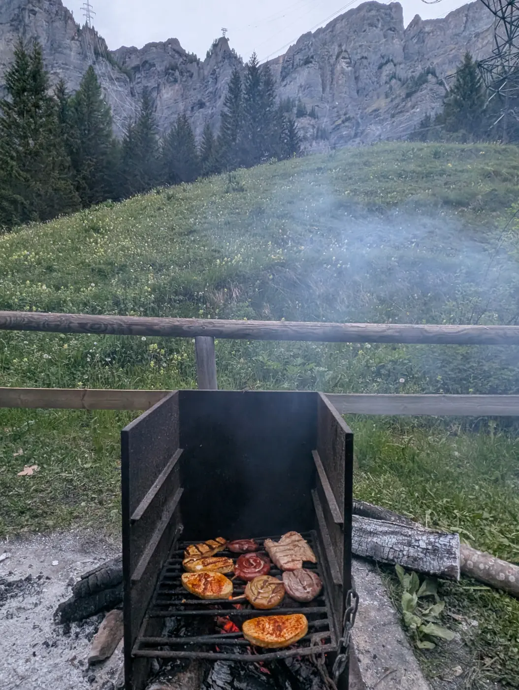

Eine kleine Brücke über den Bach, ein Bergsee zum Steinewerfen und eine Welle, auf der das Bike kurz abhebt: Mehr braucht ein Kind nicht für einen perfekten Bike-Tag. In Leukerbad liegt das alles an einer Runde. Biken mit Kindern funktioniert hier, weil die leichten Touren hier im Dorf anfangen und hier wieder aufhören. Ihr müsst nicht zuerst ins Tal fahren, kein Auto umparken und keinen Shuttle buchen. Ihr steigt auf das Bike, fahrt los, und wenn es reicht, seid ihr in kurzer Zeit zurück in der Wohnung.

## Was Kinder auf dem Bike brauchen

Kinder fahren nicht für Höhenmeter. Sie fahren für eine Brücke über den Bach, eine Welle, auf der das Bike kurz leicht wird, und eine Pause mit etwas Süssem. Eine gute Familientour hat deshalb drei Dinge: einen Weg ohne lange Steigungen, etwas zum Anschauen und einen Ort zum Einkehren.

In Leukerbad gibt es Touren, auf die genau das zutrifft. Die offiziellen Beschreibungen markieren einige davon als familienfreundlich. Wir haben sie nach dem sortiert, was ihr an dem Tag wollt.

## Die Beizu Tour: zum Majingsee und zurück

Die Beizu Tour ist unsere erste Empfehlung für Familien. Sie beginnt am Dorfplatz, ist rund zehn Kilometer lang und führt über gut 400 Höhenmeter hinauf und wieder hinunter. Die Stufe ist leicht.

Vom Dorf geht es zuerst auf Asphalt, dann auf Forstwegen hinauf zum Restaurant Weidstübli. Weiter oben liegt der Majingsee, ein kleiner Bergsee, an dem ihr bleiben wollt, bis jemand Hunger hat. Danach überquert ihr die Dala, und es folgt das Stück, an das sich Kinder erinnern: ein lustiger Trail entlang des Bachs, mit kleinen Brücken. Beim Restaurant Buljes gibt es die nächste Pause, dann führt der Weg über den Gemmiweg zur Talstation der Gemmibahn und zurück ins Dorf.

Was wir Familien raten:

- Plant die Tour mit viel Zeit. Die Fahrzeit liegt bei etwa zwei Stunden, mit Pausen wird ein halber Tag daraus.
- Der Aufstieg zum See ist der anstrengendste Teil. Danach geht es vor allem bergab.
- Die Gemmibahn ist fünf Minuten zu Fuss von der Wohnung. Das Ende der Tour liegt also fast vor der Tür.

## Der Jales-Flow: mit der Bahn hinauf, Welle um Welle hinunter

Wenn eure Kinder schon sicher bremsen und gern bergab fahren, ist der Jales-Flow auf Torrent der Höhepunkt. Die Bahn bringt euch mit den Bikes zur Rinderhütte auf über 2300 Meter. Von dort führt eine gebaute Abfahrt zur Mittelstation Torrentalp: gut drei Kilometer, nur bergab.

Der Trail hat Wellen, Mulden, Anlieger und kleine Sprünge. Die Sprünge sind freiwillig, jede Stelle lässt sich umfahren. Das Gefälle liegt im Schnitt bei zehn Prozent, und die Strecke ist so gebaut, dass sie bei trockenem Boden fast alle Biker meistern. Genau das macht ihn für Familien gut: Die Grossen haben Spass, die Kleinen auch, und am Ende wollen alle nochmals fahren.

Zwei Hinweise:

- Nach Regen und im Herbst kann der Trail rutschig sein. Für Anfänger empfehlen ihn die Betreiber nur bei trockenen Verhältnissen.
- Ab der Torrentalp geht es auf dem Deleeschi-Flow weiter. Die erste Hälfte ist blau und gut fahrbar. Ab der Forststrasse wird er rot, mit engen Kurven und mehr Tempo. Mit Kindern nehmt ihr dort besser die Forststrasse bis Flaschen und achtet auf Gegenverkehr.

Zur Torrentbahn fahrt ihr von [Alpine Siesta](/wohnungen/alpine-siesta/) aus etwa sieben Minuten mit dem Bus. Über Mittag machen die Bahnen eine Pause. Die erste Fahrt am Vormittag ist mit Kindern ohnehin die beste: kühler, ruhiger, und am Nachmittag bleibt Zeit fürs Bad.

## Von Dorf zu Dorf: Hännutrail und Dala Kultur Bike

Für ältere Kinder, die schon eine längere Strecke schaffen, gibt es zwei leichte Touren von Leukerbad bis ins Rhonetal. Beide sind als familienfreundlich markiert, und beide gehen vor allem bergab.

Der **Hännutrail** führt durch das alte Dorf, an den Albinenleitern vorbei und über eine Nebenstrasse zur Talstation Flaschen. Danach folgt ein Singletrail mit einfachen Hindernissen bis nach Albinen, ein kleines Bergdorf mit viel Charme. Weiter geht es durch den Wald nach St. Barbara, an Reben vorbei nach Leuk und Susten. Rund 14 Kilometer, gut 200 Meter hinauf, fast 1000 hinunter.

Der **Dala Kultur Bike** ist eine Einsteiger-Tour mit viel zum Entdecken. Ab der Sportarena führt der Weg auf breiten Trails und Flurstrassen nach Inden, teils auf der Trasse der alten Bahn von Leuk nach Leukerbad. Unterwegs liegt ein Kalkofen aus dem Spätmittelalter, und an der Felswand Schattuflüe führt der historische Weg der Varnerleitern hinunter. Hier kam schon Goethe 1779 nach Leukerbad. Danach öffnet sich das Rhonetal, und über Varen geht es nach Leuk.

Bei beiden Touren endet ihr unten im Tal. Zurück nach Leukerbad fährt der Bus ab Leuk. Jeder zweite Bus hat einen Anhänger für Bikes, die anderen einen Halter hinten. Eine Velo-Reservation über die SBB wird empfohlen. Rechnet für die Rückfahrt genug Zeit ein, damit der Tag nicht mit Warten endet.

## Kinderbikes, Bike School und Guides

Ihr müsst die Bikes nicht von zu Hause mitbringen. Im Dorf gibt es eine Bikevermietung mit Kinderbikes, Mountainbikes und E-Mountainbikes. Reparaturen und Ersatzteile gibt es dort auch. Reservieren könnt ihr online, in den Sommerferien lohnt sich das.

Die Bike School Leukerbad ist eine offizielle Lizenzschule. Für Kinder bietet sie die Kids Bike League an, für Erwachsene und Familien geführte Touren. Auf Anfrage stellen die Guides auch ein eigenes Programm zusammen.

Im Sommer ist jeden Donnerstag ein Bike-Guide im Dorf. Er gibt Tipps zur Fahrtechnik und nimmt am Nachmittag Gäste auf eine geführte Tour von etwa drei Stunden mit. Für Familien, die zum ersten Mal in den Bergen fahren, ist das ein guter Einstieg.

## So plant ihr einen Bike-Tag mit Kindern

Was sich bei Familien bewährt:

- **Vormittag fahren, Nachmittag frei.** Die erste Bahn, eine Abfahrt oder eine Runde, Mittagessen unterwegs. Am Nachmittag geht ihr in die Therme, sie ist zehn Minuten zu Fuss von der Wohnung.
- **Kurz anfangen.** Am ersten Tag reicht eine Runde. Wer nach zwei Stunden noch Lust hat, fährt am nächsten Tag weiter.
- **Pausen einplanen.** Weidstübli, Buljes, Flaschen, Birchen: Bergrestaurants liegen auf vielen Touren am Weg.
- **Rücksicht üben.** Auf vielen Wegen sind auch Wandernde unterwegs, auf der Torrent-Bergstrasse auch Trottinetts. Das ist eine gute Gelegenheit, Kindern Klingeln und langsames Vorbeifahren zu zeigen.

## Nach der Tour

Am Abend seid ihr in der Wohnung. Bike-Kleider kommen in die Waschmaschine, die Kinder in die Badewanne. Auf dem Balkon steht ein Elektrogrill, und wer die Beine hochlegen will, setzt sich auf den anderen Balkon mit Blick auf die Gemmi. Für den nächsten Tag braucht ihr keinen Plan. Leukerbad hat genug Wege, dass ihr morgen einfach eine andere Richtung nehmt.

## Bikes mieten und in der Wohnung abstellen

Ein eigenes Bike musst du nicht mitbringen. In Leukerbad und rundherum gibt es mehrere Bikevermietungen. **Alpine Cycling** im Dorf vermietet E-Mountainbikes, Mountainbikes und Kinderbikes und kümmert sich auch um Service und Reparaturen. **Rolis mobile Bikestation** in Albinen vermietet E-Bikes, Mountainbikes und Rennvelos, auch wochenweise, und bringt das Bike auf Wunsch direkt an den Start deiner Tour.

Bringt ihr die Familienbikes von zu Hause mit, kommen sie in [Alpine Siesta](/wohnungen/alpine-siesta/) in den Keller. Grosse und kleine Bikes stehen dort trocken, und das Treppenhaus bleibt frei für den Kinderwagen.