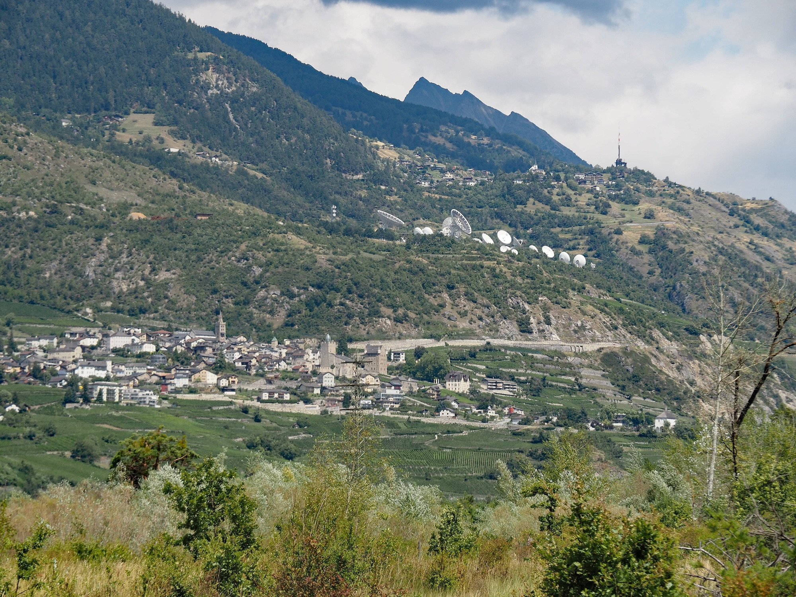
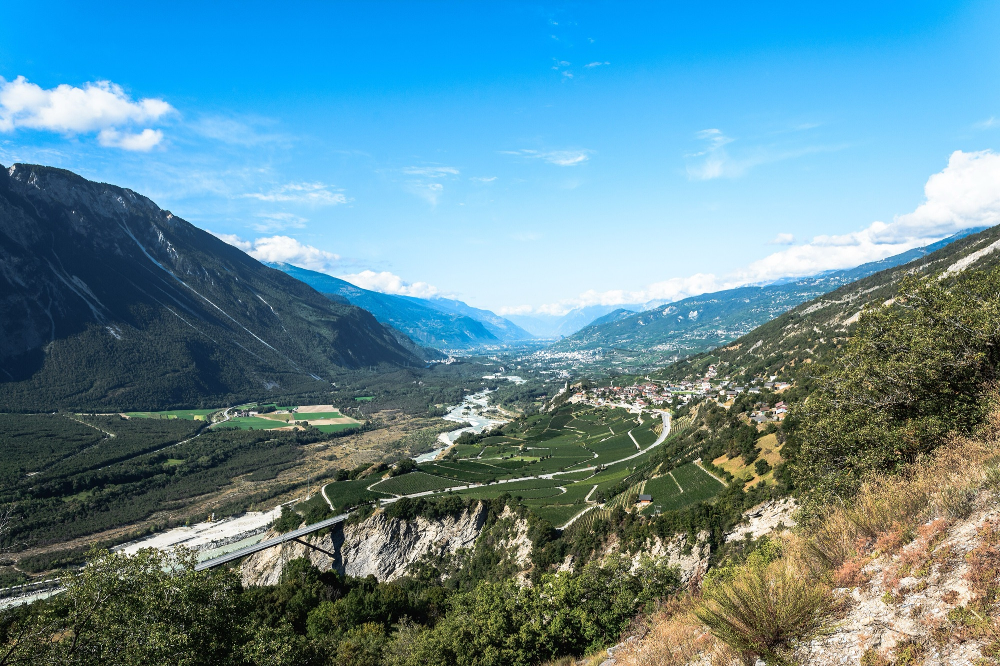

Frühstück in Leukerbad, Kaffee in Albinen, Mittagessen in der Altstadt von Leuk und am Nachmittag ein Glas Wein in Varen. Und das alles auf dem Bike. Biken zwischen den Orten ist rund um Leukerbad die schönste Art, das Wallis kennenzulernen. Viele Touren hier sind keine Runden, sondern Wege von einem Dorf zum nächsten. Du startest im Dorf oder an der Bergstation auf über 2300 Metern und endest unten im Rhonetal, in Leuk, Varen oder Susten. Dazwischen liegen Albinen, Guttet, Feschel und Inden, alte Wege und Spycher. Zurück bringt dich der Bus, mit dem Bike im Anhänger.

## Wie eine Tour von A nach B funktioniert

Leukerbad liegt auf rund 1400 Metern, Susten im Rhonetal auf gut 600. Dazwischen liegt ein Hang mit Dörfern, Alpen und Wald, und durch diesen Hang führen die Trails. Das heisst: Die meisten Touren gehen vor allem bergab. Wer mit der Bahn startet, fährt bis zu 1700 Höhenmeter hinunter und nur wenige hundert hinauf.

Der Plan für so einen Tag sieht meist so aus:

1. Am Morgen von der Wohnung zur Bahn oder direkt los ab Dorf.
2. Über die Dörfer bis ins Rhonetal fahren, mit Pausen unterwegs.
3. In Leuk einkehren, dann zum Bahnhof Susten rollen.
4. Mit dem Bus zurück nach Leukerbad. Jeder zweite Bus fährt mit Anhänger, die anderen haben einen Bikehalter. Eine Velo-Reservation über die SBB wird empfohlen.

Am Abend bist du wieder im Dorf, und die Therme ist zehn Minuten von der Wohnung entfernt.

## Hännutrail: über Albinen nach Leuk

Der Hännutrail ist die leichteste Tour ins Tal und ideal für den Einstieg. Er beginnt im Dorf, führt am alten Hotel Maison Blanche vorbei und auf einem Flurweg bis zu den Albinenleitern. Das sind senkrechte Holzleitern in der Felswand, über die früher die Albiner nach Leukerbad stiegen. Mit dem Bike musst du da zum Glück nicht hinauf, eine Nebenstrasse führt zur Talstation Flaschen.

Von Flaschen geht es auf einem Singletrail mit einfachen Hindernissen nach Albinen. Das Dorf ist alt, schon im 11. Jahrhundert siedelten hier Leute aus Leukerbad. Mach eine Pause zwischen den dunklen Holzhäusern. Danach geht es durch den Wald nach St. Barbara und an den Reben vorbei nach Leuk und Susten.

Rund 14 Kilometer, gut 200 Meter hinauf, fast 1000 Meter hinunter, Stufe leicht.

## Dala Kultur Bike: auf Goethes Weg nach Varen

Der Dala Kultur Bike ist eine Tour zum Schauen. Er führt auf der anderen Talseite, rechts der Dala, über Wiesen und durch gemischte Wälder nach Inden. Ein Teil des Weges folgt der Trasse der alten Eisenbahn, die einmal Leuk mit Leukerbad verband.

Nach Inden kommt ein restaurierter Kalkofen aus dem Spätmittelalter und dann das eindrücklichste Stück: der Weg der Varnerleitern, der die steile Felswand Schattuflüe überwindet. Über genau diesen Wegabschnitt kam Johann Wolfgang von Goethe 1779 von Sierre nach Leukerbad. Danach weitet sich das Tal, und das Rhonetal liegt offen vor dir. Über das Weindorf Varen geht es nach Leuk.

Rund 14 Kilometer, kaum 120 Meter hinauf, fast 900 hinunter, Stufe leicht. Die Wege sind breit und übersichtlich, auf einigen Abschnitten sind auch Wandernde unterwegs.

## Torrenttrail: von der Rinderhütte über fünf Dörfer

Der Torrenttrail ist die lange Version dieser Idee. Die Torrentbahn bringt dich zur Rinderhütte auf über 2300 Meter, von dort sind es 29 Kilometer bis Susten. Unterwegs kommst du durch Oberu, Bachalp, Brentschen, Feschel und Guttet, vorbei an einem See mit Rastplatz und an der Satellitenbodenstation Brentjong.

In Leuk lohnt sich ein letzter Halt. Das Schloss mit der Kuppel, die Mario Botta ergänzt hat, steht mitten in der Altstadt. Von dort rollst du gemütlich auf der Veloland-Route 72 nach Susten.

Die Stufe ist mittel, mit kurzen Anstiegen zwischen den Abfahrten. Wer am Ende lieber wieder im Dorf ankommt, nimmt den Torrenttrail Short. Er zweigt bei der Alp Oberu ab, führt nach Guttet und über den Höhenweg und Albinen zurück nach Leukerbad.

## Chällerflüe und Guggerhubel: zwei Wege nach Varen und Leuk

Für Geübte gibt es zwei weitere Touren ins Tal, beide mittel.

Die **Chällerflüe** startet im Dorf und führt über das Restaurant Birchen und die Alp Larschi zu einer Felsquerung. Dort schiebst du das Bike etwa 350 Meter auf einem breiten Weg, der talseitig mit Drahtseilen gesichert ist. Schwindelfrei sein hilft. Oben belohnt dich eine Abfahrt von 1100 Tiefenmetern auf Singletrails bis nach Varen. Dort lohnt sich ein Besuch in einem Weinkeller, bevor es weiter nach Leuk geht. Mehr zum Weindorf steht auf [Varen, Wein in einem ruhigen Dorf](/leukerbad/wein/varen/).

Der **Guggerhubel** beginnt mit einem Aufstieg auf Neben- und Alpstrassen zur Torrentalp. Danach folgt ein Höhenweg zum Aussichtspunkt Undru Guggerhubel und ein Singletrail durch einen Wald, der 2003 abgebrannt ist und langsam nachwächst. Über Guttet-Feschel und Leuk geht es nach Susten.

## Zurück aus eigener Kraft: Dala Bärgüf

Wer den Bus nicht nehmen will, fährt selbst hinauf. Der Dala Bärgüf ist eine Aufstiegsroute mit wenig Verkehr: von Susten durch Leuk, über St. Barbara und Tschingeren nach Albinen und weiter nach Leukerbad. Rund 900 Höhenmeter auf 14,5 Kilometern. Ohne Motor ist das schwer, mit dem E-Bike eine schöne Runde.

Kombiniert mit einer der Abfahrten wird daraus eine ganze Tagestour ohne Bahn und ohne Bus. Ein Tipp für das letzte Stück: Nach dem Tunnel bei den Albinenleitern bremsen und auf den Naturpfad wechseln. Er führt ohne Höhenverlust direkt ins Dorfzentrum.

## Weiter weg: Jeizinen, Unterbäch und Kandersteg

Rund um Leukerbad beginnen auch Touren, die über die Region hinausführen.

- **Valais Alpine Bike, Etappe 2:** von der Rinderhütte über die Feselalp und Erschmatt nach Steg, mit einem Pumptrack am Weg, weiter nach Raron und mit der Gondel nach Unterbäch. Eine Etappe einer Tour quer durch das Wallis.
- **Jeizibärg Bike:** ab Gampel mit der Seilbahn nach Jeizinen, hinauf zum Heruhubel und über die Meiggu-Alpen zurück ins Tal, mit Blick ins Lötschental.
- **Gemmi Gspass:** mit der Gemmibahn auf den Pass, auf einer Schotterroute am Daubensee entlang und am alten Berghotel Schwarenbach vorbei bis zur Bergstation Sunnbüel bei Kandersteg. Technisch einfach, mit einer frühen Bahn am ruhigsten.

## Zwei Tage: Lötschental, Leukerbad, Kandersteg

Die grösste Tour verbindet drei Orte und zwei Kantone. Am ersten Tag fährst du von der Lauchernalp im Lötschental über das Gebiet Torrent nach Leukerbad. Am zweiten Tag geht es über den Gemmipass nach Kandersteg. Zusammen sind es über 50 Kilometer und mehr als 2400 Höhenmeter hinauf, für Mountainbiker und E-Mountainbiker mit guter Kondition.

Die Übernachtung dazwischen ist in Leukerbad. In [Alpine Siesta](/wohnungen/alpine-siesta/) kommen die verschwitzten Kleider in die Waschmaschine, du in die Badewanne oder in die Therme. Und die Gemmibahn für den zweiten Tag ist fünf Minuten zu Fuss.

## Bikes mieten und in der Wohnung abstellen

Ein eigenes Bike musst du nicht mitbringen. In Leukerbad und rundherum gibt es mehrere Bikevermietungen. **Alpine Cycling** im Dorf vermietet E-Mountainbikes, Mountainbikes und Kinderbikes und kümmert sich auch um Service und Reparaturen. **Rolis mobile Bikestation** in Albinen vermietet E-Bikes, Mountainbikes und Rennvelos, auch wochenweise, und bringt das Bike auf Wunsch direkt an den Start deiner Tour.

Fährst du mit dem eigenen Bike, stellst du es in [Alpine Siesta](/wohnungen/alpine-siesta/) im Keller ab. Kommst du am Abend mit dem Bus aus dem Rhonetal zurück, ist der Weg vom Bike in die Badewanne kurz.

*Bildnachweis, Wikimedia Commons. Titelbild: [Onepau](https://commons.wikimedia.org/wiki/File:Albinen_valais.jpg), [CC BY-SA 4.0](https://creativecommons.org/licenses/by-sa/4.0); Leuk und Brentjong: [Arkelin](https://commons.wikimedia.org/wiki/File:Leuk_%E2%80%93_Brentjong_%E2%80%93_Guttet.jpg), [CC BY 4.0](https://creativecommons.org/licenses/by/4.0); Rhonetal: [Domenico Convertini](https://commons.wikimedia.org/wiki/File:Leukerbad,_Rhonetal,_Switzerland_(51546505588).jpg), [CC BY-SA 2.0](https://creativecommons.org/licenses/by-sa/2.0).*
