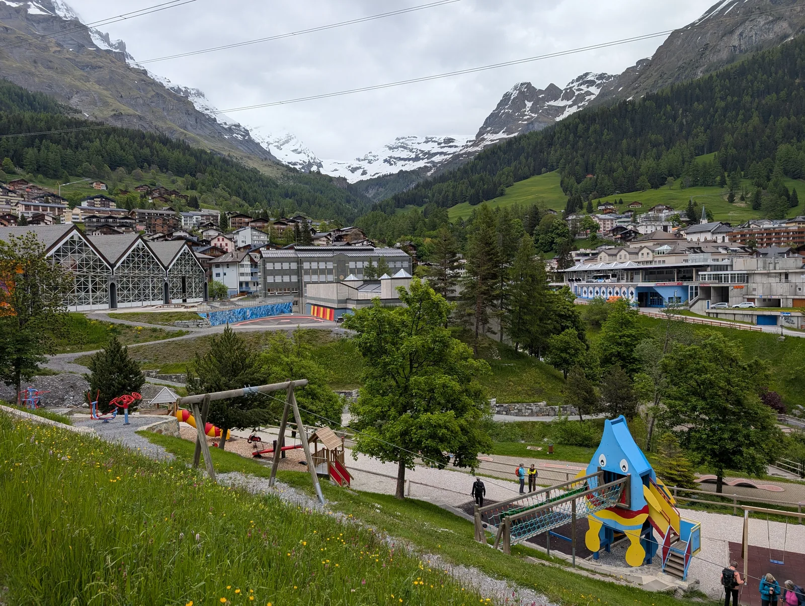
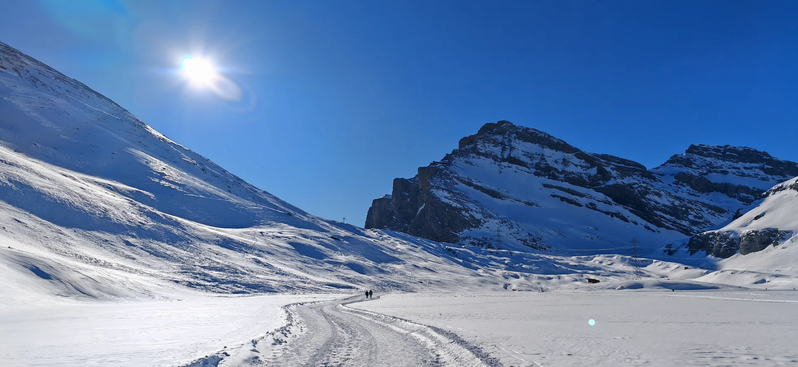
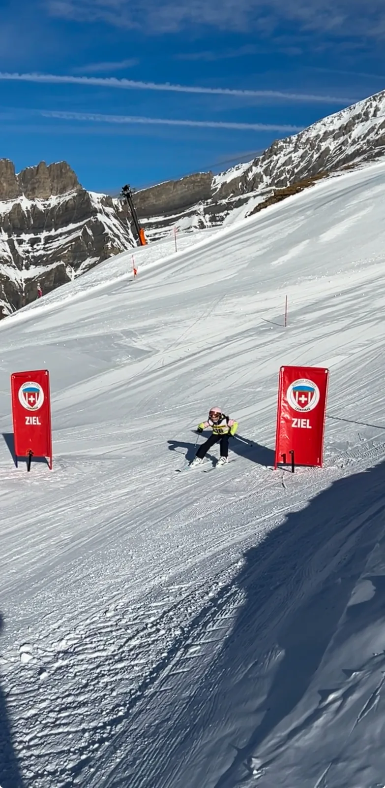
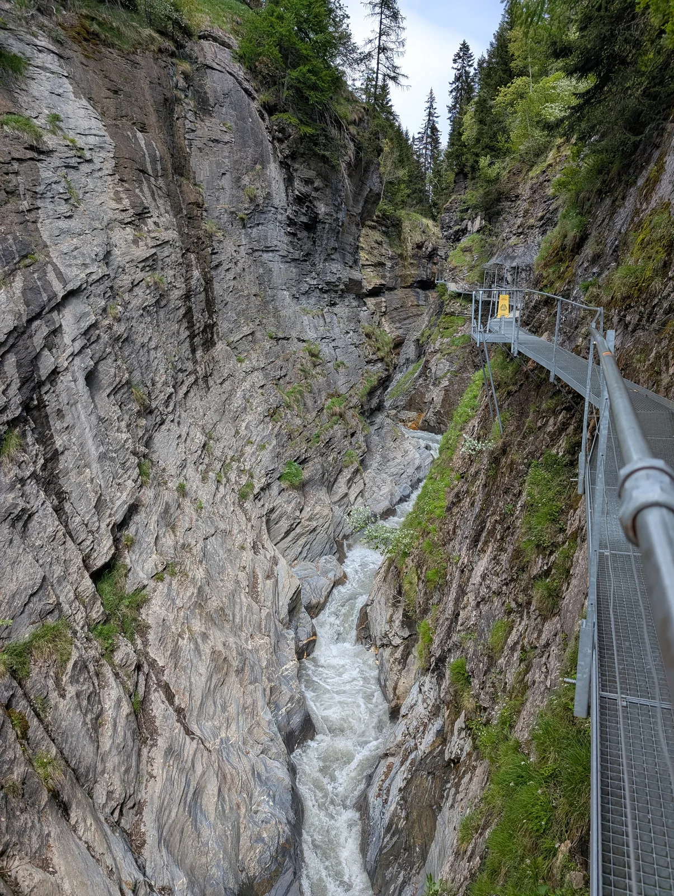
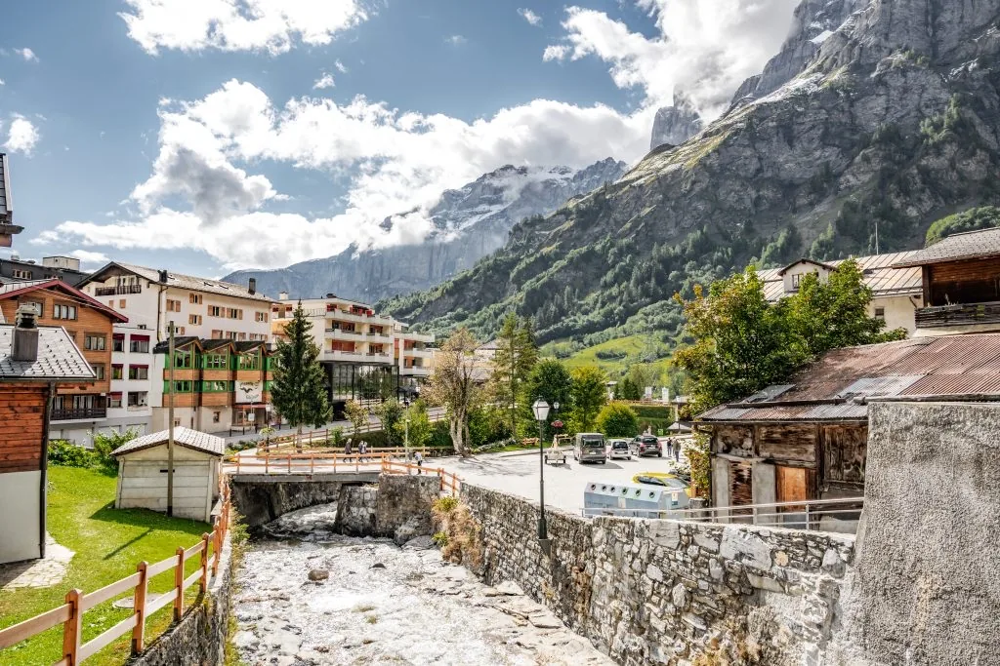
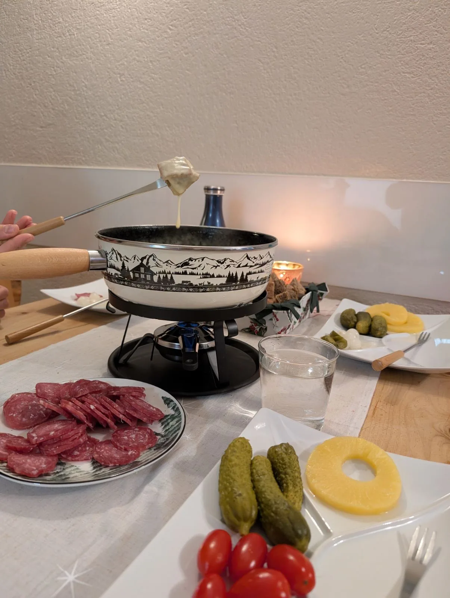

---
# Pillar Page /leukerbad/familie/ – erstellt mit dem Skill pillar-artikel.
# Stimme: Skill engagierte-texte. Unbelegte Zahlen weglassen, nicht im Text markieren.
title: "Familienferien in Leukerbad mit Kindern"
description: "Familienferien in Leukerbad heissen kurze Wege: Therme, Gemmi und das Dorf zu Fuss, und abends ein eigenes Zimmer für die Kinder."
h1: "Familienferien in Leukerbad, ohne jeden Tag neu zu planen"
lead: "Leukerbad liegt am Ende des Tals. Die Therme, die Gemmibahn und das Dorf sind zu Fuss da, und abends hat jedes Kind ein Bett, das nicht im Wohnzimmer steht. So bleiben Ferien Ferien."
bild: ./leukerbad-winter-dorf-schnee-felswand.webp
bild_alt: "Verschneites Leukerbad im Tal, Holzhäuser und ein langes helles Gebäude vor Felswänden"
aktualisiert: 2026-10-26
faq:
  - frage: Wie weit ist die Therme von der Wohnung?
    antwort: Von Alpine Siesta gehst du etwa zehn Minuten zu Fuss zur Leukerbad Therme. Zentrum und Sportarena sind ebenfalls etwa zehn Minuten, die Gemmibahn fünf.
  - frage: Haben die Kinder ein eigenes Zimmer?
    antwort: Ja. Es gibt ein Doppelzimmer, ein Kinderzimmer mit zwei Einzelbetten und das Wohnzimmer mit einem Schlafsofa für zwei. Ein Babybett lässt sich zusätzlich ausklappen.
  - frage: Brauchen wir ein Auto?
    antwort: Für Therme, Dorf und Gemmibahn nicht. Ein Aussenparkplatz gehört zur Wohnung. Zur Torrentbahn fährst du in etwa sieben Minuten mit dem Bus.
  - frage: Was machen wir, wenn es regnet?
    antwort: Die Therme ist zehn Minuten zu Fuss entfernt, die Sportarena auch. In der Wohnung warten Fondue, Raclette, Spiele und eine Spielküche.
  - frage: Sind Haustiere erlaubt?
    antwort: Stubenreine Haustiere sind willkommen. Geraucht wird nur auf dem Balkon.
entwurf: false
---

Familienferien sollen erholen, und nicht noch zusätzlich fordern. Dafür ist Leukerbad gemacht: kurze Wege, viel Natur, und ein Dorf, in dem du dich mit Kindern sofort zurechtfindest. Winter, Sommer und ein Regentag lassen sich ohne starren Plan gestalten. Du gehst los, du machst Pause, du kehrst um, wenn es reicht.

## Warum das Dorf für Familien ruhiger ist als ein grosses Ferienzentrum

Leukerbad hat kein durchlaufendes Tal. Die Strasse endet hier. Du merkst das am Abend: weniger Verkehr, und die Berge sind die Kulisse, nicht eine Einfahrt. Für Kinder ist das praktisch. Der Spielplatz, der Bäcker und der Weg zur Therme liegen im selben Radius, nicht in drei verschiedenen Orten.

Was Familien bei uns schätzen, ist nicht ein einzelner Ausflug. Es ist die Möglichkeit, den Ausflug abzubrechen. Jemand ist müde, jemand ist nass, jemand will nur noch essen. Dann seid ihr in zehn Minuten wieder in der Wohnung, nicht in einem Parkhaus am anderen Ende eines Resorts.

Dazu kommt das Wasser. Aus den Quellen von Leukerbad kommen täglich über 3,9 Millionen Liter Thermalwasser. Ein Badetag ist hier kein Ausflug, den du extra einplanst. Er ist die naheliegende Antwort, wenn der Vormittag draussen lang genug war.

## Die Wohnung, von der aus der Tag startet

[Alpine Siesta](/wohnungen/alpine-siesta/) ist 65 Quadratmeter, im ersten Stock, mit Lift und ohne Stufen. Drei Zimmer, in jedem zwei Schlafplätze: ein Doppelzimmer, ein Kinderzimmer mit zwei Einzelbetten, und das Wohnzimmer mit einem Schlafsofa. Ein Babybett klappst du aus, wenn ihr mit einem Kleinkind reist. Wenn die Kinder im Bett sind, gehört das Wohnzimmer wieder euch. Das ist der Punkt, an dem Ferien mit Kindern entweder eng werden oder noch einen Abend haben.

In der Küche steht, was ihr am Abend braucht, ohne einzukaufen zu müssen, was das Rezept verlangt: Induktion, ein Backofen, der schnell heiss wird, eine Spülmaschine und ein Becken, das die Pfannen nach dem Essen fasst. Fondue geht auf dem Herd, Raclette gibt es auch. Für den Kaffee eine CoffeeB-Maschine und eine Mokka-Kanne. Hochstuhl, Spielküche, Brettspiele und ein Schaukelpferd sind da. Zwei Balkone: einer zum Sitzen mit Blick auf die Gemmi, einer mit Elektrogrill. Geraucht wird nur draussen.

Check-in ist ab 15:00, Check-out bis 11:00. Am Anreisetag seid ihr um drei in der Wohnung, und die Therme ist dann noch drin. Der grosse Ausflug kommt am nächsten Morgen. Am Abreisetag habt ihr den Morgen. Ein Aussenparkplatz gehört dazu. Die Gästekarten liegen in der Wohnung und geben Rabatt auf Angebote in der Region.

## Winter: Piste, Schnee und warme Pausen

Der Winter in Leukerbad ist familienfreundlich, weil neben dem Skifahren noch vieles andere geht. Ein Tag auf der Piste. Ein Tag, an dem ihr eine Spur in den Schnee tretet, eine halbe Stunde geht und umkehrt. Ein Tag, an dem das Wärmste der Nachmittag im Wasser ist.

Was bei uns im Winter gut funktioniert:

- Ein kurzer Spaziergang im Schnee, auch mit Kinderwagen oder Schlitten.
- Schlitteln und Schneespielen, ohne dafür ein ganzes Skigebiet zu brauchen.
- Eine Pause, bevor jemand hungrig und nass gleichzeitig ist.
- Danach die Therme. Kalte Luft, warmes Wasser, und ihr seid zu Fuss wieder zu Hause.

Die Tage mit dem Dorf und dem Bad sind oft die, an die sich die Kinder erinnern.

## Worauf du bei einem Skigebiet mit Kindern achtest

Mit Kindern zählt eine übersichtliche Anfängerzone, breite Pisten, Lifte, die ein Kind ohne Erklärung versteht, und ein Ort, an dem ihr aufhören könnt und gleich wieder im Dorf seid.

Torrent erreichst du in etwa sieben Minuten mit dem Bus: breite Pisten, Anfängerzonen und die Freiheit, nach ein paar Abfahrten wieder aufzuhören. Mehr dazu auf der Seite [Skifahren mit Kindern](/leukerbad/familie/kinderfreundliche-skigebiete/).

Unser Rat für den ersten Skitag: kurz bleiben. Lieber zwei Stunden, in denen das Kind noch Lust hat, als ein Tag, der in Tränen auf dem Lift endet. Die Therme am Nachmittag rettet mehr Skiferien als eine zusätzliche Piste.

## Sommer: raus, und wieder zurück, bevor es zu viel wird

Im Sommer ist Leukerbad grün, und die Felswände bleiben. Ihr müsst keinen Gipfel planen. Eine Bahn bringt euch hinauf, ein Weg bringt euch ein Stück, und das Dorf ist nah, wenn jemand nicht mehr will.

Was im Sommer bei Familien gut ankommt:

- Leichte Wege mit einer Pause, im Tempo der kürzesten Beine.
- Die Bergbahn, wenn ihr Höhe wollt, ohne den Aufstieg zu Fuss.
- Wasser, Wiese und ein Grillplatz, wenn ihr einfach bleiben wollt.
- Ein Spielplatz im Dorf für den Nachmittag.

Eine Schlucht mit einem Steg an der Felswand ist so ein Ausflug: der Bach ist laut, der Weg ist klar, und ihr dreht um, wenn die Beine kurz werden.

Der Majingsee oberhalb des Dorfs passt in einen Vormittag: laufen, entdecken, pausieren, ohne Zeitdruck.

Im Dorf selbst ist der Bach die kürzeste Runde. Ihr geht zehn Minuten, schaut die Felswand an und seid wieder bei den Häusern. Das ist der Tag, an dem ihr einfach im Dorf bleiben wollt.

## Wenn das Wetter nicht mitmacht

Regen und Wind gehören zum Wallis. Ob ein Ort für Familien taugt, siehst du an so einem Tag, nicht an einem Prospektfoto mit blauem Himmel.

Was dann geht, ohne das Tal zu verlassen:

- Die Leukerbad Therme, etwa zehn Minuten zu Fuss, mit Platz für Gross und Klein.
- Die Sportarena, ebenfalls etwa zehn Minuten: Eis, Spiel und Bewegung auf engem Raum.
- Der Weg zurück. Weil alles nah ist, müsst ihr einen misslungenen Ausflug nicht aussitzen.
- Die Wohnung. Fondue, Raclette, Spiele, die Spielküche, der Kamin. An so einem Tag ist das der Plan.

Das Fondue auf dem Foto ist aus unserer Küche, nicht aus einem Restaurant bei Regen. Der Herd ist ein Induktionsfeld, das Caquelon steht auf dem Rechaud. Ihr braucht keinen Tisch im Dorf, wenn draussen nichts geht. Raclette geht genauso.

An Regentagen ist die Therme voller. Wer früh geht, hat mehr Platz, und danach seid ihr schnell wieder in der Wohnung.

## Die Gemmi, wenn ihr hinauf wollt

Die Gemmi ist der Berg, den ihr vom Balkon seht. Die Bahn ist fünf Minuten von der Wohnung. Das ist der Vorteil: ihr entscheidet am Morgen, nicht drei Tage vorher.

Ihr müsst den Pass nicht überqueren. Ein Stück Höhe ist ohne Anfahrt da. Oben ist es kühler und offener als im Dorf. Wie weit ihr geht, bestimmen die kürzesten Beine.

Kommt ihr herunter und jemand ist durchgefroren oder überhitzt, ist die Wohnung nah. Die Gemmi ist ein Ausflug, den ihr abbrechen könnt und zu Fuss nach Hause geht.

Im Winter ist dieselbe Wand der Hintergrund fürs Bad und für den Schnee im Dorf. Der Tag sieht auch von unten nach Leukerbad aus: Häuser, Wald, Fels.

## Was du von der Wohnung aus erreichst

Die Zeiten gelten ab Alpine Siesta, nicht ab irgendeinem Parkplatz im Dorf.

| Ziel | Weg |
|---|---|
| Gemmibahn | 5 Minuten zu Fuss |
| Haltestelle La Boheme und die Bäckerei | 2 Minuten zu Fuss |
| Leukerbad Therme | 10 Minuten zu Fuss |
| Zentrum oder Sportarena | 10 Minuten zu Fuss |
| Torrentbahn | 7 Minuten mit dem Bus |

Die Gemmibahn in fünf Minuten heisst: ein Ausflug auf den Pass kann spontan sein. Er muss nicht der eine Tag sein, für den ihr früh aufsteht.

## Ein Tag, der ruhig bleibt

So sieht ein Tag aus, der bei Familien bei uns funktioniert.

Am Morgen entscheidet ihr draussen vor der Tür, nicht am Vorabend in einer Liste. Die Bäckerei an der Haltestelle La Boheme ist zwei Minuten entfernt. Danach entweder eine kurze Runde, die Bahn oder gar nichts.

Am Mittag esst ihr, bevor der Hunger die Entscheidung trifft. In der Wohnung geht das schneller als die Suche nach einem Restaurant mit einem freien Hochstuhl.

Am Nachmittag eine Sache. Die Therme, der Spielplatz, der Schnee oder der Bach.

Am Abend seid ihr drin, bevor die Kinder überdreht sind. Drei Zimmer heissen: die Kleinen können schlafen, und ihr sitzt noch am Tisch. Das Schlafsofa im Wohnzimmer ist ein Bett für zwei. Solange das Doppelzimmer frei ist, schlaft ihr dort.

Am Abreisetag ist um 11:00 Schluss. Das Gepäck ist schneller draussen, wenn der Morgen nicht noch ein Ausflug werden soll.

## Mit Kleinkind, mit Schulkindern, mit Grosseltern

Je nach Alter sieht der Tag anders aus. Deshalb sagen wir die Schlafplätze so klar.

Mit einem Baby zählt der Lift mehr als die Aussicht. Ihr kommt ohne Stufen ins erste Obergeschoss, das Babybett klappt ihr auf, und der Hochstuhl steht am Tisch. Ein langer Tag draussen ist dann selten der Plan. Die Therme in zehn Minuten, der Balkon mit dem Gemmiblick und ein frühes Abendessen sind genug. In der Wohnung ist der Weg vom Lift zur Tür ohne Treppe.

Mit Schulkindern wird das Kinderzimmer wichtig. Zwei Einzelbetten, ein Regal, die Spielküche, das Schaukelpferd. Abends schliessen sie die Tür, und das Wohnzimmer ist wieder ein Wohnzimmer. Der Tag ist eine Piste, eine Spur im Schnee oder der Spielplatz. Eine Sache reicht.

Mit Grosseltern zählt dasselbe wie mit dem Kinderwagen: der Lift bis zur Wohnung, ein eigenes Zimmer, und die Möglichkeit, mittags heimzugehen, während die anderen noch draussen sind. Sechs Schlafplätze heissen, dass eine kleine Familie und ein Grosselternpaar im selben Stock schlafen. Das Sofa ist dann das sechste Bett.

## Was ihr einpacken solltet

Föhn, Waage, Spülmaschine, Waschmaschine, WLAN und Fernseher sind da. Eine Xbox 360 und Brettspiele auch.

Dazu, weil es vom Tag abhängt: Badesachen und im Winter eine Mütze fürs Aussenbecken. Schichten, weil das Tal am Morgen kalt und am Mittag in der Sonne heiss sein kann. Hausschuhe, damit der Schneematsch nicht durch die Zimmer läuft. Nasse Jacken gehören auf den Balkon. Käse fürs Fondue holt ihr im Dorf, zusammen mit Windeln und Milch. Die Bäckerei bei La Boheme ist zwei Minuten von der Tür.

## Eine Woche in eurem Tempo

Sieben Tage, und jeder darf etwas anderes sein. Am Anreisetag, ab 15:00, räumt ihr ein. Die Gemmi kommt an einem der nächsten Morgen.

Ein Tag gehört dem Wasser. Ihr geht zur Therme und kommt zurück, solange die Kinder noch freundlich sind. Die Müdigkeit kommt im warmen Wasser schneller als auf dem Weg.

Ein Tag gehört dem Schnee oder, im Sommer, einem Weg. Eine Sache, dann umkehren. Die Gemmibahn ist fünf Minuten von der Tür.

Ein Tag gehört einfach euch. Spielplatz, Bach oder Balkon. Genau dieser Tag ist der Grund, warum der nächste wieder geht.

Torrent, wenn ihr Ski fahren wollt: sieben Minuten mit dem Bus, und am Nachmittag seid ihr im Dorf. Den letzten Morgen lasst ihr ruhig. Um 11:00 ist die Wohnung leer. Die Therme nehmt ihr am Vorabend.

## Essen, ohne jeden Abend einen Tisch zu suchen

Mit Kindern ist der Abend in der eigenen Küche oft der leichteste Teil des Tages. Der Hochstuhl steht schon, und niemand wartet auf einen Tisch.

Ihr könnt jeden Abend drin essen und den Tag beenden, wenn er zu Ende ist. Fondue und Raclette sind das Wallis am Tisch. Das Caquelon hat ein Bergpanorama drauf, der Käse zieht, und die Beilagen sind das, was ihr eingekauft habt: Brot, etwas Wurst, Gurken, was die Kinder essen.

Frühstück ist bei euch. Die Bäckerei ist der Zwei-Minuten-Weg. Kaffee macht die Maschine oder die Mokka-Kanne, je nachdem, wer zuerst in der Küche steht.

## Kurtaxe und Gästekarte, in einem Absatz

Bei einer Direktbuchung ist die Kurtaxe im Preis. Auf Booking.com und Airbnb ist sie nicht dabei und wird später fällig. Die Gästekarten liegen bereit und geben Rabatt auf Angebote in der Region.

## Die Tage, und die Wohnung

Die wichtigen Orte liegen zu Fuss: Therme, Gemmi, Sportarena, Bäcker. In der Wohnung schlafen sechs Personen, jedes Paar in seinem Raum: vier in den beiden Zimmern, zwei auf dem Schlafsofa, das Babybett zusätzlich.

Wie die einzelnen Tage aussehen: [Winter mit Kindern](/leukerbad/familie/winter-mit-kindern/), [Sommer mit Kindern](/leukerbad/familie/sommer-mit-kindern/), [Schlechtwetter mit Kindern](/leukerbad/familie/schlechtwetter-mit-kindern/) und [Skifahren mit Kindern](/leukerbad/familie/kinderfreundliche-skigebiete/). Von jeder Seite kommt ihr zurück zur [Wohnung](/wohnungen/alpine-siesta/).
