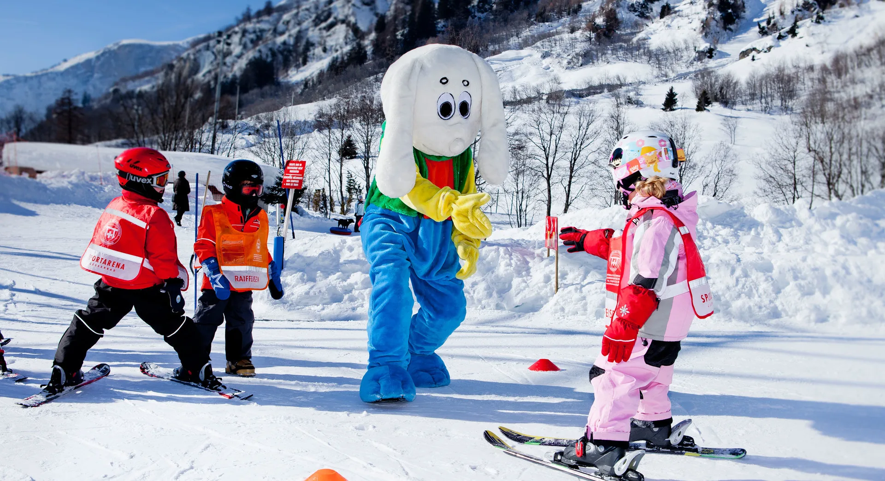
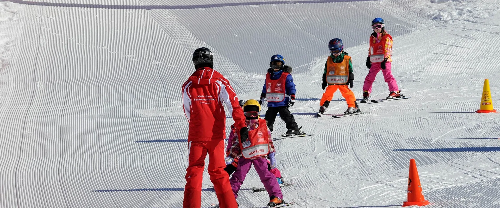
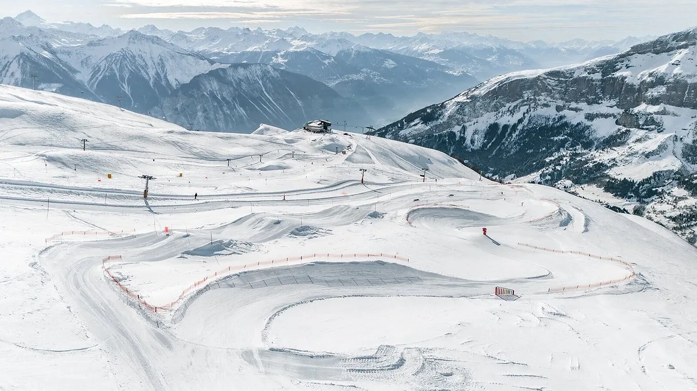

Mit Kindern zählen Übersicht, kurze Wege, ein Anfängerbereich und die Freiheit, mittendrin aufzuhören. Ab Leukerbad habt ihr dafür zwei Orte in der Nähe: die Sportarena für den Anfang, den Torrent für einen halben Tag. Beide erreicht ihr ohne Auto.

## Was den Tag leicht macht

Ein Skitag mit Kindern wird leicht durch das Drumherum. Hilfreich ist:

- ein Übungsbereich, der vom übrigen Betrieb getrennt ist
- breite Pisten, die ihr überblickt
- kurze Lifte, die ein Kind ohne Erklärung versteht
- wenig Gedränge an der Talstation
- eine Pause, die nicht erst am anderen Ende des Gebiets möglich ist
- etwas anderes als Ski: Schlitten, Schnee, oder einfach Schluss

Dann fühlt sich der Tag machbar an, und am Nachmittag seid ihr wieder im Dorf.

## Die Sportarena für die ersten Schwünge

Die Sportarena Leukerbad ist der Ort für den Einstieg. Alles liegt beieinander, es ist ruhiger als ein grosses Gebiet, und der Tag darf kurz sein. Von der Wohnung sind es etwa zehn Minuten zu Fuss.

Auf dem Foto steht ein Maskottchen zwischen Kindern. Die Westen zeigen Sportarena. Das ist Spiel auf Ski, in einem Tempo, das die Kinder bestimmen. Für jüngere Kinder und für den ersten Kontakt ist das der richtige Ort.

Vier Kinder auf einer flachen Piste, eine Person in Rot bleibt bei ihnen. So sehen die ersten Schwünge aus: jemand ist da, die Piste ist übersichtlich, und der Block bleibt kurz.

Was die Halle sonst noch hat, Eis und bei Regen die Innenangebote, steht bei [Schlechtwetter mit Kindern](/leukerbad/familie/schlechtwetter-mit-kindern/).

## Der Torrent, wenn die Niveaus verschieden sind

Der Torrent ist das Gebiet für einen halben Tag, wenn nicht alle gleich fahren. Breite Pisten und kurze Lifte, und danach seid ihr wieder im Dorf.

Eine breite Piste mit markierten Kurven, Lifte, und dahinter die Gipfel. Zur Torrentbahn fährt der Bus ab Leukerbad etwa sieben Minuten. Danach seid ihr wieder im Dorf.

Am ersten Tag dort bleiben zwei Stunden mit Lust der schönste Block. Die Therme am Nachmittag ist zehn Minuten von der Wohnung und macht aus dem Skitag wieder Ferien.

## Für welches Alter

Kleinkinder: Schnee, Schlitten, erste Versuche auf dem Übungsgelände. Kinder: kurze Abfahrten und viele Pausen. Grössere Kinder: mehr Piste, solange sie wollen. Den Tag verkürzt ihr jederzeit, weil Wohnung und Therme nah sind.

Ein Aussenparkplatz gehört zur Wohnung. Für Sportarena und Torrent lasst ihr das Auto stehen. Wer zu zweit verschieden fährt, spricht vorher die Uhrzeit der Rückkehr ab, damit alle mit einem guten Gefühl aufhören. Nasse Skischuhe und Jacken kommen auf den Balkon. Das Kinderzimmer bleibt trocken.

Am Anreisetag, Check-in ab 15:00, gehört der Abend der Wohnung. Am Abreisetag ist um 11:00 die Wohnung leer. Die Bahn nehmt ihr an einem der Tage dazwischen.

## Ein Skitag, der am Nachmittag noch Ferien ist

Für den ersten Kontakt: Sportarena, zehn Minuten zu Fuss, ein bis zwei Stunden. Danach Essen in der Wohnung. Der zweite Ort kommt an einem anderen Tag.

Für einen Tag mit verschiedenen Niveaus: Bus zur Torrentbahn, sieben Minuten, und eine Uhrzeit, zu der ihr wieder im Dorf seid. Die sprecht ihr vorher ab, und dann hält sie.

Danach die Therme, solange noch Energie da ist. Sonst das Kinderzimmer: zwei Betten, Schaukelpferd, Regal mit Spielen. Der Schnee bleibt draussen. Nasse Sachen kommen auf den Balkon.

Gästekarten liegen in der Wohnung und geben Rabatt auf Angebote in der Region. Die Kurtaxe ist bei einer Direktbuchung im Preis. Auf Booking.com und Airbnb wird sie später fällig.

[Alpine Siesta](/wohnungen/alpine-siesta/) ist der Ausgangspunkt: drei Zimmer, damit der Abend nach dem Schnee noch ruhig ist. Der weitere Winter, Spaziergänge und die Holzbrücke im Schnee, steht bei [Winter mit Kindern](/leukerbad/familie/winter-mit-kindern/). Die Übersicht ist [Familienferien in Leukerbad](/leukerbad/familie/).
