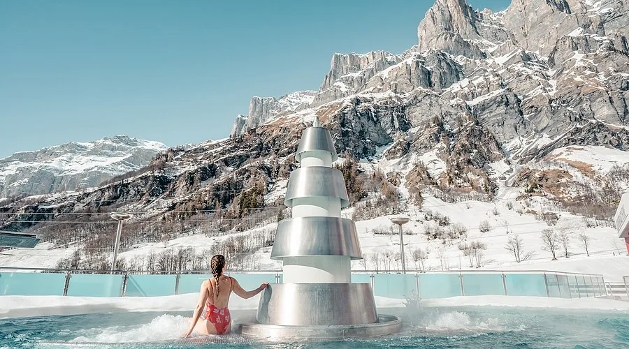
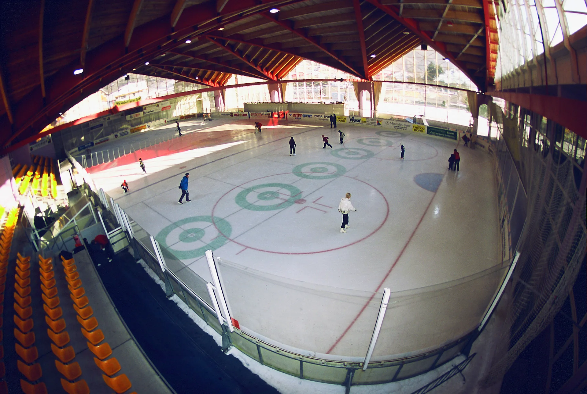
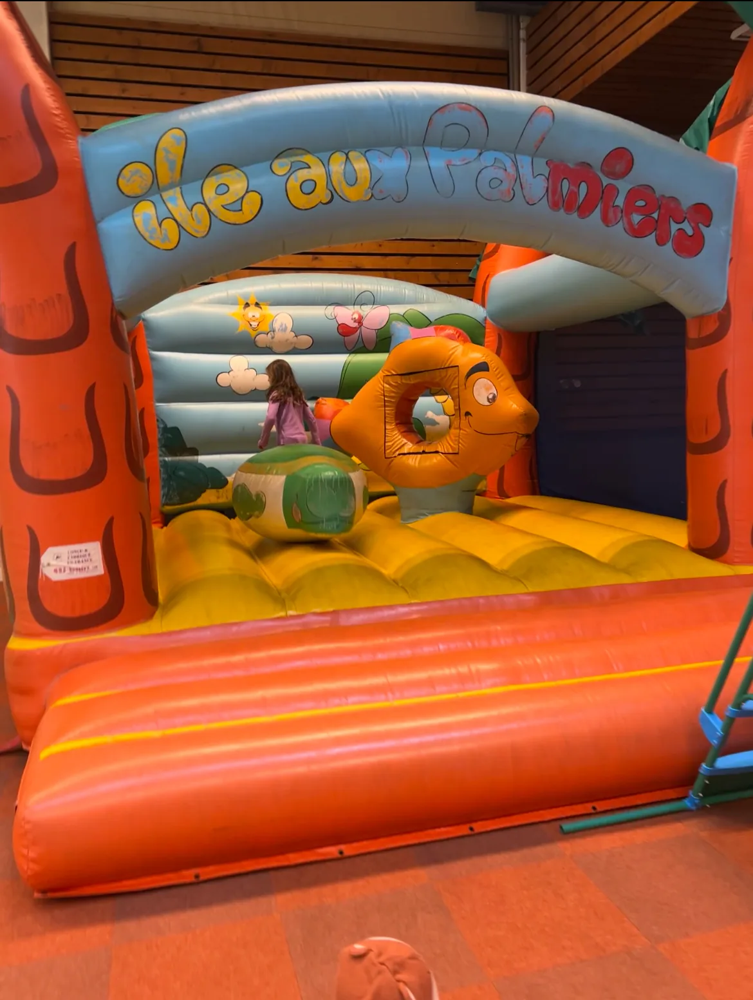
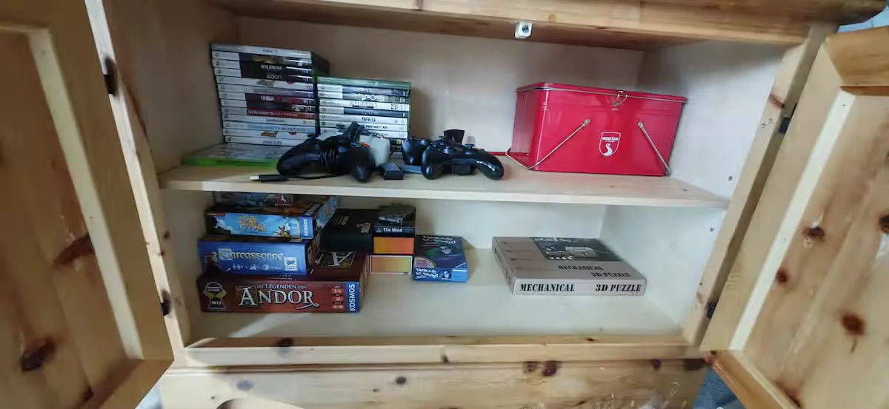
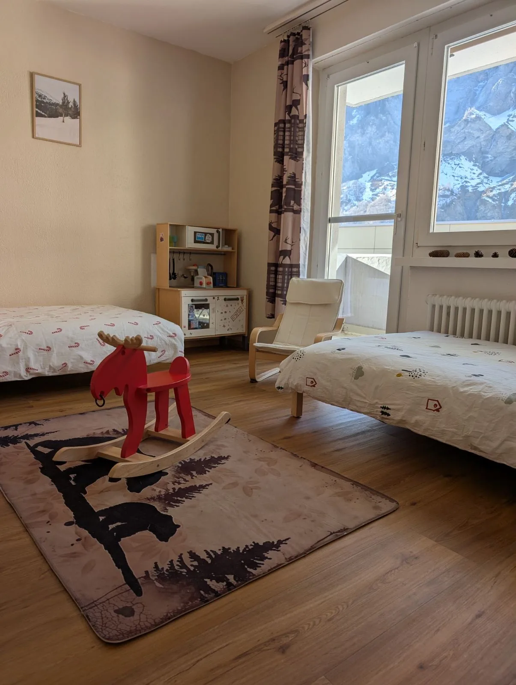

Schlechtwetter gehört zu Familienferien, und in Leukerbad bleibt der Tag trotzdem schön. Therme, Sportarena und die Wohnung liegen so nah, dass ihr zehn Minuten geht oder einfach drin bleibt.

## Warum Regen hier leicht bleibt

Viele Orte liegen beieinander. Kurze Wege, ein Plan, den ihr am Morgen neu wählt, und ein Ort, an dem die Energie sinken darf. Der Tag trägt sich von selbst.

## Wärme: die Therme

Bei Regen oder nassem Schnee ist das warme Wasser oft die einfachste Antwort. Kinder planschen, ihr sitzt, und der Tag fühlt sich noch nach Ferien an.

Das Aussenbecken liegt vor der Felswand. Warmes Wasser, Schnee oder Regen draussen, und ihr seid mitten in den Ferien. Von der Wohnung sind es etwa zehn Minuten zu Fuss.

## Die Sportarena, ohne Sonne

Die Sportarena ist auch an einem grauen Tag der richtige Ort. Auf engem Raum bleibt ihr kurz oder länger, je nach Lust.

Eine Halle, ein Eis, ein paar Läufer: an einem Regentag ist das schon ein Ausflug. Dazu kommen Ballsport, Fitness und Klettern unter Dach, je nachdem, worauf die Kinder Lust haben.

In der Region gibt es Hallen zum Toben. Auf dem Bogen dieser Hüpfburg steht «Île aux Palmiers». In der Wohnung sind es an dem Tag die Spiele, die Spielküche und das Kinderzimmer.

Zur Sportarena sind es etwa zehn Minuten zu Fuss. Der erste Ski-Kontakt auf dem Übungsgelände steht bei [Skifahren mit Kindern](/leukerbad/familie/kinderfreundliche-skigebiete/).

## Kurz raus, dann wieder rein

Oft reicht ein Gang ums Haus, frische Luft, und danach Wärme. Viele Winterwege sind kurz genug, um bei Nässe umzukehren. Die Spaziergänge beschreibt [Winter mit Kindern](/leukerbad/familie/winter-mit-kindern/).

## In der Wohnung bleiben

Manchmal ist der ruhige Tag der schönste. Dafür ist in der Wohnung etwas da, für kleine und grosse Leute.

Der Schrank ist in der Wohnung. Brettspiele, Controller und eine rote Dose. Fondue und Raclette gehen auf dem Induktionsherd, wenn ihr kochen wollt. An einem Regentag ist das der Plan.

Das Kinderzimmer ist ebenfalls die Wohnung: zwei Betten, Schaukelpferd, Spielküche, und die Felswand im Fenster, auch wenn es regnet. Wenn die Kinder dort sind, bleibt das Wohnzimmer für euch.

## Wie ein Regentag bei uns aussieht

Am Morgen seht ihr die Scheibe und wählt.

Eine Runde Therme, solange die Kinder noch freundlich sind. Warmes Wasser macht angenehm müde, lange bevor der Weg lang wird. Danach die Wohnung.

Oder die Halle, kurz: Eis, Spiel, Bewegung. Dann zurück, solange alle noch guter Dinge sind.

Oder der ganze Tag drin. Spiele, eine Spielküche, der elektrische Kamin, und am Abend Fondue. Den Käse holt ihr im Dorf. Die Bäckerei für den Morgen ist zwei Minuten, Haltestelle La Boheme.

Stubenreine Haustiere dürfen mit, auch an einem Tag, an dem niemand rauswill. Das Kinderzimmer bleibt für die Kinder. Das Tier schläft dort, wo es ruhig ist. Wenn das Schlafsofa in dieser Nacht ein Bett ist, bleibt es ein Bett. Geraucht wird auf dem Balkon.

Mit einem Baby ist Wärme und Nähe der ganze Plan. Mit Kleinkindern das Wasser und das Toben drinnen. Mit grösseren Kindern der Wechsel zwischen Halle und Ruhe. Weil alles nah ist, könnt ihr den Tag jederzeit ändern.

Von [Alpine Siesta](/wohnungen/alpine-siesta/) erreicht ihr Therme und Sportarena in etwa zehn Minuten. Ihr könnt jederzeit zurück. Die Übersicht über das Dorf steht bei [Familienferien in Leukerbad](/leukerbad/familie/), der Sommer bei [Sommer mit Kindern](/leukerbad/familie/sommer-mit-kindern/).
