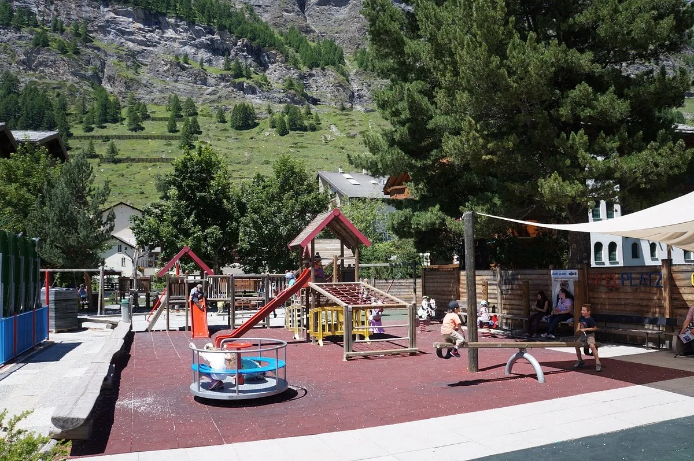
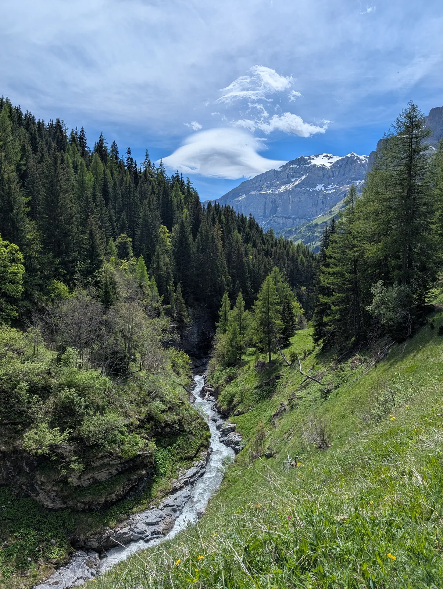
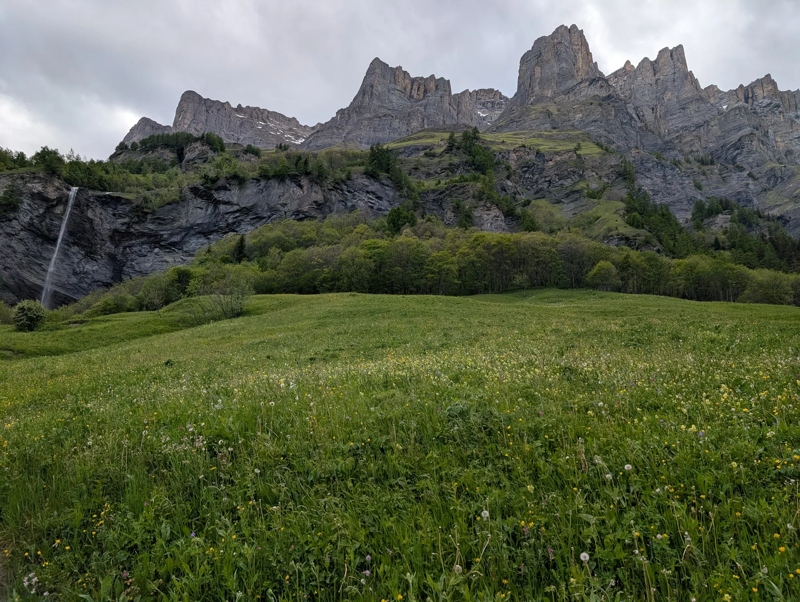
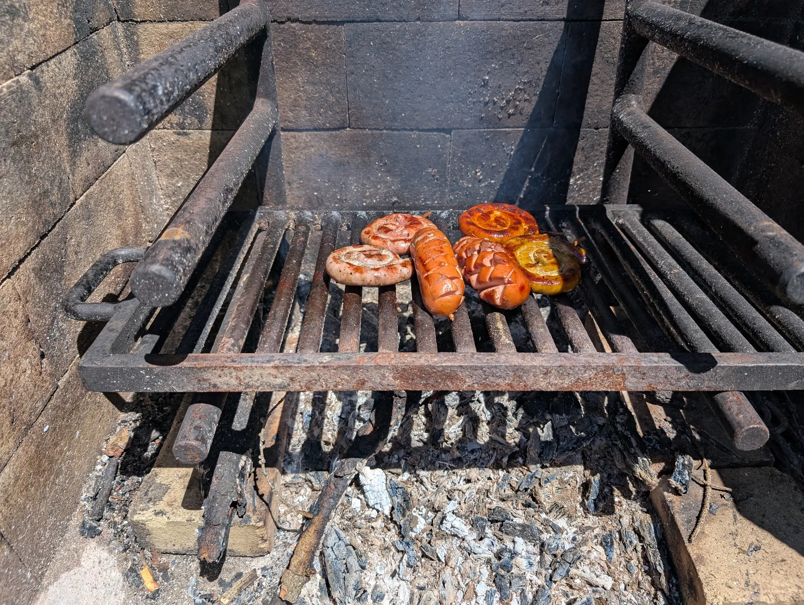
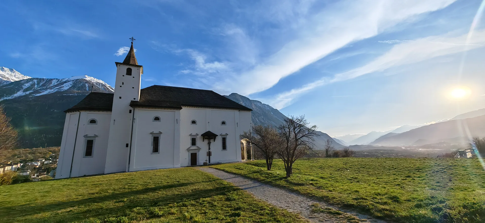

Sommer mit Kindern in Leukerbad hat Zeit. Ihr seid draussen, und mittags seid ihr schon wieder zu Hause, wenn es reicht. Das Dorf ist klein, die Felswand ist immer da, und viele Wege fangen an der Tür an.

## Ein Sommer im Tempo der Kinder

Was Familien hier schätzen, ist ein Ort, an dem ein Kind stehen bleiben darf. Spielplatz, Bach und der Weg zur Bahn liegen im selben kleinen Kreis. Die Bergbahn nimmt die Höhenmeter, wenn die Beine kurz sind. Eine Wiese braucht keinen Eintritt.

Der Spielplatz auf dem Foto hat Rutsche, Karussell und Klettergerüst, die Felswand bleibt im Rücken. Das ist ein ganzer Nachmittag. Wenn jemand müde wird, seid ihr in wenigen Minuten wieder in der Wohnung.

## Wege, die ihr abbrechen könnt

Ein guter Sommerweg mit Kindern hat Wasser, Schatten oder eine Wiese, und ein klares Ende. Ihr geht, so weit die Beine wollen.

Der Bach im Wald ist so ein Stück: laut, grün, und ihr dreht um, wenn die Beine wollen.

Der Majingsee oberhalb des Dorfs passt in einen Vormittag: hinauf, eine Pause, und wieder zurück. Der Römerweg bei Leukerbad ist ein kurzer Gang ab der Tür, ohne Auto.

Die Wiese mit dem dünnen Wasserfall ist genau das, was «draussen bleiben» heisst: Blumen, Fels, und ihr bleibt, solange es schön ist.

Draussen essen verlängert den Tag. Ein Grillrost, Würste, und ihr bleibt, solange es schön ist. Wenn ihr drin bleiben wollt, gehen Fondue und Raclette in der Wohnung. Das steht auch bei [Schlechtwetter mit Kindern](/leukerbad/familie/schlechtwetter-mit-kindern/), und es gilt an einem heissen Nachmittag genauso.

Eine weisse Kirche auf einer Wiese, Berge dahinter: ein schöner Halt unterwegs, Schatten, und dann geht es weiter oder zurück.

## Ab der Wohnung

Von [Alpine Siesta](/wohnungen/alpine-siesta/) ist die Gemmibahn fünf Minuten zu Fuss, die Bäckerei an der Haltestelle La Boheme zwei, Therme und Zentrum etwa zehn. Ihr geht morgens los, seid mittags zurück und könnt am Nachmittag noch einmal raus, ohne das Auto zu starten.

Die Wohnung selbst ist 65 Quadratmeter, im ersten Stock, mit Lift und ohne Stufen. Drei Zimmer mit je zwei Schlafplätzen, plus ein Babybett zum Ausklappen. Wenn die Kinder im Bett sind, bleibt das Wohnzimmer für euch. Das ist im Sommer derselbe Vorteil wie im Winter: der Tag darf draussen laut sein, der Abend nicht.

Mit einem Baby sind das kurze Wege und die Trage. Mit Kleinkindern der Spielplatz, Wasser und die Erlaubnis stehen zu bleiben. Mit grösseren Kindern darf der Weg länger werden. Er muss nicht bis zum Abend dauern.

## Ein Sommertag ohne Liste

Am Morgen die Bäckerei, zwei Minuten. Dann eine Sache: Spielplatz, Bach oder die Bahn. Das Mittagessen ist zu Hause.

Am Mittag zurück. Sechs Personen essen in der Wohnung, der Hochstuhl steht schon: vier schlafen nachts in den beiden Zimmern, zwei auf dem Schlafsofa, das Babybett zusätzlich. Tagsüber ist der Tisch einfach der Tisch. Fondue und Raclette sind der Abend, wenn ihr drin bleiben wollt.

Am Nachmittag dürft ihr noch einmal raus oder auf dem Balkon bleiben. Einer der beiden Balkone ist zum Sitzen, mit Blick auf die Gemmi. Der andere hat den Elektrogrill. Geraucht wird nur dort.

Mit Grosseltern gilt dasselbe wie mit dem Kinderwagen: der Lift bis zur Wohnung, ein eigenes Zimmer, und die Möglichkeit, mittags heimzugehen, während die anderen noch draussen sind.

Wenn der Himmel zuzieht, gehen Therme und Halle in denselben zehn Minuten. Das steht bei [Schlechtwetter mit Kindern](/leukerbad/familie/schlechtwetter-mit-kindern/).

Der Winter ist die andere Jahreszeit: [Winter mit Kindern](/leukerbad/familie/winter-mit-kindern/). Die Übersicht steht bei [Familienferien in Leukerbad](/leukerbad/familie/).
