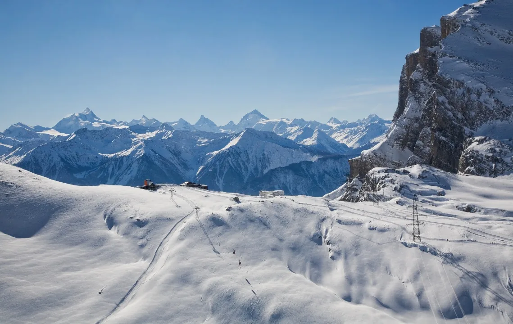

Winter mit Kindern in Leukerbad ist leicht, weil das Dorf am Ende des Tals liegt und die Wege kurz sind. Ein Tag im Schnee endet, sobald ihr wollt, und ihr seid zu Fuss wieder in der Wohnung. Bei uns sieht so ein Winter aus: Piste, Spaziergang, Sportarena, und Tage, an denen ihr einfach wieder reingeht.

## Drei Arten von Wintertagen

Im Wallis ist der Winter die Piste und alles daneben. Sobald jemand müde wird, ist der Rest des Tages noch lang, und das Dorf ist nah. Bei uns gibt es drei Sorten Tage, und alle drei sind Winter:

- ein paar Abfahrten, dann Schluss
- ein Spaziergang im Schnee, auch nur eine halbe Stunde
- Wärme: Therme oder die Halle, wenn draussen nichts mehr geht

Eine weite Piste, eine Gipfelkette, und danach seid ihr zu Fuss oder mit einem kurzen Bus wieder in der Wohnung. In Leukerbad zählt genau das: der Rückweg ist kurz.

Wie ein Skitag mit Kindern konkret aussieht, und wann die Sportarena besser ist als der Torrent, steht auf der Seite [Skifahren mit Kindern](/leukerbad/familie/kinderfreundliche-skigebiete/).

## Winterspaziergänge für die ganze Familie

Auch abseits der Skipisten gibt es rund um Leukerbad viel zu entdecken. Ob auf dem Römerweg, Richtung Weidstübli, am Daubensee oder auf dem Lomperaweg – die Region bietet schöne Möglichkeiten für gemeinsame Winterspaziergänge.

Ein besonderes Highlight für Familien ist der Lomperaweg: Nach einem gemütlichen Spaziergang könnt ihr den Rückweg bei passenden Schnee- und Wegverhältnissen mit dem Schlitten zurücklegen – ein Riesenspass für Gross und Klein!

Dabei muss es nicht immer eine grosse Wanderung sein. Oft reicht schon ein kurzer Ausflug, um die verschneite Landschaft zu geniessen, frische Bergluft zu schnuppern und gemeinsam kleine Abenteuer zu erleben.

## Sportarena

Die Sportarena Leukerbad bietet Kindern einen idealen Einstieg ins Skifahren. In einer ruhigen und übersichtlichen Umgebung können die Kleinen spielerisch ihre ersten Erfahrungen auf Skiern sammeln – ganz ohne Zeitdruck und in ihrem eigenen Tempo.

Auch wenn das Wetter draussen einmal nicht mitspielt, muss der Spass nicht zu kurz kommen. Ob Schlittschuhlaufen oder andere Aktivitäten im Trockenen – auf unserer Seite [Schlechtwetter mit Kindern](/leukerbad/familie/schlechtwetter-mit-kindern/) findet ihr tolle Ideen für einen abwechslungsreichen Familientag.

## Skifahren auf Torrent – Pistenspass für die ganze Familie

Wer Lust auf einen abwechslungsreichen Skitag hat, ist auf Torrent genau richtig. Das Skigebiet oberhalb von Leukerbad begeistert mit langen Abfahrten, herrlichem Bergpanorama und jeder Menge Möglichkeiten für Gross und Klein.

Ob gemütlich auf breiten Pisten unterwegs oder auf der Suche nach einer sportlichen Herausforderung – hier findet jeder die passende Abfahrt. Während erfahrene Skifahrer die anspruchsvollen schwarzen Pisten entdecken, können sich Abenteuerlustige im Funpark austoben.

Auch die Kleinsten kommen nicht zu kurz: Ein eigener Kinderbereich mit Zauberteppich bietet ideale Bedingungen für die ersten Versuche auf Skiern.

Und wer einmal etwas anderes ausprobieren möchte, kann die verschneite Bergwelt auf dem Velogemel erkunden – eine besondere Abwechslung zum klassischen Skifahren.

So wird ein Tag auf Torrent zu einem gemeinsamen Wintererlebnis, bei dem jedes Familienmitglied auf seine Kosten kommt.

## Gemmi im Winter – Natur, Schlittelspass und traumhafte Aussichten

Ein Ausflug auf die Gemmi gehört zu den besonderen Wintererlebnissen in Leukerbad. Schon die Fahrt mit der Bergbahn ist ein kleines Abenteuer und oben angekommen erwartet euch eine beeindruckende Bergwelt.

Wer es gemütlich mag, geniesst einen Winterspaziergang rund um den Daubensee und lässt dabei die verschneite Landschaft auf sich wirken. Hier könnt ihr gemeinsam die frische Bergluft geniessen und den Alltag hinter euch lassen.

Für etwas mehr Action sorgen die Schlittelabfahrten, bei denen Gross und Klein jede Menge Spass haben können.

Und zwischendurch lohnt es sich, einfach stehen zu bleiben und die fantastische Aussicht auf die umliegenden Berge zu geniessen. Ein Wintertag auf der Gemmi kann so entspannt oder abenteuerlich sein, wie ihr möchtet.

## Entspannung im Thermalbad – der perfekte Abschluss eines Wintertages

Nach einem erlebnisreichen Tag im Schnee gibt es kaum etwas Schöneres, als ins wohlig warme Thermalwasser einzutauchen. Während sich die Erwachsenen entspannen und ihre müden Muskeln nach dem Skifahren oder Schlitteln erholen, können sich die Kinder in den verschiedenen Kinderbereichen nach Herzenslust austoben und planschen.

Ob gemeinsam im warmen Aussenbecken die winterliche Bergkulisse geniessen oder einfach im Wasser entspannen – ein Besuch im Thermalbad ist der perfekte Ausklang für einen gelungenen Familientag in Leukerbad.

## Ab der Wohnung, ohne Auto

| Ziel | Weg |
|---|---|
| Gemmibahn | 5 Minuten zu Fuss |
| Sportarena und Zentrum | 10 Minuten zu Fuss |
| Leukerbad Therme | 10 Minuten zu Fuss |
| Torrentbahn | 7 Minuten mit dem Bus |

Der Sommer ist die andere Hälfte: [Sommer mit Kindern](/leukerbad/familie/sommer-mit-kindern/). Die Übersicht über das ganze Dorf steht bei [Familienferien in Leukerbad](/leukerbad/familie/). Wie ein Skitag konkret aussieht, steht auf [Skifahren mit Kindern](/leukerbad/familie/kinderfreundliche-skigebiete/).
