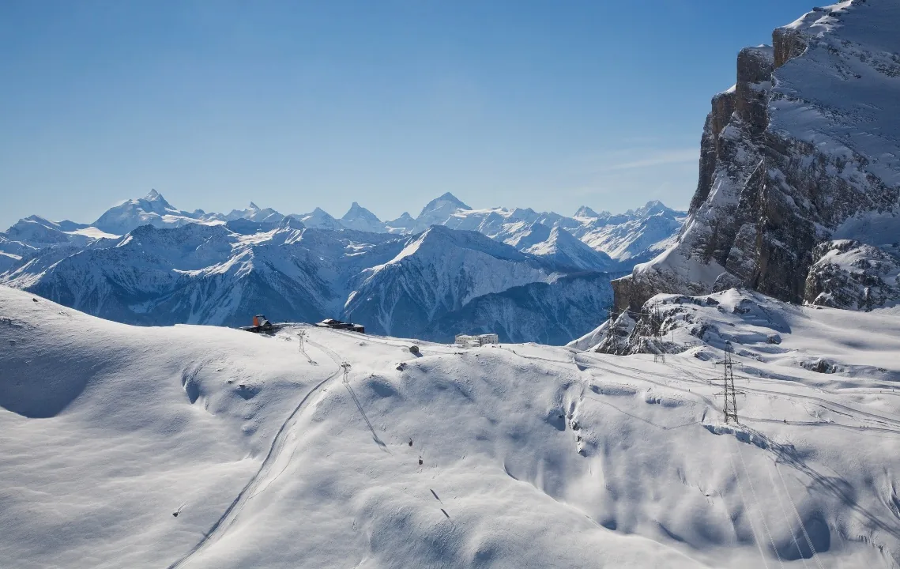
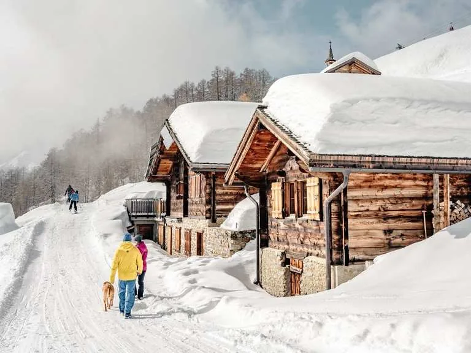
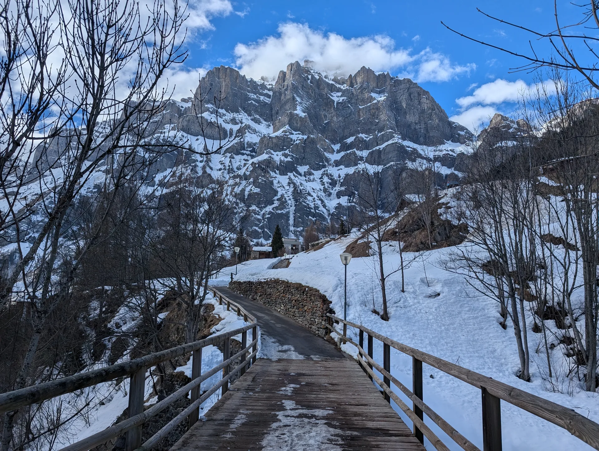
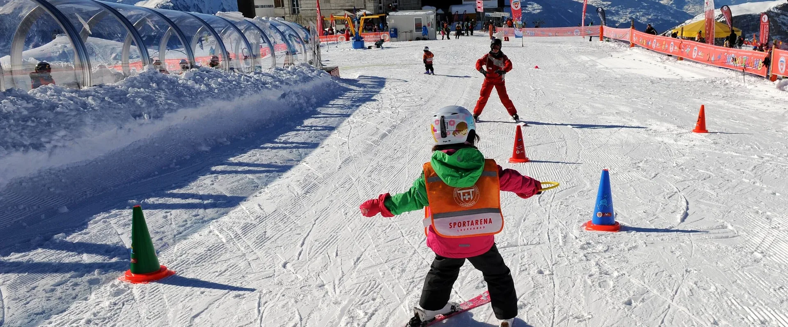

Winter mit Kindern in Leukerbad ist leicht, weil das Dorf am Ende des Tals liegt und die Wege kurz sind. Ein Tag im Schnee endet, sobald ihr wollt, und ihr seid zu Fuss wieder in der Wohnung. Bei uns sieht so ein Winter aus: Piste, Spaziergang, Sportarena, und Tage, an denen ihr einfach wieder reingeht.

## Drei Arten von Wintertagen

Im Wallis ist der Winter die Piste und alles daneben. Sobald jemand müde wird, ist der Rest des Tages noch lang, und das Dorf ist nah. Bei uns gibt es drei Sorten Tage, und alle drei sind Winter:

- ein paar Abfahrten, dann Schluss
- ein Spaziergang im Schnee, auch nur eine halbe Stunde
- Wärme: Therme oder die Halle, wenn draussen nichts mehr geht

Eine weite Piste, eine Gipfelkette, und danach seid ihr zu Fuss oder mit einem kurzen Bus wieder in der Wohnung. In Leukerbad zählt genau das: der Rückweg ist kurz.

Wie ein Skitag mit Kindern konkret aussieht, und wann die Sportarena besser ist als der Torrent, steht auf der Seite [Skifahren mit Kindern](/leukerbad/familie/kinderfreundliche-skigebiete/).

## Spazieren, ein Stück und wieder zurück

Ein Winterspaziergang darf einfach Schnee sein. Gerade Wege, Schnee zum Anfassen, und ihr kehrt um, wenn es reicht. Mit Kinderwagen, solange der Weg fest ist. Am Morgen seht ihr, wie der Schnee liegt, und wählt das Stück, das heute passt.

Römerweg, der Weg zum Weidstübli, der Daubensee und der Lomperaweg sind Spaziergänge in der Region. Ihr geht ein Stück und kehrt um, wenn es reicht.

Die Holzbrücke im Schnee ist so ein Stück Weg: kurz, klar, und die Felswand ist das Ziel, nicht ein Gipfelkreuz. Wenn der Wind dreht oder jemand nasse Handschuhe hat, ist das schon der ganze Ausflug.

## Die Sportarena, wenn der Tag klein bleiben soll

Die Sportarena Leukerbad ist der Ort für den ersten Kontakt mit Ski, ruhig und übersichtlich. Auf dem Foto trägt das Kind eine Weste mit der Aufschrift Sportarena und steht zwischen Pylonen. Das ist ein Übungsfeld, in dem der Tag kurz bleiben darf.

Von [Alpine Siesta](/wohnungen/alpine-siesta/) sind es etwa zehn Minuten zu Fuss dorthin. Eis und Bewegung unter Dach beschreibt die Seite [Schlechtwetter mit Kindern](/leukerbad/familie/schlechtwetter-mit-kindern/).

## Ab der Wohnung, ohne Auto

| Ziel | Weg |
|---|---|
| Gemmibahn | 5 Minuten zu Fuss |
| Sportarena und Zentrum | 10 Minuten zu Fuss |
| Leukerbad Therme | 10 Minuten zu Fuss |
| Torrentbahn | 7 Minuten mit dem Bus |

Check-in ist ab 15:00. Der erste Skitag ist der Morgen danach. Am Abreisetag ist um 11:00 Schluss, der Morgen gehört dem Koffer. Ein Aussenparkplatz gehört zur Wohnung. Für Sportarena, Therme und Gemmi lasst ihr ihn stehen.

Mit einem Baby ist der Winter ein kurzer Gang und eine warme Pause. Mit Kleinkindern Schlitten und Schnee. Mit grösseren Kindern darf der Tag länger werden, eine Piste reicht. Drei Zimmer heissen: abends ist das Wohnzimmer wieder ruhig, auch wenn der Tag draussen laut war.

## So läuft ein Wintertag

Am Morgen entscheidet ihr vor der Tür. Die Bäckerei ist zwei Minuten entfernt. Danach die Sportarena, ein Stück Schnee, oder ein ruhiger Vormittag.

Wenn ihr Ski wollt, bleibt es bei einem Block. Danach Essen. In der Wohnung steht der Hochstuhl schon, und niemand sucht einen Tisch.

Am Nachmittag eine Sache. Die Therme ist der schöne Abschluss, zehn Minuten zu Fuss.

Am Abend sind die Kinder im Kinderzimmer, zwei Einzelbetten, und das Wohnzimmer gehört wieder euch. Das Schlafsofa ist ein Bett für zwei. Solange das Doppelzimmer frei ist, schlaft ihr dort. Mit einem Baby klappt ihr das Babybett aus. Der Lift bringt euch ohne Stufen ins erste Obergeschoss, auch mit nassen Jacken. Die Jacken gehören auf den Balkon.

Die Felswand ist vom Dorf aus da. Der Tag sieht auch dann nach Leukerbad aus, wenn ihr unten bleibt.

Der Sommer ist die andere Hälfte: [Sommer mit Kindern](/leukerbad/familie/sommer-mit-kindern/). Die Übersicht über das ganze Dorf steht bei [Familienferien in Leukerbad](/leukerbad/familie/).
