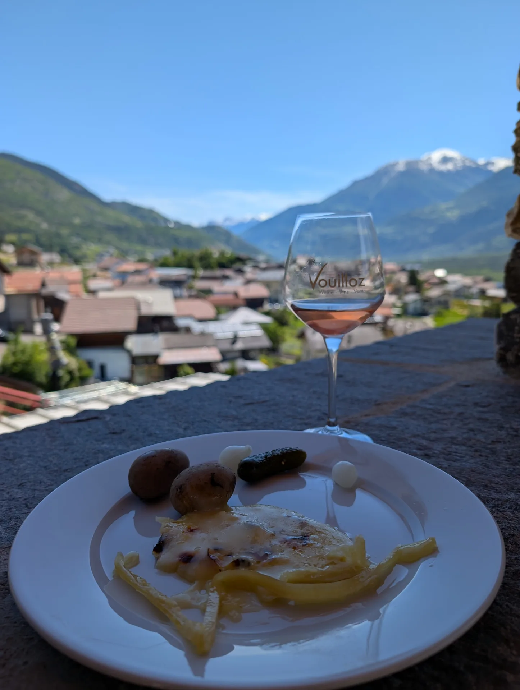
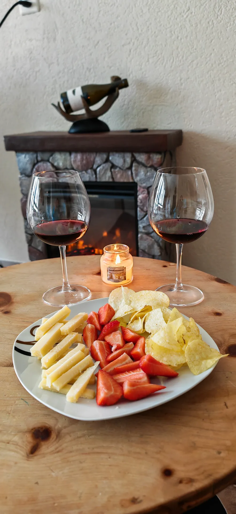

---
# Keine Fahrzeiten nach Varen oder Lavaux. Die Quelle nennt keine geprüfte Dauer ab Leukerbad.
title: "Wein im Wallis, abends in der Wohnung"
description: "Walliser Wein ab Leukerbad: Reben am Tag, und am Abend ein Glas am Tisch, wenn die Kinder im Zimmer sind."
h1: "Wein im Wallis, und der Abend gehört dem Tisch"
lead: "Tagsüber Reben, ein Dorf oder die Therme. Abends ein Glas aus dem Wallis, wenn die Kinder in ihrem Zimmer sind."
bild: ./lavaux-rebterrassen-dorf-see.webp
bild_alt: "Grüne Rebterrassen, ein Dorf und ein See, dahinter Berge"
aktualisiert: 2026-10-27
faq:
  - frage: Passt Wein zu Ferien mit Kindern?
    antwort: Ja. Am Tag seid ihr draussen, am Abend steht das Glas auf eurem Tisch. Die Kinder schlafen im eigenen Zimmer.
  - frage: Wo trinken wir den Wein?
    antwort: In der Wohnung. Fondue, Raclette oder ein einfaches Essen, dazu eine Flasche aus dem Wallis. Der Hochstuhl steht schon am Tisch.
  - frage: Welche Sorten sind typisch?
    antwort: Fendant zum Essen, Petite Arvine als frischer Weisswein, Heida zum Käse. Bei Rot Cornalin, Humagne Rouge oder ein Walliser Pinot.
  - frage: Liegt Lavaux in Leukerbad?
    antwort: Nein. Lavaux liegt am See, das ist ein Ausflug für einen Tag. Abends seid ihr wieder in der Wohnung.
entwurf: false
---

Im Wallis wächst der Wein an steilen Hängen, und am Abend steht das Glas bei euch auf dem Tisch. Die Kinder haben dann ihr Zimmer. Ihr müsst nicht ausgehen, damit der Tag nach Ferien schmeckt.

Das Wallis ist das grosse Weinbaugebiet der Schweiz. Entlang der Rhone liegen die Reben, oft auf Terrassen, oft in kleinen Betrieben. Mehr als 50 Sorten wachsen hier, viele davon fast nur in diesem Tal. Das Klima ist trocken und sonnig, die Lagen ziehen sich von etwa 500 bis 1100 Meter.

## Ein Tag in den Reben

Im Herbst stehen die Leute in den Zeilen, rote Kisten im Gang, die Blätter schon gelb. Das ist die Weinlese, wie sie aussieht: Handarbeit am Hang, nicht eine Bühne. An anderen Tagen reicht ein Spaziergang zwischen den Reben, kurz genug, dass ihr umkehrt, wenn die Kinder nicht mehr wollen.

Lavaux ist der Ausflug ans andere Ufer der Ferien: Terrassen, ein Weg, ein See, Berge dahinter. Die Rebterrassen dort gehören zum UNESCO-Welterbe. Ihr macht daraus einen Tag und seid abends wieder in Leukerbad. Mehr dazu auf [Lavaux](/leukerbad/wein/lavaux/). Das ruhige Weindorf heisst [Varen](/leukerbad/wein/varen/). Den Überblick über die Lagen im Wallis gibt [Weinregionen](/leukerbad/wein/wallis/).

## Das Glas am Abend

Raclette, Kartoffeln, eine Gurke, und ein Glas Rosé. Auf dem Glas steht Vouilloz, Vin du Valais. Dahinter das Dorf und die Berge. So endet ein Tag, wenn ihr draussen bleiben wollt und die Kinder noch wach sind.

Drinnen ist es der Kamin, zwei Gläser Rotwein, Käse auf dem Teller. Die Flasche steht auf dem Sims. Niemand muss einen Tisch im Dorf suchen. Welche Sorten zu Käse, Fleisch oder einfach zum Abend passen, steht bei [Rebsorten im Wallis](/leukerbad/wein/rebsorten/).

Am Tisch in [Alpine Siesta](/wohnungen/alpine-siesta/) sind vier Gedecke und der Hochstuhl. Fondue und Raclette gehen auf dem Herd. Das Kinderzimmer hat zwei Betten und ein Schaukelpferd. Wenn die Tür zu ist, gehört der Abend euch.

Check-in ist ab 15:00, Check-out bis 11:00. Die Therme ist zehn Minuten zu Fuss, die Gemmibahn fünf. Den Wein holt ihr im Tal, den Abend verbringt ihr hier. Die anderen Tage im Dorf stehen bei den [Familienferien](/leukerbad/familie/).
