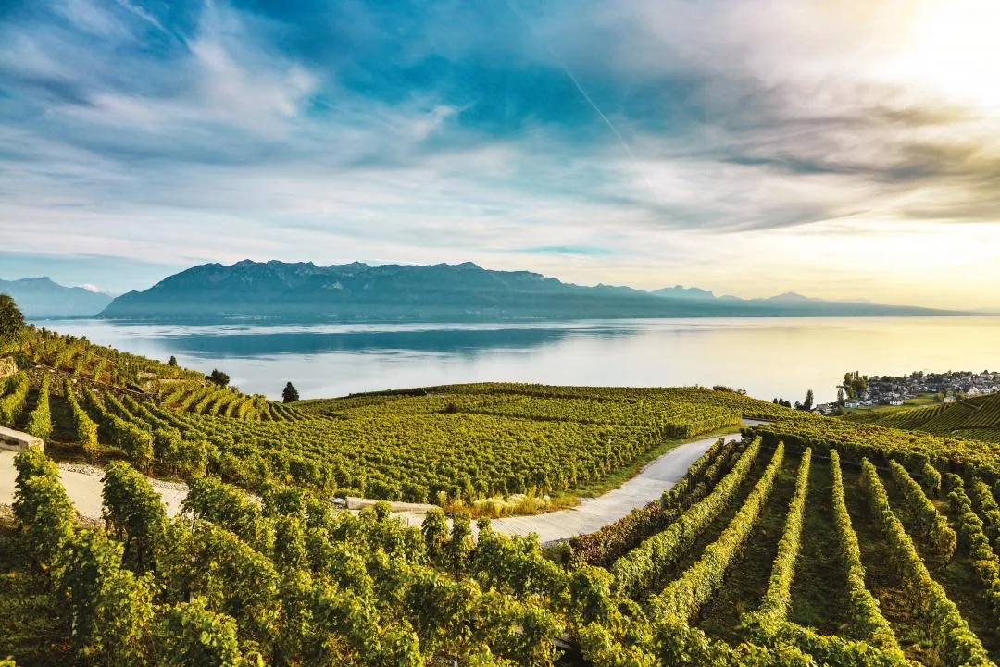
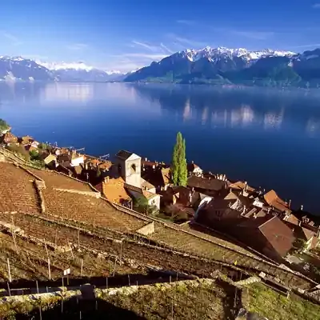
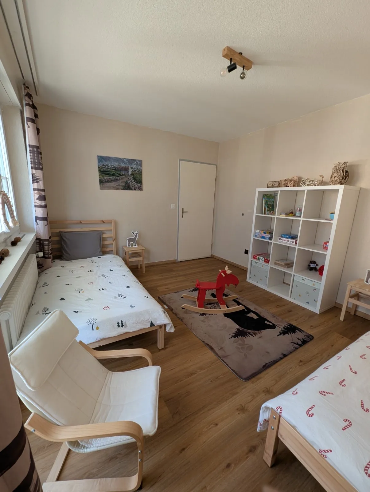

Lavaux ist der Tag, an dem Reben, Wasser und Berge in einem Blick liegen. Die Terrassen ziehen sich über dem See. Abends seid ihr wieder in Leukerbad, und das Glas steht auf eurem Tisch.

## Terrassen, die zum Ort gehören

Die Rebterrassen von Lavaux gehören zum UNESCO-Welterbe. Wein wächst hier seit dem Mittelalter, auf Mauern, die den Hang halten. Es ist kein Fest, es ist die Landschaft.

Ein Weg schwingt sich durch die Zeilen, der See liegt dahinter, rechts ein Ort am Ufer. Ihr geht so weit, wie die kürzesten Beine wollen. Picknickplätze und Dörfer mit kleinen Kellern liegen am Weg. Eine Etappe reicht.

Im kälteren Licht sind die Reben braun, die Dächer rot, der See dunkelblau, die Berge noch weiss. Derselbe Ort, eine andere Jahreszeit. Der Turm im Dorf bleibt der Halt, an dem ihr euch orientiert.

## Chasselas, und der Abend zu Hause

Lavaux ist bekannt für frische Weissweine, vor allem Chasselas: leicht, mineralisch, gut zum Essen. Im Wallis heisst die Sorte oft Fendant. Ihr müsst sie nicht vor Ort leeren. Eine Flasche kommt mit nach Leukerbad und wird aufgemacht, wenn die Kinder spielen oder schlafen.

In [Alpine Siesta](/wohnungen/alpine-siesta/) wartet das Kinderzimmer: zwei Betten, Schaukelpferd, Regal. Die Therme ist zehn Minuten zu Fuss, falls der Tag am See lang war. Wie die Sorten im Wallis heissen, steht bei [Rebsorten](/leukerbad/wein/rebsorten/). Das ruhige Dorf über der Rhone ist [Varen](/leukerbad/wein/varen/). Die Übersicht ist [Wein im Wallis](/leukerbad/wein/).
