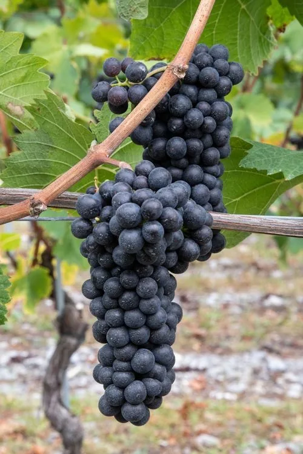
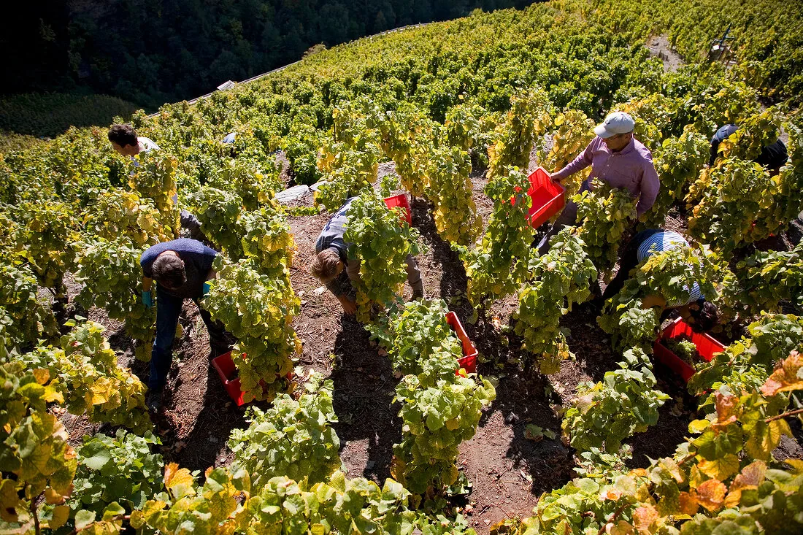
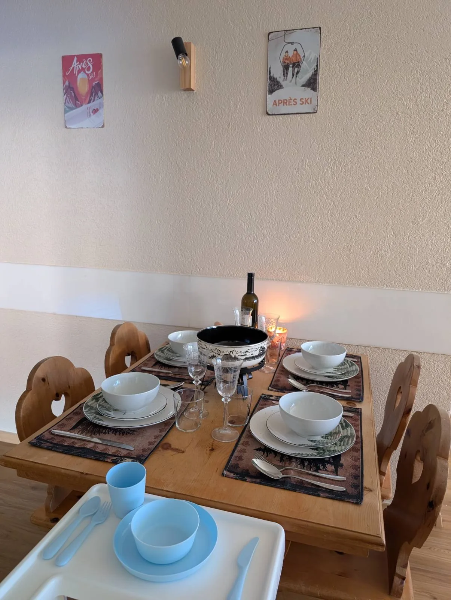

Im Wallis wachsen auf engem Raum mehr als 50 Rebsorten, viele davon fast nur hier. Sie schmecken nach Sonne, nach steilen Terrassen und nach dem Ort. Ihr braucht dafür kein Vokabular. Hell heisst frisch, dunkel heisst würzig, und die Flasche geht abends auf, wenn die Kinder schlafen.

Die Reben stehen etwa zwischen 500 und 1100 Metern, an trockenen Hängen, oft in der Hand kleiner Betriebe. Deshalb schmeckt derselbe Name von Lage zu Lage anders.

## Rot, würzig, zum Fleisch

Cornalin ist dunkel und würzig, mit Beeren und Gewürz, und passt zu Fleisch, Grill und einem Schmorgericht. Humagne Rouge ist erdiger und bleibt nah an der Region. Pinot Noir wird im Wallis durch Sonne und Höhe kräftiger und ist der Wein, mit dem viele anfangen.

## Weiss, leicht, zum Käse

Petite Arvine ist frisch, lebendig, im Abgang leicht salzig, mit Zitrus. Sie passt zum Apéro, zu Fisch und zu einem leichten Teller. Heida, auch Savagnin Blanc, wächst höher, hat mehr Körper, nussig und mineralisch, und steht gut neben Raclette und Käse. Fendant ist der Chasselas des Wallis: leicht, und er verträgt fast jedes Essen am Abend.

Im Herbst sieht man, wo das herkommt. Rote Kisten, gelbe Blätter, Leute in den Zeilen. Danach liegt der Wein in der Flasche, und ihr entscheidet, an welchem Abend sie aufgeht.

## Am Tisch in Leukerbad

In [Alpine Siesta](/wohnungen/alpine-siesta/) ist der Tisch gedeckt, der Hochstuhl steht davor, die Flasche in der Mitte. Fondue und Raclette sind für Heida und Fendant da, ein Schmorgericht für den Cornalin. Das Kinderzimmer ist nebenan.

Wo ihr die Flasche herholt, ein ruhiges Dorf oder ein Tag am See, steht bei [Varen](/leukerbad/wein/varen/) und [Lavaux](/leukerbad/wein/lavaux/). Die Lagen im Tal beschreibt [Weinregionen im Wallis](/leukerbad/wein/wallis/). Die Übersicht ist [Wein im Wallis](/leukerbad/wein/).
