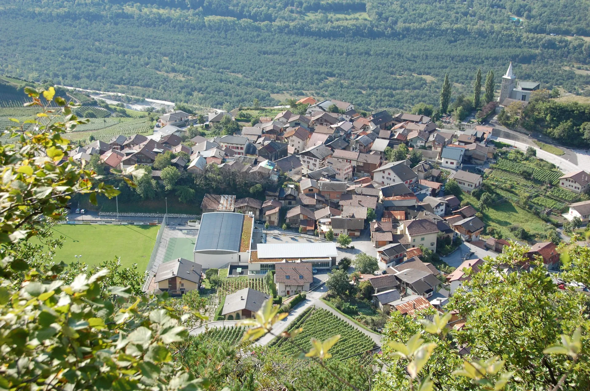
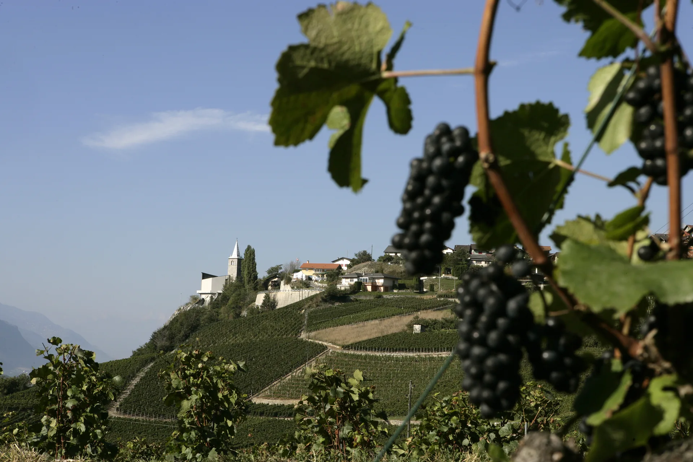
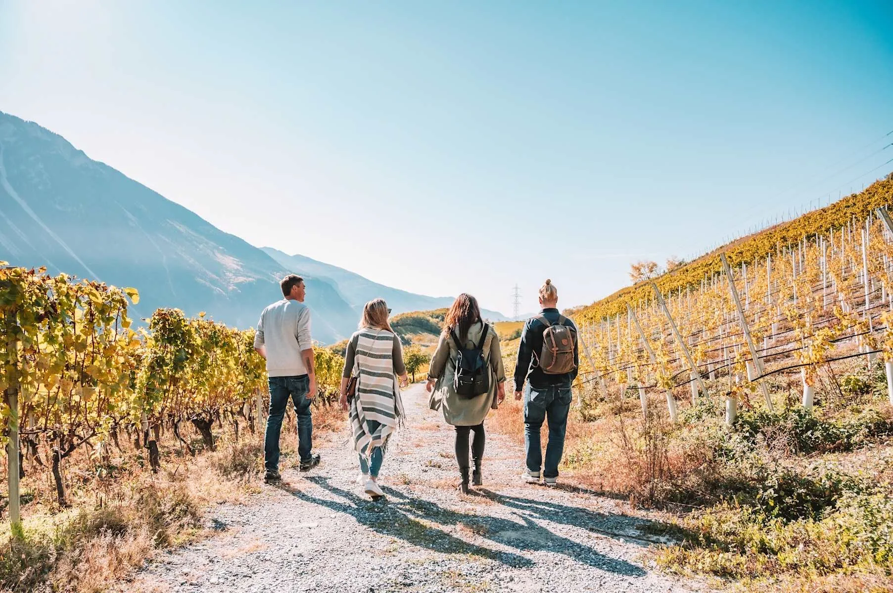

Varen liegt über dem Rhonetal. Die Reben stehen in kleinen Parzellen, das Dorf ist überschaubar, und niemand muss eine Menschenmenge durchqueren, um eine Flasche mitzunehmen. Abends seid ihr in Leukerbad, und der Wein aus Varen steht auf dem Tisch.

## Hänge, die nach Herbst schmecken

Die Südhänge sind sonnig, das Klima trocken, die Betriebe klein. Bei einer Degustation erzählt jemand vom Wein, statt eine Rede zu halten. Ihr bleibt so lange, wie es für die Kinder noch leicht ist.

Von oben seht ihr die Dächer, den hellen Kirchturm, Reben dazwischen und ein grünes Spielfeld. Das Dorf ist klein genug, dass ein Spaziergang durch die Gassen der ganze Vormittag sein kann.

Im Rebberg hängen die dunklen Trauben direkt vor dem Turm. Ihr geht ein Stück den Hang hinauf und seid schnell wieder bei den Häusern. Die Weine von hier sind klare Weissweine und kräftige Rotweine, oft in kleinen Mengen.

## Zu Fuss, und dann der Abend

Ein Kiesweg zwischen gelben Reben, der Berg auf der einen Seite. Vier Personen, genug Abstand, kein Programm. Mit Kindern bleibt derselbe Weg kürzer: bis zur nächsten Biegung, dann zurück ins Dorf.

Wenig Verkehr, viel Ruhe. Der Wein wird oft erst später aufgemacht, bewusst, am eigenen Tisch.

In [Alpine Siesta](/wohnungen/alpine-siesta/) ist der Kamin an, der Käse auf dem Teller, die Kinder nebenan. Check-in ab 15:00, die Therme zehn Minuten zu Fuss. Die Terrassen am See beschreibt [Lavaux](/leukerbad/wein/lavaux/), die Sorten [Rebsorten im Wallis](/leukerbad/wein/rebsorten/). Zurück zur Übersicht: [Wein im Wallis](/leukerbad/wein/).
