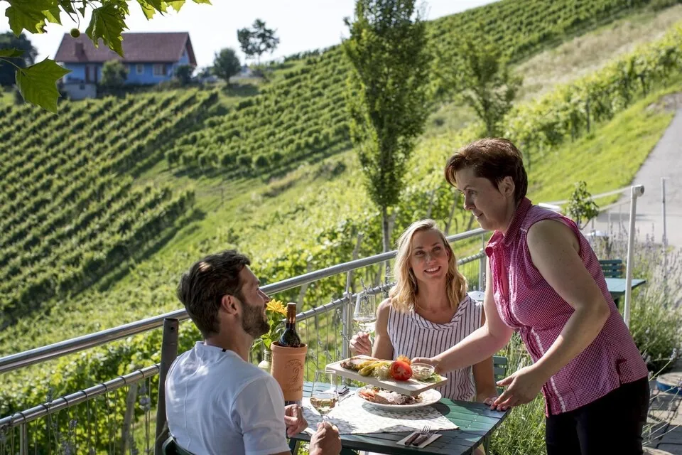
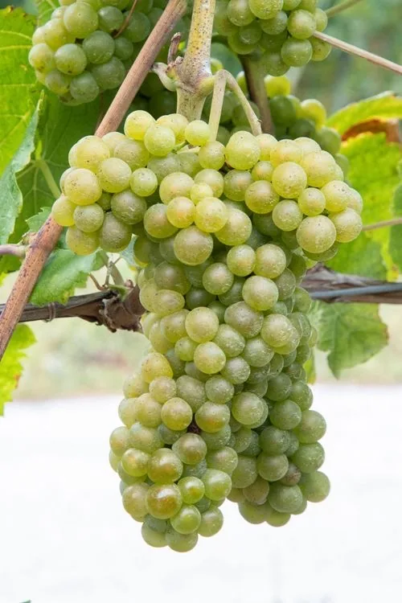

Das Wallis ist das Herz des Schweizer Weinbaus. Die Reben ziehen sich durchs Rhonetal, oft als Terrassen, oft in der Hand von kleinen Betrieben. Jede Lage schmeckt nach Sonne, Boden und dem Ort. Von Leukerbad aus ist das ein Tag im Tal, und der Abend bleibt in der Wohnung.

## Was die Lagen gemeinsam haben

Trocken und sonnig, grosse Höhenunterschiede, steile Terrassen und Trockensteinmauern. Viele Sorten wachsen fast nur hier. Der Wein gehört zum Alltag im Tal, nicht zu einem festlichen Programm.

Ein Weg durch die Zeilen zeigt, wie nah Rebe und Aussicht beieinander liegen. Ihr geht ein Stück und kehrt um. Lavaux, am See, ist so ein Tag für sich und steht auf einer [eigenen Seite](/leukerbad/wein/lavaux/). Varen, das ruhige Dorf über dem Tal, auch: [Varen](/leukerbad/wein/varen/).

Manchmal steht der Tisch schon in den Reben: Gläser, eine Flasche, ein Teller, der Hang dahinter. Das ist ein Halt auf einem Ausflug. Mit Kindern wird derselbe Wein oft erst am Abend aufgemacht, wenn alle wieder in Leukerbad sind.

## Sorten, die zum Tal gehören

Helle Trauben, dunkelgrüne Blätter: daraus werden die Weissweine, die am Abend leicht bleiben. Fendant, Petite Arvine, Heida. Die Roten heissen Cornalin, Humagne Rouge, Pinot Noir. Was zu Käse und was zu Fleisch passt, steht bei [Rebsorten im Wallis](/leukerbad/wein/rebsorten/).

In [Alpine Siesta](/wohnungen/alpine-siesta/) stehen die Gläser vor dem Kamin, der Käse auf dem Teller, die Kinder im Zimmer nebenan. Check-in ist ab 15:00. Die Therme ist zehn Minuten zu Fuss, wenn der Tag in den Reben lang war. Die Übersicht ist [Wein im Wallis](/leukerbad/wein/).
