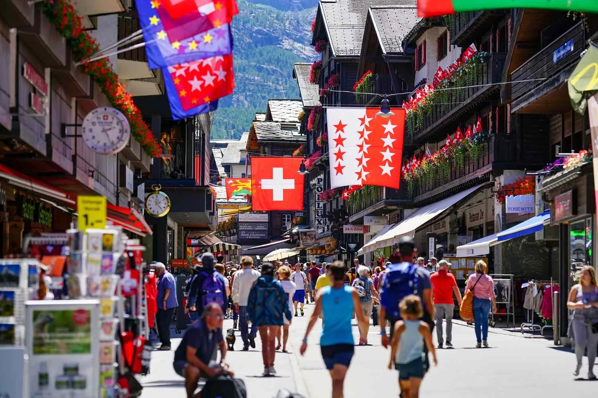
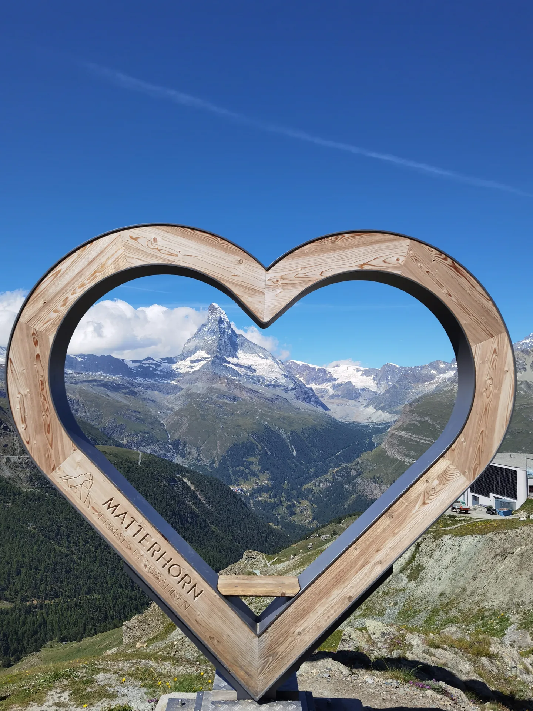
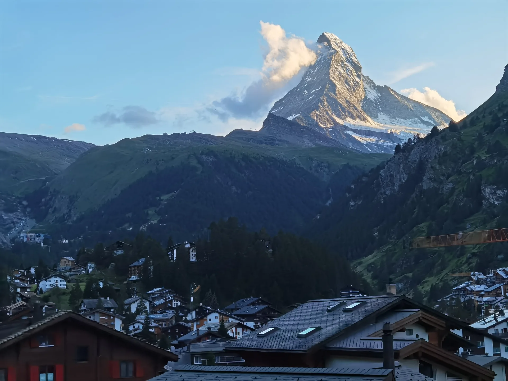
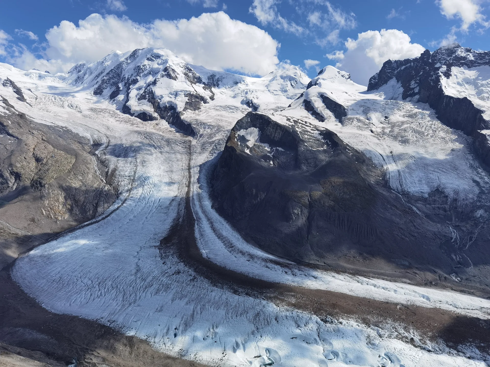

---
# Fahrzeit Leukerbad–Zermatt steht in der Quelle nicht. Keine Zahl erfunden.
title: "Zermatt als Tag von Leukerbad aus"
description: "Zermatt mit Kindern ab Leukerbad: Matterhorn und autofreies Dorf an einem Tag, und am Abend wieder in der Wohnung."
h1: "Zermatt erleben, und am Abend wieder in Leukerbad"
lead: "Das Matterhorn, die Bahn und das Dorf ohne Autos. Ihr geht früh los, bleibt bei einer Sache, und am Abend seid ihr wieder in der Wohnung."
bild: ./zermatt-orange-bahn-matterhorn.webp
bild_alt: "Orange Bahn auf einem Hang, dahinter das Matterhorn und Leitungen"
aktualisiert: 2026-10-27
faq:
  - frage: Müssen wir in Zermatt übernachten?
    antwort: Der schöne Tag ist der Ausflug. Am Abend seid ihr wieder in Leukerbad, in der Wohnung, mit einem eigenen Zimmer für die Kinder.
  - frage: Was machen Kinder an so einem Tag?
    antwort: Die Bahn, das Matterhorn, ein Spaziergang durchs Dorf oder der Spielplatz. Eine Sache reicht, und sie bleibt hängen.
  - frage: Wann ist das Dorf am angenehmsten?
    antwort: Unter der Woche, und in den ruhigeren Wochen im späten Frühling und frühen Herbst. Dann hat die Strasse Luft für eine Pause.
  - frage: Passt der Ausflug an den Anreisetag?
    antwort: "Check-in ist ab 15:00. Der Zermatt-Tag ist einer der Tage danach. Am Abreisetag ist um 11:00 Schluss."
entwurf: false
---

Zermatt ist das Matterhorn, ein Dorf ohne Autos, und eine Bahnfahrt, die für Kinder schon der Ausflug ist. Von Leukerbad aus macht ihr daraus einen Tag. Ihr fahrt früh, bleibt bei einer Sache, und am Abend seid ihr wieder in der Wohnung. Die Kinder haben ihr Zimmer, ihr habt den Tisch.

## Das Matterhorn, nah genug zum Staunen

Die Bahn nimmt den Hang. Das Matterhorn steht dahinter, Leitungen ziehen über die Wiese, und die Lärchen werden gelb. Für Kinder ist das die Anreise: Berge, das Rattern, und am Ende ein Ort, an dem man zu Fuss weitergeht.

Im Dorf hängen die Schweizer Fahne und die Valais-Fahne über der Strasse. Holzhäuser, Blumenkästen, Menschen zu Fuss. Ihr geht ein Stück, schaut, wo die Kinder stehen bleiben wollen, und setzt euch, bevor der Tag voll wird. Unter der Woche hat diese Strasse mehr Luft. Im späten Frühling und im frühen Herbst auch.

Oben rahmt ein Herz aus Holz den Berg ein. Auf dem Rahmen steht Matterhorn. Das ist der Blick, für den ihr hinauffahrt: der Gipfel, das Tal, und ihr entscheidet, wann es reicht. Eine Bahn oder das Dorf. Beides an einem Tag wird lang. Eines davon wird der Tag, an den sich die Kinder erinnern.

## Ein Tag, und dann der Abend zu Hause

Wenn das Licht auf den Berg fällt, seid ihr schon auf dem Rückweg oder wieder in Leukerbad. Das Dorf im Abendlicht ist das Bild des Tages, nicht ein zweites Programm. Am Abend gehört der Tisch euch.

Wer hinauffährt, sieht Eis und Fels. Eine Gletscherzunge legt sich um eine dunkle Insel aus Stein, darüber die Gipfel. Das ist ein grosser Blick für einen kurzen Halt. Danach die Bahn hinunter, und der Tag hat sein Highlight gehabt.

Wie der Tag im Einzelnen läuft, steht auf [Zermatt als Tagesausflug](/leukerbad/zermatt/tagesausflug/). Wann die Strasse am ruhigsten ist, und welche Tage ihr lieber in Leukerbad bleibt, steht bei [Wann der Tag passt](/leukerbad/zermatt/wann-zermatt-passt/).

## Was die Kinder mitnehmen

Kinder mögen an Zermatt die Bahn, den Berg und dass keine Autos durch die Gasse fahren. Ein Spielschiff in einem Holztrog, ein Weg über die Wiese, der Spielplatz mit Rutsche und Karussell: das sind die Dinge, die sie anfassen. Mehr dazu auf [Zermatt mit Kindern](/leukerbad/zermatt/zermatt-mit-kindern/).

Eine Sache pro Tag. Danach Essen, und am Abend das Kinderzimmer. Zwei Einzelbetten, und das Wohnzimmer gehört wieder euch.

## Zurück in Leukerbad

Die Gondel trägt den Namen Gemmi-Bahnen. Von [Alpine Siesta](/wohnungen/alpine-siesta/) sind es fünf Minuten zu Fuss bis zur Bahn. Unten liegt das Dorf. Die Therme ist zehn Minuten zu Fuss, die Bäckerei an der Haltestelle La Boheme zwei.

Check-in ist ab 15:00, Check-out bis 11:00. Den Zermatt-Tag legt ihr zwischen Anreise und Abreise. Am Abend geht Fondue auf dem Herd, oder ihr geht noch ins warme Wasser, solange die Kinder freundlich sind. Sechs Schlafplätze: das Doppelzimmer, das Kinderzimmer, das Schlafsofa, und ein Babybett zum Ausklappen.

Die übrigen Tage im Dorf, Therme, Schnee und Sommer, stehen bei den [Familienferien](/leukerbad/familie/).
