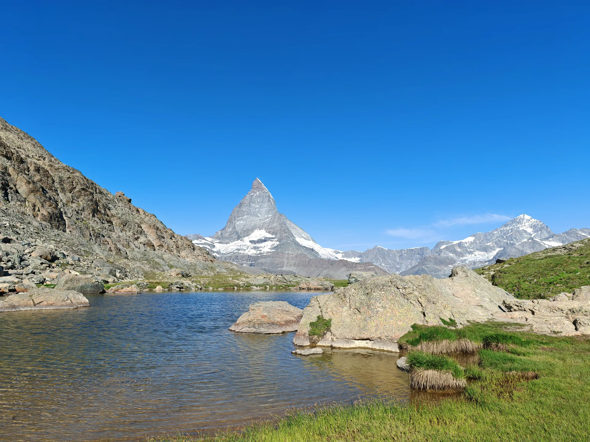
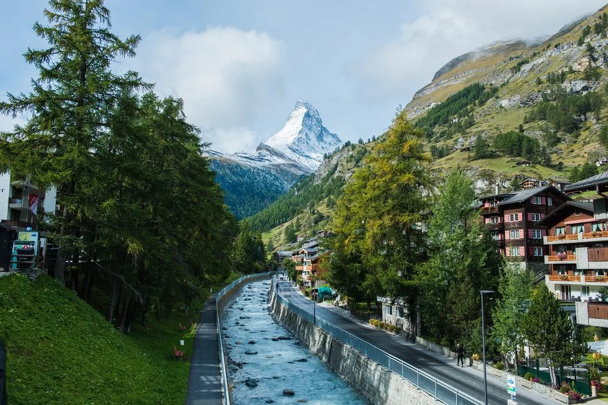

Ein Tag in Zermatt reicht. Ihr seht das Matterhorn über den Holzhäusern, die Valais-Fahne an der Stange, und ihr seid am Abend wieder dort, wo die Kinder ihr Bett haben. Der Ausflug bleibt etwas Besonderes, weil er ein Tag ist.

## Früh los, und das Tempo tief halten

Unter der Woche startet der Tag leichter. Die Fahrt selbst ist für Kinder schon ein Stück Abenteuer: Berge, der Wechsel der Bahn, und am Ende ein Dorf, in dem man einfach weitergeht.

Im Dorf lasst ihr das Tempo unten. Ein Stück durch die Gasse, die Fahnen über euch, ein Halt, wo die Kinder stehen bleiben. Ein warmes Getränk mit Blick auf den Berg ist oft der Moment, der bleibt. Ihr müsst nicht jede Gasse sehen.

## Eine Sache auf dem Berg oder am Wasser

Wer hinauffährt, kann bei einem See ankommen: Felsen, Gras, und das Matterhorn in der Mitte. Das ist ein Halt, kein Rundgang. Ihr bleibt, solange die Kinder am Wasser spielen wollen, und fahrt wieder hinunter.

Wer im Dorf bleibt, hat den Bach, den Weg daneben und den Berg zwischen den Bäumen. Das ist ein Spaziergang, den ihr abbrechen könnt, sobald die Beine kürzer werden. Eine Fahrt hinauf und noch der ganze Ort an demselben Tag wird lang. Ihr wählt eines.

## Am Abend wieder in Leukerbad

Der Rückweg gehört zum Tag. In [Alpine Siesta](/wohnungen/alpine-siesta/) ist das Kinderzimmer bereit, zwei Betten, und das Wohnzimmer ist wieder eures. Die Therme ist zehn Minuten zu Fuss, wenn noch Energie da ist. Wenn nicht, bleibt ihr am Tisch.

Check-in ist ab 15:00. Diesen Tag legt ihr nicht auf die Anreise. Am Abreisetag ist um 11:00 die Wohnung leer. Wie der Tag zu den anderen Ferientagen passt, steht auf [Zermatt erleben](/leukerbad/zermatt/). Mit jüngeren Kindern lohnt sich der Blick auf [Zermatt mit Kindern](/leukerbad/zermatt/zermatt-mit-kindern/).
