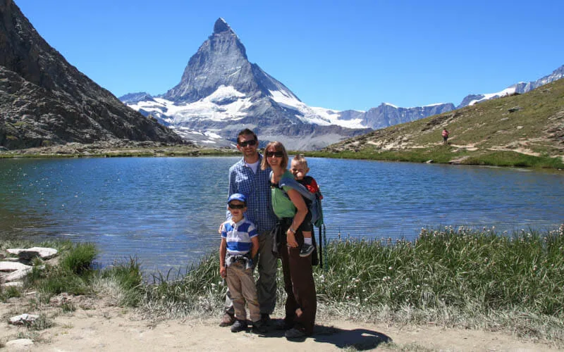
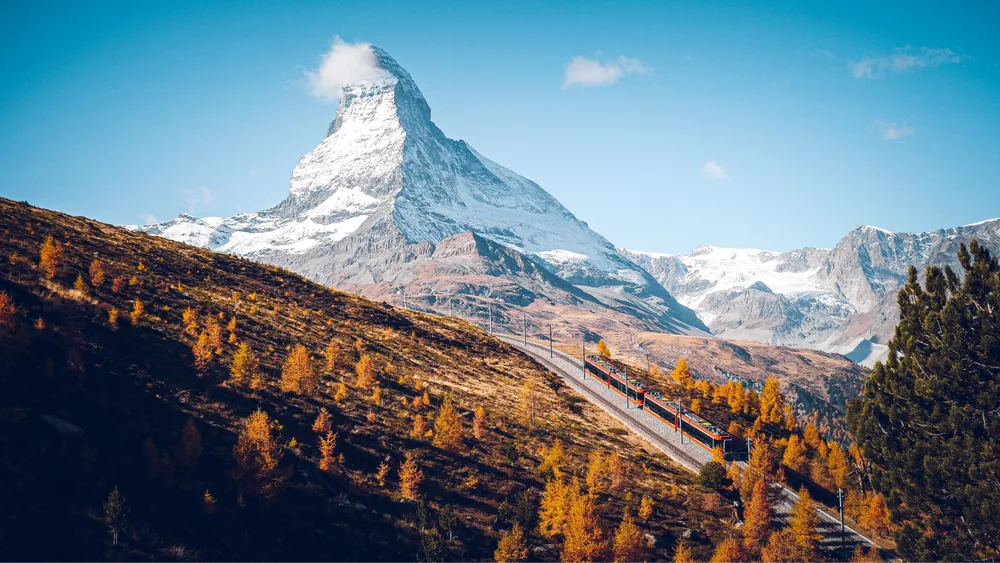
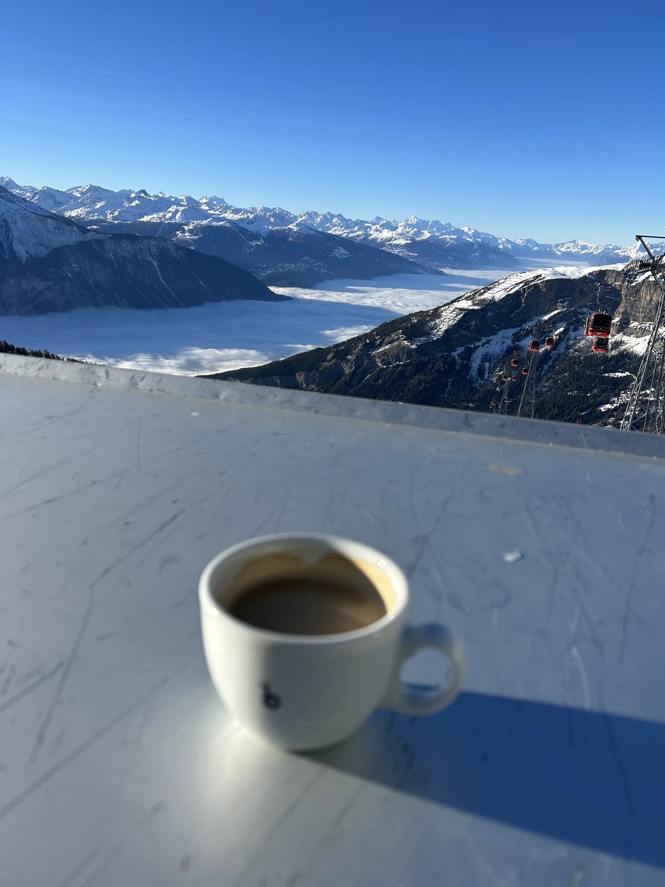

Der schönste Zermatt-Tag ist der, an dem das Dorf Luft hat. Ihr fahrt unter der Woche, im späten Frühling oder im frühen Herbst, und am Abend seid ihr wieder in Leukerbad. Die Gondel der Gemmi-Bahnen erinnert daran, wo der Tag beginnt und endet: fünf Minuten von der Wohnung, und das Tal liegt unten.

## Wenn das Dorf Raum lässt

Im späten Frühling und im frühen Herbst ist die Gasse ruhiger. Wege mit Kindern werden kürzer, an der Bahn wartet ihr weniger, und eine Pause ist wirklich eine Pause. Unter der Woche gilt dasselbe: weniger Tagesgäste, mehr Platz auf der Strasse, mehr Ruhe für jüngere Kinder.

So sieht ein ruhiger Halt aus. Eine Familie am See, der Berg dahinter, und niemand muss zur nächsten Bahn hetzen. Ihr bleibt, solange es schön ist, und fahrt zurück, wenn die Kleinen genug haben.

Im Herbst fährt die Bahn durch gelbe Lärchen, das Matterhorn hat eine Wolke am Gipfel. Das ist ein guter Tag für genau eine Fahrt. Danach das Dorf oder gleich der Weg nach Hause.

## Die vollen Wochen, und die Tage dazwischen

In den Schulferien, an einem sonnigen Sommerwochenende und in der vollen Winterzeit ist das Dorf lebendig. Viele Menschen, volle Züge, und die Pause will geplant sein. Dann legt ihr den Ausflug auf einen Wochentag daneben, und die vollen Tage verbringt ihr dort, wo ihr zu Fuss umkehren könnt.

Ein Kaffee mit Blick auf die Gondeln ist so ein Halt, wenn ihr oben seid. Die Tasse, das Tal unter dem Nebel, die roten Kabinen. Danach ist der Tag voll genug.

## Die ruhigen Tage gehören Leukerbad

Der Daubensee ist so ein Tag ohne Zermatt. Ein See zwischen Geröllhängen, ein Kiesweg, ein paar Wanderer, und ihr kehrt um, wenn die Beine wollen. Die Gemmibahn ist fünf Minuten von [Alpine Siesta](/wohnungen/alpine-siesta/). Die Therme ist zehn Minuten zu Fuss, der Spielplatz und der Bach im Dorf auch.

So teilt sich eine Woche: ein Tag für das Matterhorn, die anderen für das Tal. Wie der eine Tag abläuft, steht bei [Zermatt als Tagesausflug](/leukerbad/zermatt/tagesausflug/). Die Übersicht ist [Zermatt erleben](/leukerbad/zermatt/).
