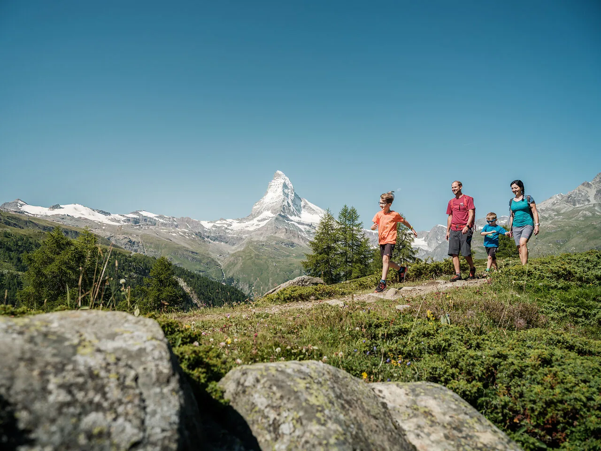
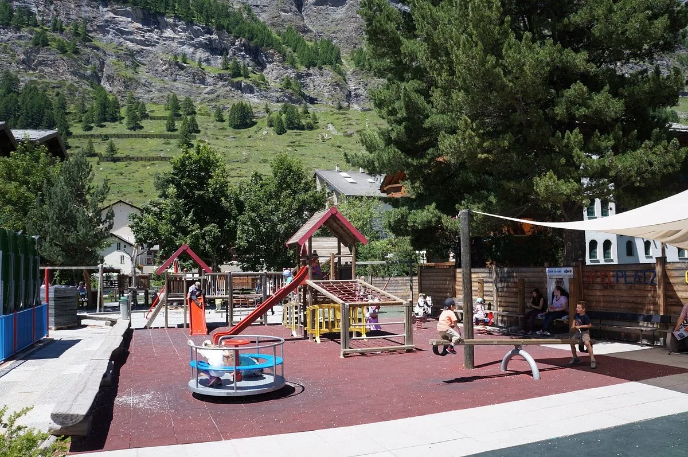
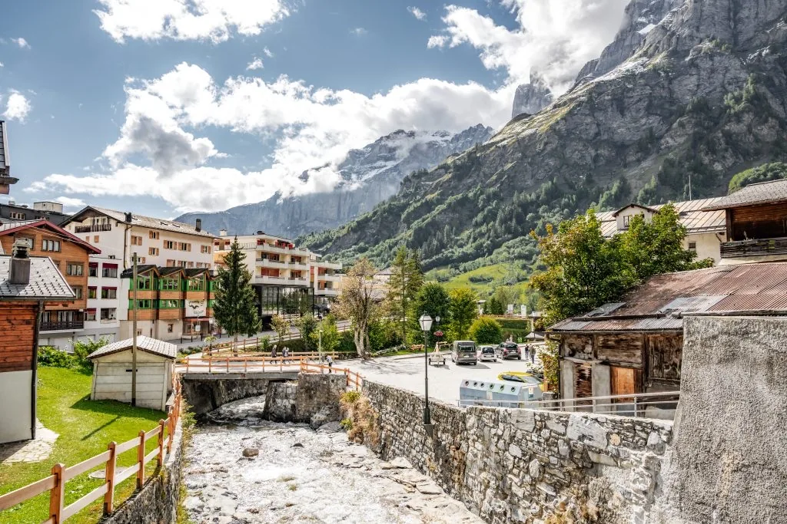

Kinder mögen an Zermatt, dass der Berg plötzlich da ist und dass man im Dorf zu Fuss geht. Der Tag wird schön, wenn ihr eine Sache auswählt und am Abend wieder in Leukerbad seid. Das Kinderzimmer ist dann ihres, und der Tag darf zu Ende sein.

## Was sie anfassen und sehen

Ein Weg über die Wiese, der Berg im Rücken, und die Kinder dürfen vorauslaufen. Das ist schon ein ganzer Vormittag. Ihr müsst nicht weiter, wenn das jüngste Kind sich hinsetzt.

Die Fahrt hinauf gehört dazu. Eine orange Bahn am Hang, das Matterhorn dahinter: für viele Kinder ist das der Höhepunkt, noch bevor das Dorf anfängt.

Im Dorf gibt es keine Autos in dieser Gasse. Fahnen, Holzhäuser, Menschen zu Fuss. Unter der Woche und in den ruhigeren Wochen findet ihr eine Lücke zum Stehenbleiben. Ein Halt mit etwas Warmen, und weiter, solange die Stimmung hält.

## Spielplatz und ein Stück Wasser

Der Spielplatz hat Rutsche, Karussell und ein Klettergerüst, an der Wand steht Spielplatz. Das ist der Nachmittag, wenn die Beine keine Bahn mehr wollen. Danach ist der Tag rund, und ihr fahrt zurück.

Am Wasser wird es noch einfacher. Zwei Kinder, ein Holztrog, ein kleines Schiff, und das Matterhorn im Hintergrund: so ein Spiel braucht keinen Plan.

## Am Abend das eigene Zimmer

In Leukerbad ist der Bach wieder neben den Häusern, eine Holzbrücke, die Felswand darüber. Von [Alpine Siesta](/wohnungen/alpine-siesta/) seid ihr in wenigen Minuten dort, und in zehn Minuten in der Therme. Das Kinderzimmer hat zwei Betten. Wenn die Tür zu ist, gehört das Wohnzimmer wieder euch.

Check-in ist ab 15:00, also ist der Zermatt-Tag einer der folgenden Tage. Um 11:00 am Abreisetag ist die Wohnung leer. Den Ablauf des Ausflugs beschreibt [Zermatt als Tagesausflug](/leukerbad/zermatt/tagesausflug/), die ruhigen Wochen stehen bei [Wann der Tag passt](/leukerbad/zermatt/wann-zermatt-passt/).
